# 🌌 Arquitectura Workstation por Capas — Mapa General (MOC)

> [!NOTE]
> **Bienvenido al Vault de Arquitectura Workstation:**
> Este repositorio constituye la **arquitectura integral, modular y documentada** para construir, aprovisionar y operar una estación de trabajo avanzada sobre Arch Linux / Omarchy.
> 
> A diferencia de un script lineal, el sistema está organizado en **8 capas funcionales de abstracción**: desde el hardware y el almacenamiento compartido hasta dos entornos de escritorio completos (**Clavis Shell** y **Noctalia/Nyxuri Shell**), un entorno de desarrollo profesional (**Neovim dual** `craftzdog` + `rvim`) y una suite unificada de gestión de dotfiles y mantenimiento.

---

## 🎬 Demostraciones del Entorno (Showcase)

| Clavis Shell (Quickshell + Niri Edge) | Nyxuri Shell (Noctalia + mpvpaper) |
|---|---|
| ![[assets/niri_showcase_unixporn_720p.mp4]] | ![[assets/nyxury-showcase.mp4]] |
| *Estética macOS / Liquid Glass y widgets C++* | *Entorno dinámico con wallpapers en video y widgets QML* |

*(Consulta las demostraciones en alta resolución y la guía de medios en [[07.3 - Guia de Video Showcase y Recursos Audiovisuales|07.3 - Guía de Video Showcase y Recursos Audiovisuales]])*

---

## 🗺️ Mapa de Arquitectura del Sistema

```mermaid
flowchart TD
    subgraph Capa0["00 - MOC & Topología"]
        MOC["00.0 Mapa General (MOC)"]
        TOP["00.1 Topología de Usuarios & Perfiles"]
    end

    subgraph Capa1["01 - Core del Sistema & Hardware"]
        SUDO["01.1 Sudo sin Contraseña"]
        HW["01.2 Hardware & Fix Intel i915"]
        USERS["01.3 Creación de Usuarios"]
        SDDM["01.4 Display Manager SDDM (Herald OS)"]
        BTRFS["01.5 Snapshots Btrfs & Snapper"]
    end

    subgraph Capa2["02 - Almacenamiento Compartido (/z)"]
        ZPOOL["02.1 Pool Compartido /z (ACLs & Git)"]
        ZMEDIA["02.2 Wallpapers & Medios Compartidos"]
    end

    subgraph Capa3["03 - Toolchain Global & Workstation"]
        GLOBAL["03.1 Paquetes Globales & Browsers"]
        DEV["03.2 Toolchain Dev (C, Rust, Node, Python)"]
        TERM["03.3 Terminal Ghostty & Herdr/Tmux"]
        FONTS["03.4 Tipografías (BlexMono & PlemolJP)"]
    end

    subgraph Capa4["04 - Entornos de Escritorio (Desktop Flavors)"]
        NIRI["04.1 Niri Core (niri-edge & key-cli)"]
        CLAVIS["04.2 Flavor Clavis (Quickshell & Updater)"]
        MACTAHOE["04.3 Apariencia Clavis (MacTahoe & Fcitx5)"]
        APPS["04.4 Suite Apps Clavis (SPlayer, etc.)"]
        NYXURI["04.5 Flavor Nyxuri (Noctalia Shell)"]
    end

    subgraph Capa5["05 - Suite de Desarrollo Neovim"]
        NVZ["05.1 Arquitectura Dual (/z/nvims)"]
        NVCRAFT["05.2 Craftzdog (nvim) & Distro Propia (rvim)"]
    end

    subgraph Capa6["06 - Dotfiles & Ciclo de Vida"]
        DOTBARE["06.1 Gestión de Dotfiles (dotbare)"]
        TESTBENCH["06.2 Testbench en Usuarios Limpios"]
        PLAN["06.3 Dotfiles Omarchy para gracie"]
    end

    subgraph Capa7["07 - Referencias & Assets"]
        KEYS["07.1 Mapa Completo de Atajos"]
        UPSTREAM["07.2 Repositorios Upstream & Forks"]
        VIDEO["07.3 Videos Showcase"]
        SYSASSETS["07.4 Archivos de Sistema (assets/system)"]
    end

    Capa0 --> Capa1
    Capa1 --> Capa2
    Capa2 --> Capa3
    Capa3 --> Capa4
    Capa3 --> Capa5
    Capa4 --> Capa6
    Capa5 --> Capa6
    Capa6 --> Capa7

    classDef default fill:#1e1e2e,stroke:#cba6f7,stroke-width:2px,color:#cdd6f4;
    classDef phase fill:#181825,stroke:#89b4fa,stroke-width:2px,color:#89b4fa;
```

---

## 🗂️ Navegación por Capas del Sistema

A continuación se presentan los módulos centrales de cada capa. Puedes acceder al índice dedicado de cada capa para explorar sus notas detalladas:

| Capa | Hub de Capa (MOC) | Descripción Arquitectónica |
|---|---|---|
| **Capa 00** | [[00.1 - Topologia de Usuarios y Perfiles\|👥 Topología de Usuarios y Perfiles]] | Modelo de cuentas, grupos y convivencia Omarchy / Clavis / Nyxuri |
| **Capa 01** | [[01.0 - Core del Sistema (MOC)\|⚙️ Capa 01 — Core del Sistema y Hardware]] | Sudoers, mitigación i915, provisión multiusuario, SDDM y Btrfs |
| **Capa 02** | [[02.0 - Almacenamiento Compartido (MOC)\|💾 Capa 02 — Almacenamiento Compartido (z)]] | Montaje `/z`, ACLs multiusuario, Git `safe.directory` y medios |
| **Capa 03** | [[03.0 - Toolchain Global y Estacion de Trabajo (MOC)\|🛠️ Capa 03 — Toolchain Global]] | Paquetes del sistema, compiladores, Ghostty, multiplexores y fuentes |
| **Capa 04** | [[04.0 - Entornos de Escritorio (MOC)\|🪟 Capa 04 — Entornos de Escritorio]] | Niri scrollable, Clavis (Quickshell), MacTahoe y Nyxuri (Noctalia) |
| **Capa 05** | [[05.0 - Suite de Desarrollo Neovim (MOC)\|💻 Capa 05 — Suite Neovim Dual]] | Entorno dual en `/z/nvims/`: Craftzdog (`nvim`) y distro propia (`rvim`) |
| **Capa 06** | [[06.0 - Dotfiles y Ciclo de Vida (MOC)\|🔄 Capa 06 — Dotfiles y Ciclo de Vida]] | Gestión con `dotbare`, testbench en `sura`/`nyxuri-test` y dotfiles `gracie` |
| **Capa 07** | [[07.0 - Referencias del Sistema (MOC)\|📚 Capa 07 — Referencias y Assets]] | Hoja de atajos, upstream matrix, video showcase y réplicas de sistema |
