## 🎬 Demostraciones del Entorno (Showcase)

| Clavis Shell (Quickshell + Niri Edge) | Nyxuri Shell (Noctalia + mpvpaper) |
|---|---|
| ![[assets/niri_showcase_unixporn_720p.mp4]] | ![[assets/nyxury-showcase.mp4]] |
| *Estética macOS / Liquid Glass y widgets C++* | *Entorno dinámico con wallpapers en video y widgets QML* |

*(Consulta las demostraciones en alta resolución y la guía de medios en [[07.3 - Guia de Video Showcase y Recursos Audiovisuales|07.3 - Guía de Video Showcase y Recursos Audiovisuales]])*

---

## 🗺️ Mapa de Arquitectura del Sistema

```mermaid
flowchart TD
    subgraph Capa0["00 - MOC & Topología"]
        MOC["00.0 Mapa General (MOC)"]
        TOP["00.1 Topología de Usuarios & Perfiles"]
    end

    subgraph Capa1["01 - Core del Sistema & Hardware"]
        SUDO["01.1 Sudo sin Contraseña"]
        HW["01.2 Hardware & Fix Intel i915"]
        USERS["01.3 Creación de Usuarios"]
        SDDM["01.4 Display Manager SDDM (Herald OS)"]
        BTRFS["01.5 Snapshots Btrfs & Snapper"]
    end

    subgraph Capa2["02 - Almacenamiento Compartido (/z)"]
        ZPOOL["02.1 Pool Compartido /z (ACLs & Git)"]
        ZMEDIA["02.2 Wallpapers & Medios Compartidos"]
    end

    subgraph Capa3["03 - Toolchain Global & Workstation"]
        GLOBAL["03.1 Paquetes Globales & Browsers"]
        DEV["03.2 Toolchain Dev (C, Rust, Node, Python)"]
        TERM["03.3 Terminal Ghostty & Herdr/Tmux"]
        FONTS["03.4 Tipografías (BlexMono & PlemolJP)"]
    end

    subgraph Capa4["04 - Entornos de Escritorio (Desktop Flavors)"]
        NIRI["04.1 Niri Core (niri-edge & key-cli)"]
        CLAVIS["04.2 Flavor Clavis (Quickshell & Updater)"]
        MACTAHOE["04.3 Apariencia Clavis (MacTahoe & Fcitx5)"]
        APPS["04.4 Suite Apps Clavis (SPlayer, etc.)"]
        NYXURI["04.5 Flavor Nyxuri (Noctalia Shell)"]
    end

    subgraph Capa5["05 - Suite de Desarrollo Neovim"]
        NVZ["05.1 Arquitectura Dual (/z/nvims)"]
        NVCRAFT["05.2 Craftzdog (nvim) & Distro Propia (rvim)"]
    end

    subgraph Capa6["06 - Dotfiles & Ciclo de Vida"]
        DOTBARE["06.1 Gestión de Dotfiles (dotbare)"]
        TESTBENCH["06.2 Testbench en Usuarios Limpios"]
        PLAN["06.3 Dotfiles Omarchy para gracie"]
    end

    subgraph Capa7["07 - Referencias & Assets"]
        KEYS["07.1 Mapa Completo de Atajos"]
        UPSTREAM["07.2 Repositorios Upstream & Forks"]
        VIDEO["07.3 Videos Showcase"]
        SYSASSETS["07.4 Archivos de Sistema (assets/system)"]
    end

    Capa0 --> Capa1
    Capa1 --> Capa2
    Capa2 --> Capa3
    Capa3 --> Capa4
    Capa3 --> Capa5
    Capa4 --> Capa6
    Capa5 --> Capa6
    Capa6 --> Capa7

    classDef default fill:#1e1e2e,stroke:#cba6f7,stroke-width:2px,color:#cdd6f4;
    classDef phase fill:#181825,stroke:#89b4fa,stroke-width:2px,color:#89b4fa;
```

---

## 🗂️ Navegación Detallada por Capas

### [[00.0 - Mapa General del Sistema (MOC)\|Capa 00 — MOC y Topología de la Máquina]]
- [[00.0 - Mapa General del Sistema (MOC)\|00.0 - Mapa General del Sistema (MOC)]]: Índice maestro y navegación global del vault.
- [[00.1 - Topologia de Usuarios y Perfiles\|00.1 - Topología de Usuarios y Perfiles]]: Definición de roles (`gracie`, `niri`, `sura`, `nyxuri`, `nyxuri-test`) y matriz de privilegios.

### [[01.1 - Sudo sin Contrasena (Passwordless Sudo)\|Capa 01 — Core del Sistema y Hardware]]
- [[01.1 - Sudo sin Contrasena (Passwordless Sudo)\|01.1 - Sudo sin Contraseña (Passwordless Sudo)]]: Configuración de sudoers por usuario para despliegues sin interrupciones.
- [[01.2 - Hardware y Graficos (Fix Parpadeo Intel i915)\|01.2 - Hardware y Gráficos (Fix Parpadeo Intel i915)]]: Optimización del módulo kernel `i915`, desactivación de SAGV y prevención de FIFO underrun.
- [[01.3 - Creacion de Usuarios y Cuentas de Sistema\|01.3 - Creación de Usuarios y Cuentas de Sistema]]: Provisión estandarizada de cuentas de usuario, grupos base y shells.
- [[01.4 - Display Manager y Sesiones SDDM (Herald OS)\|01.4 - Display Manager y Sesiones SDDM (Herald OS)]]: Configuración de inicio de sesión gráfico SDDM, temas y sesión personalizada Herald OS.
- [[01.5 - Snapshots y Recuperacion con Btrfs\|01.5 - Snapshots y Recuperación con Btrfs]]: Respaldo instantáneo de subvolúmenes y políticas de rollback con Snapper.

### [[02.1 - Directorio Compartido (z) y Permisos ACL\|Capa 02 — Almacenamiento Compartido (/z)]]
- [[02.1 - Directorio Compartido (z) y Permisos ACL\|02.1 - Directorio Compartido (z) y Permisos ACL]]: Configuración del punto de montaje compartido `/z/`, permisos `2775`, setgid y `safe.directory` de Git.
- [[02.2 - Repositorio de Wallpapers y Medios (z)\|02.2 - Repositorio de Wallpapers y Medios (z)]]: Colección centralizada de fondos estáticos y videos animados para Clavis y mpvpaper.

### [[03.1 - Paquetes Globales y Navegadores Web\|Capa 03 — Toolchain Global y Estación de Trabajo]]
- [[03.1 - Paquetes Globales y Navegadores Web\|03.1 - Paquetes Globales y Navegadores Web]]: Suite transversal de navegación (Zen, Brave, Edge, Chrome) y herramientas de diff (`meld`, `git-delta`, `elio`).
- [[03.2 - Toolchain de Desarrollo (C, Rust, Node, Python)\|03.2 - Toolchain de Desarrollo (C, Rust, Node, Python)]]: Compiladores, runtimes y gestores de paquetes esenciales para LSPs y parsers nativos.
- [[03.3 - Terminal GPU (Ghostty) y Multiplexores (tmux, herdr)\|03.3 - Terminal GPU (Ghostty) y Multiplexores (tmux, herdr)]]: Terminal Ghostty con soporte Wayland y orquestación de agentes con herdr y tmux.
- [[03.4 - Tipografias y Fuentes del Sistema\|03.4 - Tipografías y Fuentes del Sistema]]: Instalación de fuentes para programación: BlexMono Nerd Font, PlemolJP Console NF y MacTahoe.

### [[04.1 - Niri Core (niri-edge y key-cli)\|Capa 04 — Entornos de Escritorio (Desktop Flavors)]]
- [[04.1 - Niri Core (niri-edge y key-cli)\|04.1 - Niri Core (niri-edge y key-cli)]]: Compilación del compositor scrollable Wayland y daemon del portapapeles.
- [[04.2 - Desktop Flavor Clavis (Quickshell y Actualizaciones)\|04.2 - Desktop Flavor Clavis (Quickshell y Actualizaciones)]]: Shell de interfaz Liquid Glass en Quickshell, servicios systemd y timer de actualización.
- [[04.3 - Apariencia Clavis (MacTahoe y Fcitx5)\|04.3 - Apariencia Clavis (MacTahoe y Fcitx5)]]: Iconos MacTahoe, cursores y motor de entrada Fcitx5 con tema dinámico Matugen.
- [[04.4 - Suite de Aplicaciones Clavis\|04.4 - Suite de Aplicaciones Clavis]]: Integración de aplicaciones clave: SPlayer-Next, tema Obsidian Violet y cliente Liquidbird.
- [[04.5 - Desktop Flavor Nyxuri (Noctalia Shell y mpvpaper)\|04.5 - Desktop Flavor Nyxuri (Noctalia Shell y mpvpaper)]]: Entorno experimental Noctalia Shell, automatización CI y wallpapers animados con mpvpaper.

### [[05.1 - Arquitectura Neovim Dual Compartida (z-nvims)\|Capa 05 — Suite de Desarrollo Neovim]]
- [[05.1 - Arquitectura Neovim Dual Compartida (z-nvims)\|05.1 - Arquitectura Neovim Dual Compartida (z-nvims)]]: Almacenamiento centralizado en `/z/nvims/`, enlaces simbólicos por usuario y wrapper `/usr/local/bin/rvim`.
- [[05.2 - Configuracion Craftzdog (nvim) y Distro Propia (rvim)\|05.2 - Configuración Craftzdog (nvim) y Distro Propia (rvim)]]: Experiencia completa Craftzdog con `vim.pack` + distribución personal mínima e independiente.

### [[06.1 - Gestion de Dotfiles con dotbare\|Capa 06 — Dotfiles y Ciclo de Vida]]
- [[06.1 - Gestion de Dotfiles con dotbare\|06.1 - Gestión de Dotfiles con dotbare]]: Control de dotfiles en repositorios bare de Git sin contaminar `$HOME`.
- [[06.2 - Validacion en Usuario Limpio (Testbench sura y nyxuri-test)\|06.2 - Validación en Usuario Limpio (Testbench sura y nyxuri-test)]]: Procedimiento de validación visual y funcional en usuarios desechables antes de desplegar en producción.
- [[06.3 - Dotfiles de Omarchy para gracie (Planificado)\|06.3 - Dotfiles de Omarchy para gracie (Planificado)]]: Arquitectura de versionado de dotfiles para el usuario de administración `gracie`.

### [[07.1 - Mapa Completo de Atajos de Teclado (Niri, Clavis, Nyxuri)\|Capa 07 — Referencias del Sistema]]
- [[07.1 - Mapa Completo de Atajos de Teclado (Niri, Clavis, Nyxuri)\|07.1 - Mapa Completo de Atajos de Teclado (Niri, Clavis, Nyxuri)]]: Hoja de referencia unificada de combinaciones de teclas para todos los entornos.
- [[07.2 - Repositorios Upstream y Fuentes Externas\|07.2 - Repositorios Upstream y Fuentes Externas]]: Registro de forks propios (`personal`), repositorios upstream de StatIndet/ech678 y políticas de contribución.
- [[07.3 - Guia de Video Showcase y Recursos Audiovisuales\|07.3 - Guía de Video Showcase y Recursos Audiovisuales]]: Documentación multimedia, descargas y configuración de reproductores en Obsidian.
- [[07.4 - Archivos de Sistema de Referencia (assets-system)\|07.4 - Archivos de Sistema de Referencia (assets-system)]]: Catálogo exhaustivo de archivos en `assets/system` que replican configuraciones fuera de `$HOME`.
