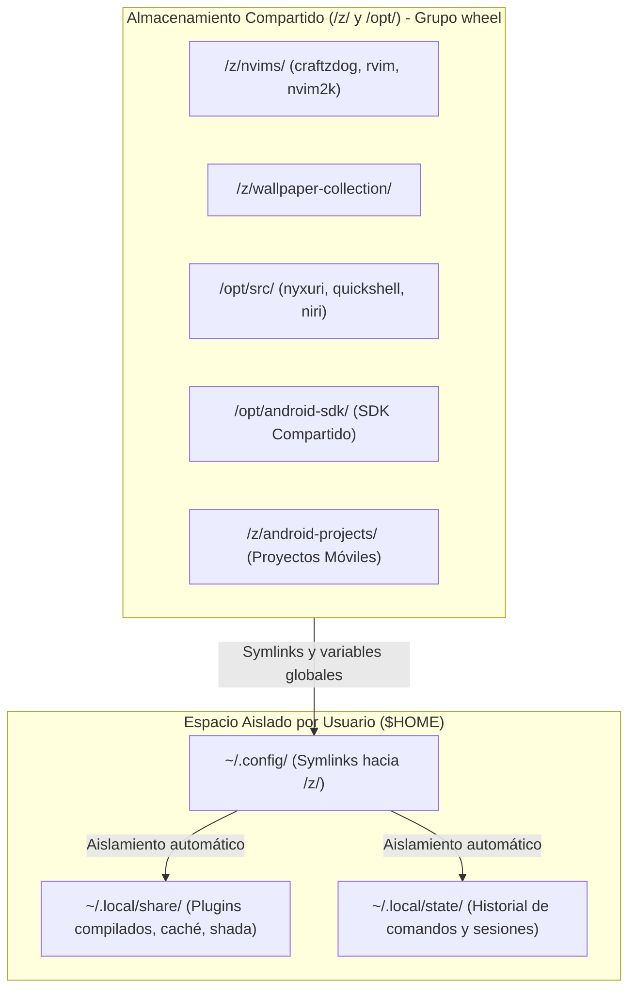

# 👥 Topología de Usuarios y Perfiles del Sistema

> [!NOTE]
> **Navegación:**
> * Siguiente: [[01.1 - Sudo sin Contrasena (Passwordless Sudo)|01.1 - Sudo sin Contraseña (Passwordless Sudo)]]
> * Volver a: [[00.0 - Mapa General del Sistema (MOC)|Índice General (MOC)]]

Esta estación de trabajo opera bajo un modelo **multiusuario y multiperfil**, diseñado para segregar entornos de producción de entornos de pruebas y permitir la coexistencia de diferentes gestores de ventanas y shells sin interferencia en sus configuraciones de usuario.

---

## 🏛️ Matriz de Cuentas y Responsabilidades

| Usuario | Rol Principal | Entorno de Escritorio | Dotfiles y Gestión | Ciclo de Vida |
|---|---|---|---|---|
| **`<admin>` (`rollo`)** | Administración y Mantenimiento | Omarchy / Hyprland base | `robert-flo/rf-dotfiles` vía Chezmoi | **Persistente**: Cuenta administrativa principal con privilegios `wheel` (dock en workspace 1 flotante). |
| **`niri`** | Producción Wayland Clavis | `niri-edge` + Clavis Shell | `robert-flo/rf-dotfiles` (Perfil Clavis) | **Persistente**: Cuenta de trabajo diario para la experiencia Niri + Clavis. |
| **`niri-classic`** | Entorno Clavis Classic | `niri-edge` + Clavis Shell Classic | `robert-flo/rf-dotfiles` + `/opt/clavis-classic` | **Persistente**: Entorno Clavis con barra clásica (pastillas/pills), ProfileHeaderCard y Device Settings restaurados. |
| **`niri-test` (`sura`)** | Testbench Clavis (Gemelo de `niri`) | `niri-edge` + Clavis Shell | `robert-flo/rf-dotfiles` (Perfil Clavis) | **Desechable**: Gemelo idéntico de producción `niri` para pruebas de escritorio con wipe en cualquier momento y auto-regeneración amnésica en cada login vía PAM (`disposable-session-manager.sh`). |
| **`niri-upstream`** | Referencia Pura Vanilla StatIndet | `niri-edge` + Quickshell Upstream | `/z/rf-dotfiles/.upstream/` + `/opt/clavis-upstream` | **Desechable**: Auto-regeneración amnésica en cada login vía PAM (`disposable-session-manager.sh`). |
| **`nyxuri`** | Entorno Noctalia Shell / Nyxuri Edge | `niri-edge` + Noctalia Shell (T3 M4) | `robert-flo/PJ-NIRI-fo-nyxuri` + Chezmoi común | **Desechable**: Auto-regeneración amnésica en cada login vía PAM (`disposable-session-manager.sh`). |
| **`nyxuri-test`** | Testbench Visual Nyxuri Edge | `niri-edge` + Noctalia Shell (T3 M4) | Replicación limpia de Nyxuri Edge + Chezmoi | **Desechable**: Auto-regeneración amnésica en cada login vía PAM (`disposable-session-manager.sh`). |
| **`nyxuri-legacy`** | Entorno Estable Nyxuri | `niri-edge` + Noctalia Shell (v3.1.0) | `ech678/Nyxuri` tag `v3.1.0` + Chezmoi común | **Desechable**: Auto-regeneración amnésica en cada login vía PAM (`disposable-session-manager.sh`). |
| **`omarchy-test`** | Testbench Omarchy 4.6 | Hyprland / Omarchy 4.6 | `robert-flo/rf-dotfiles` (Perfil Omarchy) | **Desechable**: Auto-regeneración amnésica en cada login vía PAM (`disposable-session-manager.sh`). |
| **`hyde`** | Entorno HyDE (Hyprland) | Hyprland + HyDE (`master`) | `HyDE-Project/HyDE` (`~/HyDE` vía `deez-dots`) | **Persistente**: Cuenta aislada para HyDE; excluida de `DOTFILES_USERS` (`rf-dotfiles`) para no sobrescribir su configuración. |
| **`guest`** | Sandbox Amnésico (Navegación en RAM) | Hyprland / Niri Minimal | `/etc/guest-skel` (Independiente) | **Efímero**: Aislado en RAM (`tmpfs` 8GB), cero sudo, sin acceso a `/z/`. Ver [[01.7 - Usuario Especial Amnesico y Sandbox (guest)\|01.7]]. |
| **`sandbox`** | Sandbox Desechable (Btrfs Rollback) | Hyprland / Niri + Waybar | `/home/.sandbox-golden` | **Efímero**: Aislado en NVMe con rollback instantáneo Btrfs en 1 ms, aceleración GPU. Ver [[01.8 - Usuario Sandbox Btrfs Desechable (sandbox)\|01.8]]. |

---

## 🏝️ Cuentas Especiales Sandbox Fuera de la Flota: `guest` y `sandbox`

A diferencia de las cuentas de producción y testbench de la flota, los usuarios **`guest`** y **`sandbox`** operan bajo el principio de **confinamiento estricto y desecho automático**:

1. **`guest` (Modo RAM Volátil `tmpfs`):**
   - El `$HOME` vive enteramente en RAM volátil (8GB `tmpfs`). Cero escrituras en el disco SSD. Al cerrar sesión, la memoria se desmonta y todo se esfuma. Ver [[01.7 - Usuario Especial Amnesico y Sandbox (guest)]].
2. **`sandbox` (Modo Btrfs CoW Auto-Rollback):**
   - El `$HOME` es un subvolumen Btrfs en el SSD NVMe con velocidad nativa. Al cerrar sesión o reiniciar, se destruye y restaura un snapshot nuevo desde `/home/.sandbox-golden` en 1 ms. Ver [[01.8 - Usuario Sandbox Btrfs Desechable (sandbox)]].

**Reglas comunes a ambas cuentas:**
- **No pertenecen a `wheel` ni a la flota:** Cero acceso a `/z/`, `/z-drive/` ni a otros `$HOME`.
- **Bloqueo explícito de sudo y Polkit admin:** No pueden escalar privilegios (`!ALL`).
- **Reinicio y apagado autorizados:** Polkit permite apagar o reiniciar el equipo desde la sesión gráfica.
- **LAN Shield en UFW:** Bloquea cualquier intento de escanear la red local doméstica o el router (`192.168.0.0/16`).
- **Navegación segura:** Preconfigurados con `brave-origin`, lanzador `fuzzel`, control de audio multimedia y Waybar con volumen y menú de energía.

---

## 🔐 Matriz de Grupos y Privilegios de Sistema

Todas las cuentas del sistema comparten membresía en los grupos esenciales de hardware y administración de Arch Linux:

```text
wheel, audio, video, input, storage, optical, lp, scanner, kvm, adbusers
```

* **`wheel`**: Concede acceso a `sudo` sin solicitud interactiva de contraseña mediante reglas individuales en `/etc/sudoers.d/04_<usuario>` (ver [[01.1 - Sudo sin Contrasena (Passwordless Sudo)|01.1 - Sudo sin Contraseña]]) y acceso a los puntos de almacenamiento colaborativo (`/z/` y `/opt/android-sdk`).
* **`video` & `input`**: Permiten la captura directa de eventos de teclado/ratón por parte del compositor Wayland y el control de brillo y aceleración por hardware (DRM/KMS).
* **`audio`**: Acceso al servidor de sonido PipeWire / WirePlumber.
* **`kvm`**: Habilita la virtualización acelerada por CPU/GPU para el Android Emulator (AVD) sin requerir permisos de root.
* **`adbusers`**: Permite la captura de dispositivos físicos Android por USB a través de `adb` sin errores de permisos.

---

## 🗄️ Modelo de Aislamiento vs. Almacenamiento Compartido

El diseño del sistema aplica una regla estricta para evitar la duplicación innecesaria de archivos en disco mientras mantiene intacta la privacidad de cada sesión:



1. **Compartido en `/z/` y `/opt/`**:
   - Código fuente de configuraciones Neovim (`/z/nvims/craftzdog`, `/z/nvims/rvim`, `/z/nvims/nvim2k`).
   - Colección pesada de fondos de pantalla y videos animados (`/z/wallpaper-collection`).
   - SDK oficial de Android centralizado (`/opt/android-sdk`).
   - Espacio colaborativo de proyectos móviles (`/z/android-projects`).
   - Código de componentes y forks locales (`/opt/src/`).
   - Todos los usuarios pertenecen al grupo `wheel`, los directorios tienen permisos `2775`/`2770` (setgid) y ACLs por defecto con monitoreo inotify en tiempo real (`shared_dir`).
   - Código de componentes comunes (`/z/nyxuri`).
   - Todos los usuarios pertenecen al grupo `wheel`, el directorio tiene permisos `2775` (setgid) y ACLs por defecto para herencia automática (`setfacl`).
2. **Aislado en `$HOME`**:
   - Los plugins descargados o compilados por Neovim (`~/.local/share/nvim/site/pack` o `~/.local/share/rvim`).
   - Los árboles de estado y cachés (`~/.local/state` y `~/.cache`).
   - Las configuraciones específicas de temas o tokens personales.

---

## 🔗 Próximos Pasos

- [[01.1 - Sudo sin Contrasena (Passwordless Sudo)|➡️ Configuración de Privilegios: Sudo sin Contraseña]]
- [[01.3 - Creacion de Usuarios y Cuentas de Sistema|➡️ Procedimiento de Creación de Usuarios]]
- [[02.1 - Directorio Compartido (z) y Permisos ACL|➡️ Configuración del Pool Compartido /z/]]
- [[00.0 - Mapa General del Sistema (MOC)|🏠 Volver al Índice General]]
