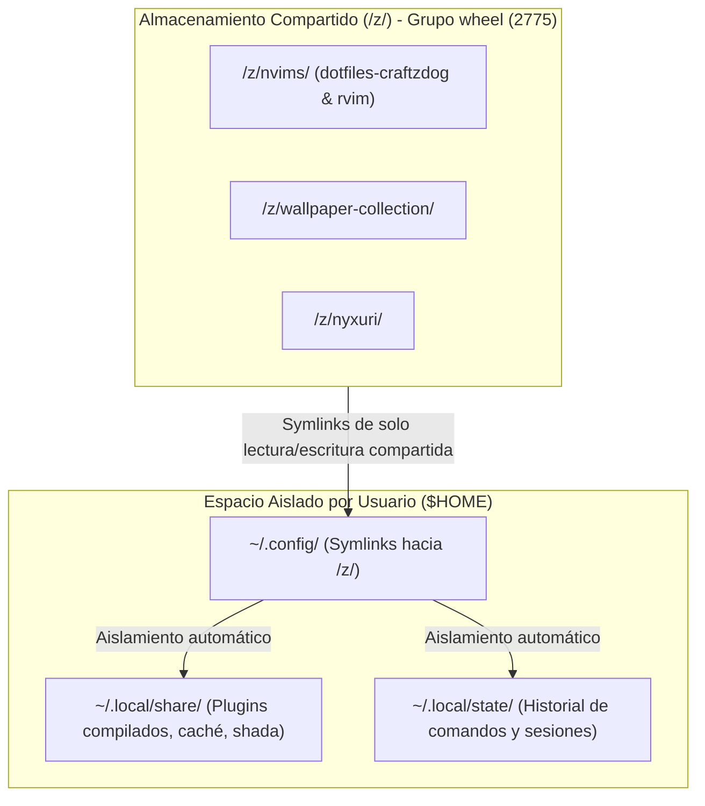

# 👥 Topología de Usuarios y Perfiles del Sistema

> [!NOTE]
> **Navegación:**
> * Siguiente: [[01.1 - Sudo sin Contrasena (Passwordless Sudo)|01.1 - Sudo sin Contraseña (Passwordless Sudo)]]
> * Volver a: [[00.0 - Mapa General del Sistema (MOC)|Índice General (MOC)]]

Esta estación de trabajo opera bajo un modelo **multiusuario y multiperfil**, diseñado para segregar entornos de producción de entornos de pruebas y permitir la coexistencia de diferentes gestores de ventanas y shells sin interferencia en sus configuraciones de usuario.

---

## 🏛️ Matriz de Cuentas y Responsabilidades

| Usuario | Rol Principal | Entorno de Escritorio | Dotfiles y Gestión | Estado en la Máquina |
|---|---|---|---|---|
| **`omarchy` / `gracie`** | Administración y Mantenimiento | Omarchy / Hyprland base | Dotfiles privados (`sura-home` / Omarchy) | Cuentas administrativas con privilegios `wheel`. |
| **`niri`** | Producción Wayland Clavis | `niri-edge` + Clavis Shell | `robert-flo/niri-dotfiles` vía `dotbare` | Cuenta de trabajo diario para la experiencia Niri + Clavis. |
| **`sura`** | Testbench Visual Clavis | `niri-edge` + Clavis Shell | Replicación limpia de `niri-dotfiles` | Cuenta desechable para validar cambios de dotfiles antes de mergear. |
| **`nyxuri`** | Producción Wayland Nyxuri | `niri-edge` + Noctalia Shell | `robert-flo/PJ-NIRI-fo-nyxuri` | Cuenta de trabajo diario para la experiencia Nyxuri. |
| **`nyxuri-test`** | Testbench Visual Nyxuri | `niri-edge` + Noctalia Shell | Replicación limpia de Nyxuri | Cuenta desechable para pruebas y experimentos en Noctalia. |

---

## 🔐 Matriz de Grupos y Privilegios de Sistema

Todas las cuentas del sistema comparten membresía en los grupos esenciales de hardware y administración de Arch Linux:

```text
wheel, audio, video, input, storage, optical, lp, scanner
```

* **`wheel`**: Concede acceso a `sudo` sin solicitud interactiva de contraseña mediante reglas individuales en `/etc/sudoers.d/04_<usuario>` (ver [[01.1 - Sudo sin Contrasena (Passwordless Sudo)|01.1 - Sudo sin Contraseña]]).
* **`video` & `input`**: Permiten la captura directa de eventos de teclado/ratón por parte del compositor Wayland y el control de brillo y aceleración por hardware (DRM/KMS).
* **`audio`**: Acceso al servidor de sonido PipeWire / WirePlumber.

---

## 🗄️ Modelo de Aislamiento vs. Almacenamiento Compartido

El diseño del sistema aplica una regla estricta para evitar la duplicación innecesaria de archivos en disco mientras mantiene intacta la privacidad de cada sesión:



1. **Compartido en `/z/`**:
   - Código fuente de configuraciones Neovim (`/z/nvims/dotfiles-craftzdog` y `/z/nvims/rvim`).
   - Colección pesada de fondos de pantalla y videos animados (`/z/wallpaper-collection`).
   - Código de componentes comunes (`/z/nyxuri`).
   - Todos los usuarios pertenecen al grupo `wheel`, el directorio tiene permisos `2775` (setgid) y ACLs por defecto para herencia automática (`setfacl`).
2. **Aislado en `$HOME`**:
   - Los plugins descargados o compilados por Neovim (`~/.local/share/nvim/site/pack` o `~/.local/share/rvim`).
   - Los árboles de estado y cachés (`~/.local/state` y `~/.cache`).
   - Las configuraciones específicas de temas o tokens personales.

---

## 🔗 Próximos Pasos

- [[01.1 - Sudo sin Contrasena (Passwordless Sudo)|➡️ Configuración de Privilegios: Sudo sin Contraseña]]
- [[01.3 - Creacion de Usuarios y Cuentas de Sistema|➡️ Procedimiento de Creación de Usuarios]]
- [[02.1 - Directorio Compartido (z) y Permisos ACL|➡️ Configuración del Pool Compartido /z/]]
- [[00.0 - Mapa General del Sistema (MOC)|🏠 Volver al Índice General]]
