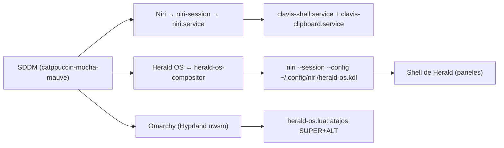

# 🖥️ Display Manager SDDM y Sesiones de Escritorio (Herald OS)

> [!NOTE]
> **Navegación:**
> * Anterior: [[01.3 - Creacion de Usuarios y Cuentas de Sistema|01.3 - Creación de Usuarios y Cuentas de Sistema]]
> * Siguiente: [[01.5 - Snapshots y Recuperacion con Btrfs|01.5 - Snapshots y Recuperación con Btrfs]]
> * Volver a: [[01.0 - Core del Sistema (MOC)|📑 Índice de Capa]]

Este módulo documenta la configuración del gestor de inicio de sesión gráfico (**SDDM**) sobre Wayland, su tema interactivo de selección de usuarios y sesiones (**Catppuccin Mocha**), y la convivencia armónica entre los diferentes escritorios: **Niri + Clavis**, **Niri + Nyxuri**, **Omarchy (Hyprland)** y **Herald OS**.

---

## 🎯 Decisiones de Arquitectura

1. **Reutilización de SDDM nativo de Omarchy:** SDDM ya opera como servicio de sistema (`sddm.service`) bajo Wayland. No se reinstala ni reemplaza para preservar las integraciones de arranque (Plymouth) y controladores gráficos.
2. **Desactivación infalible de Autologin:** Omarchy activa por defecto el autologin al usuario original en `omarchy.desktop`. Como SDDM lee **todos** los archivos en `/etc/sddm.conf.d/` sin importar su extensión, el archivo debe ser extraído a un directorio externo (`/etc/sddm.conf.d-disabled/autologin.conf`).
3. **Tema Interactivo Catppuccin Mocha (Qt 6):** Provee controles gráficos completos para alternar usuarios (`UserField.qml`) y menú desplegable para seleccionar sesiones Wayland (`SessionPanel.qml`).
4. **Registro Unificado de Sesiones:** SDDM busca descriptores `.desktop` en `/usr/share/wayland-sessions/` y `/usr/local/share/wayland-sessions/`. Al enlazarlos, todas las sesiones (`niri.desktop`, `omarchy.desktop`, `herald-os.desktop`) están inmediatamente disponibles.

---

## 🛠️ Procedimiento de Configuración de SDDM

```bash
sudo bash -c '
set -euo pipefail

echo "==> 1. Asegurando tema SDDM Catppuccin Mocha..."
if [ ! -d "/usr/share/sddm/themes/catppuccin-mocha-mauve" ]; then
    if command -v yay &>/dev/null; then
        sudo -u "${SUDO_USER:-$USER}" yay -S --needed --noconfirm catppuccin-sddm-theme-mocha || true
    fi
    if [ ! -d "/usr/share/sddm/themes/catppuccin-mocha-mauve" ]; then
        mkdir -p /usr/share/sddm/themes
        git clone --depth 1 https://github.com/catppuccin/sddm.git /tmp/catppuccin-sddm
        cp -r /tmp/catppuccin-sddm/src/catppuccin-mocha-mauve /usr/share/sddm/themes/
        rm -rf /tmp/catppuccin-sddm
    fi
fi

echo "==> 2. Deshabilitando autologin y fijando tema..."
mkdir -p /etc/sddm.conf.d-disabled
for f in /etc/sddm.conf.d/autologin.conf /etc/sddm.conf.d/autologin.conf.disabled; do
    [[ -f "$f" ]] && mv "$f" /etc/sddm.conf.d-disabled/autologin.conf
done

cat <<EOF > /etc/sddm.conf.d/10-theme.conf
[Theme]
Current=catppuccin-mocha-mauve
EOF

cat <<EOF > /etc/sddm.conf.d/99-omarchy-login.conf
[Theme]
Current=catppuccin-mocha-mauve

[Users]
RememberLastUser=true
RememberLastSession=true
EOF

echo "==> 3. Enlazando sesiones Wayland..."
mkdir -p /usr/share/wayland-sessions
if [[ -f /usr/local/share/wayland-sessions/omarchy.desktop ]]; then
    ln -sf /usr/local/share/wayland-sessions/omarchy.desktop /usr/share/wayland-sessions/omarchy.desktop
fi

echo "✅ SDDM configurado correctamente."
'
```

---

## 🛰️ Integración y Convivencia de la Sesión Herald OS

[Herald OS](https://github.com/iamlukethedev/Herald-OS) es un escritorio construido alrededor de **Hermes Agent**. Puede usarse como **sesión propia** elegida en SDDM (sobre `niri`) o como aplicación dentro de Hyprland/Omarchy.

### Piezas del Sistema en Herald OS

| Pieza | Ubicación | Rol |
|---|---|---|
| **Sesión Wayland** | `/usr/share/wayland-sessions/herald-os.desktop` | Entrada `Herald OS` en el selector de sesión de SDDM. |
| **Lanzador** | `/usr/bin/herald-os-compositor` | Script que prepara el entorno y ejecuta `niri` con la configuración de Herald. |
| **Configuración de niri** | `~/.config/niri/herald-os.kdl` | Generada por `herald-os keymap apply`. `config.kdl` no se sobrescribe. |
| **Integración Omarchy** | `~/.config/hypr/herald-os.lua` | Atajos de Herald dentro de Hyprland (`hyprland.lua`). |
| **Hermes Agent** | `~/.hermes` del usuario | Agente y plugin `herald-os-bridge`. |
| **Registro** | `~/.local/state/herald-os/compositor.log` | Salida y depuración del compositor. |



> [!CAUTION]
> **No iniciar la sesión Herald OS con las cuentas `niri`, `sura`, `nyxuri`:**
> Al arrancar, el script de tema de Herald reescribe archivos GTK (`~/.config/gtk-4.0/gtk.css`) y configuraciones de `gsettings` (`prefer-dark`). Herald OS está destinado a usarse exclusivamente con la cuenta de administración `gracie` / `omarchy` donde reside Hermes.

---

## 🔍 Pasos de Verificación

```bash
# 1. Sesiones registradas en SDDM
ls -l /usr/share/wayland-sessions/
# Salida esperada: niri.desktop, omarchy.desktop, herald-os.desktop (si aplica)

# 2. Confirmar que el autologin está desactivado
grep -rqs "^\[Autologin\]" /etc/sddm.conf.d/ || echo "✅ Autologin desactivado correctamente"

# 3. Comprobar archivos de configuración activos de SDDM
cat /etc/sddm.conf.d/10-theme.conf
cat /etc/sddm.conf.d/99-omarchy-login.conf
```

---

## 🔗 Próximos Pasos

- [[01.5 - Snapshots y Recuperacion con Btrfs|➡️ Configuración de Snapshots con Btrfs]]
- [[07.4 - Archivos de Sistema de Referencia (assets-system)|📁 Ver copias de referencia en assets/system/etc/sddm.conf.d/]]
- [[01.0 - Core del Sistema (MOC)|📑 Índice de Capa]]
