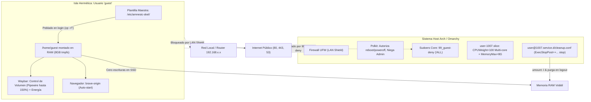

# 🛡️ Usuario Especial Amnésico y Sandbox (`guest`)

> [!NOTE]
> **Navegación de Capa:**
> * Anterior: [[01.6 - Gestion de Secretos y Llaves Cifradas (age)]]
> * Siguiente: [[01.8 - Usuario Sandbox Btrfs Desechable (sandbox)]]
> * Subir al Hub: [[01.0 - Core del Sistema (MOC)|📑 Hub de Capa 01]]
> * Topología: [[00.1 - Topologia de Usuarios y Perfiles|👥 Topología de Usuarios]]

Este módulo documenta el aprovisionamiento, blindaje y arquitectura operativa del usuario especial **`guest`**, diseñado como una **isla hermética** para navegar en la web y realizar pruebas efímeras sin que ningún script malicioso, cookie o archivo pueda persistir en disco duro: todo su `$HOME` reside temporalmente en memoria RAM (`tmpfs`) y se destruye por completo al cerrar sesión.

---

## 🎯 Filosofía y Principios Innegociables

1. **Aislamiento Absoluto de la Flota:**
   - No forma parte de la flota de trabajo ni recibe dotfiles compartidos.
   - Cero acceso a `/z/`, `/z-drive/`, `/zt/` ni a los directorios `$HOME` de otros perfiles (`omarchy`, `niri`, `nyxuri`), protegidos con permisos `0700` y `other::---`.
   - Sin acceso a llaves SSH, secretos ni variables de desarrollo.
2. **`$HOME` 100% Volátil en Memoria RAM (8 GB `tmpfs`):**
   - El directorio `/home/guest` se monta dinámicamente en RAM volátil mediante `tmpfs` con flags estrictos `nosuid,nodev,mode=700`.
   - Al cerrar sesión o reiniciar, la memoria RAM se libera de inmediato y el punto de montaje queda purgado en el SSD sin dejar rastro forense.
3. **Plantilla Maestra Compartida (`/etc/amnesic-skel`):**
   - Comparte exactamente el mismo esqueleto, barra Waybar, control de audio Pipewire hasta el 150%, Brave Origin por defecto y `.bashrc` unificado que el perfil `sandbox` (Btrfs CoW).
4. **Blindaje Cero-Escalada con Permisos de Energía:**
   - `sudo` está tajantemente bloqueado (`!ALL` en `/etc/sudoers.d/99_guest-deny`).
   - Polkit autoriza únicamente acciones de energía (`reboot`, `poweroff`, `suspend`) mediante `/etc/polkit-1/rules.d/00-guest-block.rules`, bloqueando cualquier montaje de particiones o privilegios administrativos.
5. **Rendimiento Multi-Core Fluido y Aceleración GPU:**
   - Pertenece a los grupos `render,video,audio,input,storage,users`, con acceso directo a `/dev/dri/renderD128` (GPU Intel nativa).
   - En cgroups (`/etc/systemd/system/user-1007.slice`), utiliza `CPUWeight=100` (acceso equitativo a todos los núcleos sin estrangulamiento de CFS) y techo de memoria `MemoryMax=8G` para blindar el sistema host.
6. **LAN Shield (Aislamiento de Red Local):**
   - Reglas de firewall en UFW bloquean cualquier intento de conectar a routers o redes locales (`192.168.0.0/16`, `10.0.0.0/8`, `172.16.0.0/12`), permitiendo exclusivamente tráfico Web público (80, 443, DNS).

---

## 🏛️ Diagrama de Arquitectura de Confinamiento en RAM



---

## 🛡️ Las 5 Capas de Blindaje Técnico

### 1. Bloqueo Inapelable de Escalada (`sudo`, `polkit`, `su`)

1. **Sudoers (`/etc/sudoers.d/99_guest-deny`):**
   ```text
   guest ALL=(ALL:ALL) !ALL
   sandbox ALL=(ALL:ALL) !ALL
   ```
   Rechaza cualquier invocación de `sudo` incluso si se introduce una contraseña.
2. **Polkit (`/etc/polkit-1/rules.d/00-guest-block.rules`):**
   Permite apagar, reiniciar o suspender la máquina sin contraseña (incluso con otras sesiones activas), pero bloquea tajantemente cualquier otra acción administrativa.
3. **Restricción estricta de `su` (`/etc/pam.d/su`):**
   Confinado mediante `pam_wheel.so` exclusivamente a miembros del grupo `wheel`.

---

### 2. Memoria RAM Volátil (`tmpfs` 8GB) y Destrucción en Logout

El ciclo de vida del `$HOME` está gestionado automáticamente por PAM y systemd a través de `/usr/local/bin/guest-session-manager.sh`:

1. **Al iniciar sesión (`open_session` en PAM):**
   - Se monta un sistema de archivos `tmpfs` en `/home/guest` con flags `nosuid,nodev,mode=700,size=8G`.
   - Se sincroniza la plantilla maestra limpia desde `/etc/amnesic-skel/` a `/home/guest/`.
2. **Al cerrar sesión (`user@1007.service.d/cleanup.conf` y PAM):**
   - El hook de systemd `ExecStopPost=+/usr/local/bin/guest-session-manager.sh stop` se ejecuta con privilegios root (PID 1).
   - Termina procesos huérfanos (`pkill -u guest -9`).
   - Desmonta el `tmpfs`, liberando instantáneamente la memoria RAM y eliminando cualquier archivo o rastro del directorio base.

---

### 3. LAN Shield: Bloqueo de Red Local en UFW

Ubicado en `/etc/ufw/before.rules`:

```text
# LAN SHIELD: Aislamiento estricto de Red Local para usuario guest (UID 1007)
-A ufw-before-output -m owner --uid-owner guest -p udp --dport 53 -j ACCEPT
-A ufw-before-output -m owner --uid-owner guest -p tcp --dport 53 -j ACCEPT
-A ufw-before-output -m owner --uid-owner guest -d 192.168.0.0/16 -j REJECT
-A ufw-before-output -m owner --uid-owner guest -d 10.0.0.0/8 -j REJECT
-A ufw-before-output -m owner --uid-owner guest -d 172.16.0.0/12 -j REJECT
-A ufw-before-output -m owner --uid-owner guest -d 169.254.0.0/16 -j REJECT
```

---

### 4. Asignación Multi-Core y Techo de Memoria (`user-1007.slice`)

Ubicado en `/etc/systemd/system/user-1007.slice`:

```ini
[Unit]
Description=Resource Slice for Guest Amnesic User
Before=slices.target

[Slice]
CPUWeight=100
MemoryMax=8G
TasksMax=2048
```

* **Sin estrangulamiento de CFS:** No utiliza `CPUQuota`, permitiendo a `guest` utilizar todos los núcleos del procesador con fluidez total para decodificación de video y navegación pesada.
* **Techo de Memoria:** Si una pestaña maliciosa intenta desbordar la memoria, queda limitada a 8 GB para proteger al sistema anfitrión.

---

### 5. Suite Multimedia y Experiencia de Usuario

Heredada de la plantilla maestra `/etc/amnesic-skel/`:
* **Barra de Estado Waybar:**
  - Control de volumen Pipewire interactivo con soporte de scroll hasta el **150%**.
  - Clic para alternar Silencio (*Mute*).
  - Menú de energía visual (`/usr/local/bin/power-menu.sh`) para Reiniciar, Apagar o Cerrar Sesión.
* **Navegador Predeterminado:** `brave-origin` preconfigurado con arranque automático (`exec-once`).
* **Atajos Multimedia y Aplicaciones:**
  - Teclas de volumen (`XF86AudioRaiseVolume` con `-l 1.5`, `XF86AudioLowerVolume`, `XF86AudioMute`).
  - `Super + Space`: Lanzador `fuzzel`.
  - `Super + B`: Abrir Brave Origin.
  - `Super + Return`: Abrir terminal limpia.
  - `Super + M`: Menú de energía.
  - `Super + Q`: Cerrar ventana.
* **Aliases en Terminal:** `vol`, `mute`, `volup`, `voldown`, `vol150`, `vol100`, `reboot`, `poweroff`.

---

## 🔍 Pasos de Verificación y Auditoría

```bash
# 1. Comprobar que sudo está totalmente bloqueado
sudo -u guest sudo -l

# 2. Comprobar que Polkit rechaza privilegios administrativos
sudo -u guest pkexec whoami

# 3. Comprobar que puede reiniciar de forma limpia
sudo -u guest systemctl --dry-run reboot -i

# 4. Comprobar que no puede acceder a las carpetas compartidas
sudo -u guest ls -la /z/
sudo -u guest ls -la /z-drive/
sudo -u guest ls -la /home/omarchy/

# 5. Comprobar que el LAN Shield bloquea la red local
sudo -u guest curl --connect-timeout 2 http://192.168.0.1

# 6. Comprobar estado del gestor de sesión amnésica
sudo guest-session-manager.sh status
```

---

## 🔗 Navegación de Capa

- [[01.6 - Gestion de Secretos y Llaves Cifradas (age)|⬅️ 01.6 Gestión de Secretos]]
- [[01.8 - Usuario Sandbox Btrfs Desechable (sandbox)|➡️ 01.8 Usuario Sandbox Btrfs (sandbox)]]
- [[01.0 - Core del Sistema (MOC)|📑 Volver al Hub de Capa 01]]
- [[00.1 - Topologia de Usuarios y Perfiles|👥 Topología de Usuarios]]
- [[00.0 - Mapa General del Sistema (MOC)|🏠 Volver al Mapa General del Sistema (MOC)]]
