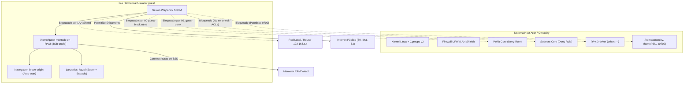

# 🛡️ Usuario Especial Amnésico y Sandbox (`guest`)

> [!NOTE]
> **Navegación de Capa:**
> * Anterior: [[01.6 - Gestion de Secretos y Llaves Cifradas (age)]]
> * Subir al Hub: [[01.0 - Core del Sistema (MOC)|📑 Hub de Capa 01]]
> * Topología: [[00.1 - Topologia de Usuarios y Perfiles|👥 Topología de Usuarios]]

Este módulo documenta el aprovisionamiento, blindaje y arquitectura operativa del usuario especial **`guest`**, diseñado como una **isla hermética** sin comunicación con el resto del sistema para navegar en la web y abrir enlaces o contenidos sospechosos con total tranquilidad de que ningún script malicioso (JavaScript, cryptominers, rastreadores o malware) pueda infectar la máquina ni escribir un solo byte en el disco duro.

---

## 🎯 Filosofía y Principios Innegociables

1. **Aislamiento Absoluto de la Flota:**
   - No forma parte de la flota de trabajo ni recibe dotfiles compartidos.
   - Cero acceso a `/z/`, `/z-drive/`, `/zt/` ni a los directorios `$HOME` de otros perfiles (`omarchy`, `niri`, `nyxuri`), los cuales permanecen protegidos con permisos `0700` y `other::---`.
   - No tiene symlinks ni configuraciones de Neovim (`nvim`/`rvim`/`cvim`), Android Studio ni variables compartidas.
2. **`$HOME` 100% Volátil en Memoria RAM (8 GB `tmpfs`):**
   - El directorio `/home/guest` no existe en el disco SSD; se monta dinámicamente en memoria RAM volátil mediante `tmpfs` con flags estrictos `nosuid,nodev`.
   - Al cerrar sesión o reiniciar, la memoria RAM se libera y **todo se desvanece de inmediato** sin dejar rastro forense.
3. **Blindaje Cero-Escalada (Anti-Sudoless):**
   - A pesar de que la estación de trabajo cuenta con sudo sin contraseña para perfiles administrativos, `guest` está **explícitamente bloqueado** de cualquier mecanismo de escalada de privilegios (`sudo`, `polkit`, `su`).
4. **Barrera de Recursos contra Criptominado:**
   - Límites estrictos en cgroups vía systemd (`CPUQuota=60%`, `MemoryMax=8G`, `TasksMax=512`). Si una página web intenta saturar la CPU o minar criptomonedas, el kernel la frena en seco sin congelar el equipo.
5. **LAN Shield (Aislamiento de Red Local):**
   - Reglas de firewall en UFW bloquean cualquier intento de escanear la red doméstica o el router (`192.168.0.0/16`, `10.0.0.0/8`, `172.16.0.0/12`), permitiendo únicamente navegación hacia la Web pública.

---

## 🏛️ Diagrama de Arquitectura de Confinamiento



---

## 🛡️ Las 5 Capas de Blindaje Técnico

### 1. Bloqueo Inapelable de Escalada (`sudo`, `polkit`, `su`)

1. **Sudoers (`/etc/sudoers.d/99_guest-deny`):**
   ```text
   guest ALL=(ALL:ALL) !ALL
   ```
   Incluso si el usuario `guest` introduce su contraseña, `sudo` rechaza tajantemente la ejecución de cualquier binario con:
   `Sorry, user guest is not allowed to execute '...' as root`.
2. **Polkit (`/etc/polkit-1/rules.d/00-guest-block.rules`):**
   ```javascript
   polkit.addRule(function(action, subject) {
       if (subject.user === "guest") {
           return polkit.Result.NO;
       }
   });
   ```
   Cualquier petición gráfica o en segundo plano para autenticar privilegios administrativos (ej. montar discos, modificar servicios systemd) es rechazada sin mostrar diálogo alguno.
3. **Restricción estricta de `su` (`/etc/pam.d/su`):**
   ```text
   auth required pam_wheel.so use_uid
   ```
   Solo miembros del grupo `wheel` pueden invocar `su`. Como `guest` no pertenece a `wheel`, la autenticación falla automáticamente.

---

### 2. Memoria RAM Volátil (`tmpfs` 8GB) y Destrucción en Logout

El ciclo de vida del `$HOME` está gestionado automáticamente por PAM a través de `/usr/local/bin/guest-session-manager.sh`:

1. **Al iniciar sesión (`open_session`):**
   - Se monta un sistema de archivos `tmpfs` en `/home/guest` con flags de seguridad `nosuid,nodev,mode=700,size=8G`.
   - Se copia la plantilla limpia desde `/etc/guest-skel/` a `/home/guest/`.
2. **Al cerrar sesión (`close_session`):**
   - Se eliminan todos los procesos residuales (`pkill -9 -u guest`).
   - Se desmonta `/home/guest`, liberando toda la memoria RAM y destruyendo instantáneamente cualquier archivo, cookie o malware.

---

### 3. LAN Shield: Bloqueo de Red Local en UFW

Ubicado en `/etc/ufw/before.rules`:

```text
# LAN SHIELD: Aislamiento estricto de Red Local para usuario guest (UID 1007)
-A ufw-before-output -m owner --uid-owner guest -p udp --dport 53 -j ACCEPT
-A ufw-before-output -m owner --uid-owner guest -p tcp --dport 53 -j ACCEPT
-A ufw-before-output -m owner --uid-owner guest -d 192.168.0.0/16 -j REJECT
-A ufw-before-output -m owner --uid-owner guest -d 10.0.0.0/8 -j REJECT
-A ufw-before-output -m owner --uid-owner guest -d 172.16.0.0/12 -j REJECT
-A ufw-before-output -m owner --uid-owner guest -d 169.254.0.0/16 -j REJECT
```

* **Permitido:** Consultas DNS (puerto 53) y tráfico hacia direcciones IP públicas de Internet.
* **Bloqueado:** Cualquier intento de conectar o sondear equipos en la red doméstica (`192.168.x.x`), routers o dispositivos IoT.

---

### 4. Cuotas de Hardware contra Criptominado (`user-1007.slice`)

Ubicado en `/etc/systemd/system/user-1007.slice`:

```ini
[Unit]
Description=Restricted Resource Slice for Guest Sandbox User
Before=slices.target

[Slice]
CPUQuota=60%
MemoryMax=8G
TasksMax=512
```

Si una página web infectada ejecuta minería de Monero o un bucle infinito en JavaScript:
* La CPU queda limitada al 60% por el kernel, impidiendo que el equipo se sobrecaliente o se congele.
* Si el navegador intenta consumir más de 8 GB de RAM, el kernel suspende la pestaña causante sin afectar tus otras sesiones.

---

### 5. Entorno Visual y Flujo de Trabajo

El esqueleto en `/etc/guest-skel/` provee un entorno limpio con:
* **Navegador predeterminado:** `brave-origin` (con escudos activos contra rastreadores y anuncios maliciosos).
* **Auto-arranque:** Al entrar a la sesión en SDDM, `brave-origin` se abre inmediatamente en pantalla.
* **Lanzador de aplicaciones:** `fuzzel` invocado mediante **`Super + Espacio`**.
* **Atajos rápidos:**
  - `Super + B`: Abrir Brave Origin.
  - `Super + Enter`: Abrir terminal limpia.
  - `Super + Q`: Cerrar ventana.
  - `Super + M`: Cerrar sesión (Log Out) y destruir la memoria RAM.

---

## 🔍 Pasos de Verificación y Auditoría

```bash
# 1. Comprobar que sudo está totalmente bloqueado
sudo -u guest sudo -l

# 2. Comprobar que Polkit rechaza privilegios
sudo -u guest pkexec whoami

# 3. Comprobar que no puede acceder a las carpetas compartidas
sudo -u guest ls -la /z/
sudo -u guest ls -la /z-drive/
sudo -u guest ls -la /home/omarchy/

# 4. Comprobar que el LAN Shield bloquea la red local
sudo -u guest curl --connect-timeout 2 http://192.168.0.1

# 5. Comprobar que la navegación a Internet público funciona
sudo -u guest curl -I https://www.google.com

# 6. Comprobar estado del gestor de sesión amnésica
sudo guest-session-manager.sh status
```

---

## 🔗 Navegación de Capa

- [[01.6 - Gestion de Secretos y Llaves Cifradas (age)|⬅️ 01.6 Gestión de Secretos]]
- [[01.0 - Core del Sistema (MOC)|📑 Volver al Hub de Capa 01]]
- [[00.1 - Topologia de Usuarios y Perfiles|👥 Topología de Usuarios]]
- [[00.0 - Mapa General del Sistema (MOC)|🏠 Volver al Mapa General del Sistema (MOC)]]
