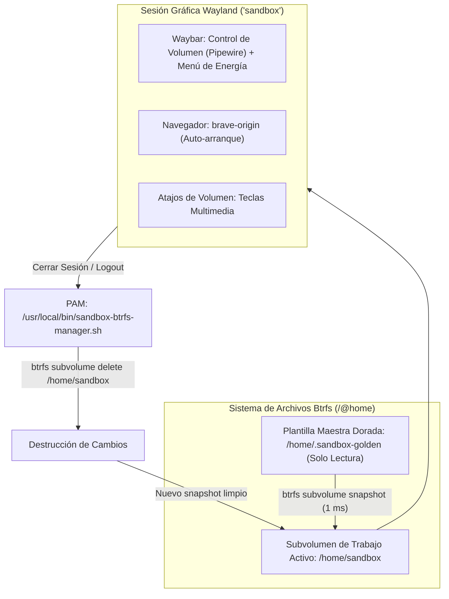

# 🛡️ Usuario Sandbox Btrfs Desechable (`sandbox`)

> [!NOTE]
> **Navegación de Capa:**
> * Anterior: [[01.7 - Usuario Especial Amnesico y Sandbox (guest)]]
> * Subir al Hub: [[01.0 - Core del Sistema (MOC)|📑 Hub de Capa 01]]
> * Topología: [[00.1 - Topologia de Usuarios y Perfiles|👥 Topología de Usuarios]]

Este módulo documenta el despliegue del usuario especial **`sandbox`**, diseñado bajo el paradigma de **$HOME desechable con auto-rollback instantáneo en Btrfs (Copy-on-Write)**. Combina el aislamiento total de la flota con velocidad nativa de disco NVMe, aceleración directa por GPU Intel, barra de estado Waybar con control de volumen y menú de reinicio/apagado sin restricciones.

---

## 🎯 Filosofía y Diferencias frente a `guest` (RAM tmpfs)

La estación de trabajo dispone de dos perfiles de aislamiento para pruebas y navegación segura:

| Característica | 🍃 `guest` (Opción RAM tmpfs) | ⚡ `sandbox` (Opción Btrfs CoW) |
|---|---|---|
| **Almacenamiento de `$HOME`** | 100% en Memoria RAM (`tmpfs` 8GB). | Subvolumen Btrfs en disco SSD NVMe (`/@home`). |
| **Consumo de Memoria RAM** | Ocupa RAM física dinámicamente según el uso. | **Cero consumo de RAM fija**: usa la caché estándar del kernel. |
| **Mecanismo de Desecho** | Desmontaje y corte eléctrico de RAM al logout. | **Snapshot rollback instantáneo en 1 ms** desde `/home/.sandbox-golden`. |
| **Capacidad de Almacenamiento** | Limitado al techo de RAM (8 GB). | Capacidad completa del disco NVMe (+100 GB). |
| **Rendimiento Gráfico** | Acelerado por GPU Intel (`render` group). | Acelerado por GPU Intel (`render` group), máxima fluidez. |
| **Entorno Visual** | Hyprland / Niri con Waybar y Brave Origin. | Hyprland / Niri con Waybar y Brave Origin. |

---

## 🏛️ Diagrama de Arquitectura de Rollback Btrfs



---

## 🛡️ Controles de Seguridad y Experiencia de Usuario

### 1. Control Multimedia de Volumen y Barra de Estado (`Waybar`)
El entorno arranca con **Waybar** en el borde superior, proporcionando:
* **Módulo de Audio Pipewire:**
  * Indicador de porcentaje de volumen en tiempo real.
  * **Rueda del ratón:** Deslizar sobre el icono sube y baja el volumen.
  * **Clic izquierdo:** Alterna Silencio (*Mute* / *Unmute*).
* **Teclas Multimedia del Teclado:**
  * `XF86AudioRaiseVolume`: `wpctl set-volume -l 1.5 @DEFAULT_AUDIO_SINK@ 5%+`
  * `XF86AudioLowerVolume`: `wpctl set-volume @DEFAULT_AUDIO_SINK@ 5%-`
  * `XF86AudioMute`: `wpctl set-mute @DEFAULT_AUDIO_SINK@ toggle`
* **Aliases en Terminal:**
  * `vol`: Consulta el volumen actual.
  * `mute`: Silencia o reactiva el audio.

### 2. Capacidad de Reinicio y Apagado (`Reboot` / `Power Off`)
* **Botón ⏻ en Waybar:** Al hacer clic, despliega el menú rápido `/usr/local/bin/power-menu.sh` con opciones para **Reiniciar Equipo**, **Apagar Equipo**, **Cerrar Sesión** o **Suspender**.
* **Polkit (`/etc/polkit-1/rules.d/00-guest-block.rules`):**
  Autoriza explícitamente `reboot` y `power-off` (incluyendo sesiones múltiples), permitiendo reiniciar o apagar el equipo directamente desde la interfaz gráfica o con `reboot` en la terminal sin pedir contraseña.
* **Cero Escalada:** Cualquier otra acción administrativa (sudo, montar discos del sistema, etc.) permanece **estrictamente bloqueada**.

### 3. Rendimiento Fluido y Aceleración por Hardware (GPU Intel)
* El usuario pertenece a los grupos `render,video,audio,input,users`.
* Acceso directo a `/dev/dri/renderD128`, eliminando todo lag de renderizado por software.
* En cgroups (`/etc/systemd/system/user-1008.slice`), utiliza `CPUWeight=100` (reparto equitativo), permitiendo utilizar la potencia de los núcleos de forma fluida sin estrangular la interfaz.

### 4. LAN Shield (Aislamiento de Red Local en UFW)
En `/etc/ufw/before.rules`:
* Bloquea cualquier intento de conectar a routers o equipos en la red doméstica (`192.168.0.0/16`, `10.0.0.0/8`, `172.16.0.0/12`).
* Autoriza únicamente consultas DNS y navegación hacia la Web pública.

---

## 🔧 Operación del Gestor de Rollback (`sandbox-btrfs-manager.sh`)

Ubicado en `/usr/local/bin/sandbox-btrfs-manager.sh`:

```text
Uso:
  sandbox-btrfs-manager.sh [COMANDO]

Comandos:
  status                 Muestra si /home/sandbox es un subvolumen activo y el espacio disponible.
  reset / rollback       Destruye /home/sandbox y restaura un snapshot limpio en 1 milisegundo.
```

### Ejemplos:
```bash
# 1. Comprobar el estado del subvolumen
sudo sandbox-btrfs-manager.sh status

# 2. Forzar un reset manual al estado de fábrica
sudo sandbox-btrfs-manager.sh reset
```

---

## 🔍 Pasos de Verificación y Auditoría

```bash
# 1. Verificar bloqueo absoluto de sudo
sudo -u sandbox sudo -l

# 2. Verificar que no puede acceder a las carpetas compartidas
sudo -u sandbox ls -la /z/
sudo -u sandbox ls -la /home/omarchy/

# 3. Probar permiso de reinicio limpio
sudo -u sandbox systemctl --dry-run reboot -i

# 4. Probar LAN Shield
sudo -u sandbox curl --connect-timeout 2 http://192.168.0.1
sudo -u sandbox curl -I https://www.google.com

# 5. Probar rollback instantáneo
sudo -u sandbox touch /home/sandbox/Desktop/prueba.txt
sudo sandbox-btrfs-manager.sh reset
ls -la /home/sandbox/Desktop/prueba.txt  # Debe retornar No such file or directory
```

---

## 🔗 Navegación de Capa

- [[01.7 - Usuario Especial Amnesico y Sandbox (guest)|⬅️ 01.7 Usuario Sandbox RAM (guest)]]
- [[01.0 - Core del Sistema (MOC)|📑 Volver al Hub de Capa 01]]
- [[00.1 - Topologia de Usuarios y Perfiles|👥 Topología de Usuarios]]
- [[00.0 - Mapa General del Sistema (MOC)|🏠 Volver al Mapa General del Sistema (MOC)]]
