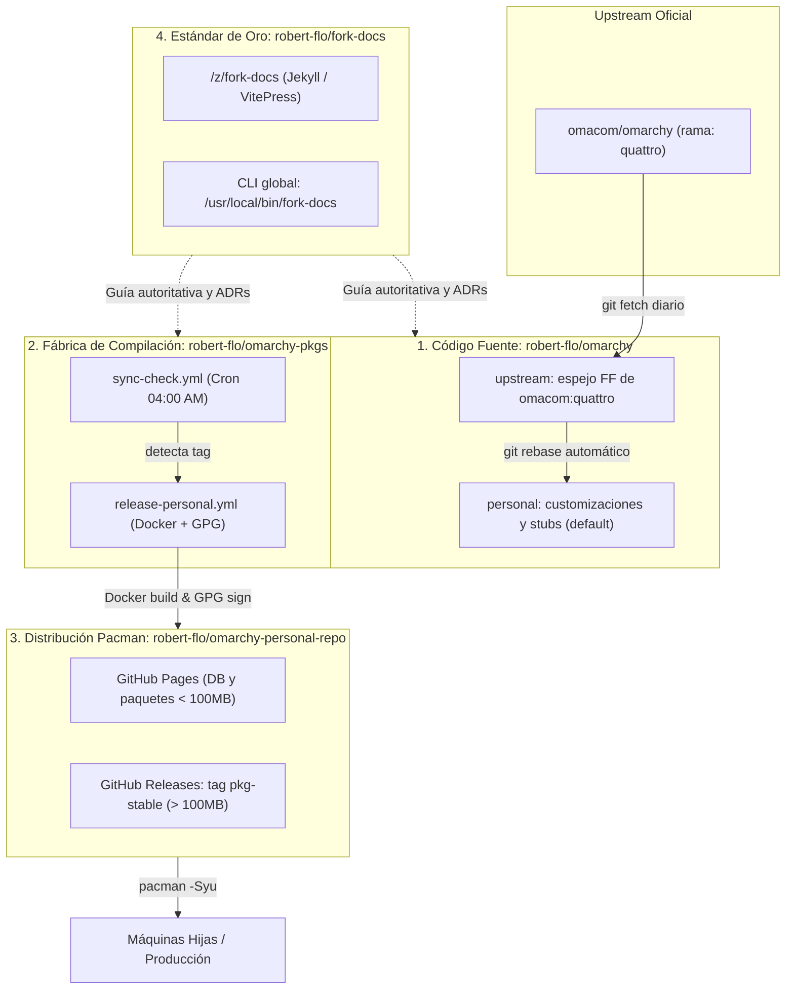

# 🌐 Ecosistema Omarchy Personal Fork y Portal fork-docs

> [!NOTE]
> **Navegación de Capa:**
> * Anterior: [[03.5 - Ecosistema Google Antigravity y Android Studio Canary (BYOA)]]
> * Subir al Hub: [[03.0 - Toolchain Global y Estacion de Trabajo (MOC)|📑 Hub de Capa 03]]
> * Índice Maestro: [[00.0 - Mapa General del Sistema (MOC)|🏠 Inicio (MOC)]]

Este módulo documenta la integración de la arquitectura del **Fork Personal de Omarchy** ([robert-flo/fork-docs](https://github.com/robert-flo/fork-docs)), su portal de documentación canónica ("Estándar de Oro"), el modelo de repositorio `pacman` firmado con sombreado de versiones, y la distinción de roles entre esta estación de trabajo (como nodo **DEV**) y las máquinas hijas de la flota.

---

## 🏛️ Topología de los Cuatro Pilares

El ecosistema desacopla estrictamente el desarrollo de la distribución upstream (`omacom/omarchy`) en cuatro repositorios autónomos:



| Pilar | Repositorio | Rama Principal | Responsabilidad |
| :--- | :--- | :--- | :--- |
| **1. Código Fuente** | `robert-flo/omarchy` | `personal` (default) / `upstream` (espejo FF) | Árbol fuente de scripts, aplicaciones, configuraciones y migraciones. |
| **2. Fábrica de Compilación** | `robert-flo/omarchy-pkgs` | `master` / `personal` | Automatización de CI/CD en contenedores puros Docker y firmado GPG. |
| **3. CDN Pacman** | `robert-flo/omarchy-personal-repo` | `gh-pages` + release `pkg-stable` | Repositorio pacman firmado servido estáticamente. |
| **4. Estándar de Oro** | `robert-flo/fork-docs` | `main` | Portal documental canónico, glosario, runbooks y ADRs (ADR-001 al ADR-010). |

---

## 🎯 Rol de esta Estación de Trabajo: Máquina DEV (`gracie` / `omarchy`)

> [!IMPORTANT]
> **Diferenciación Crítica de Roles:**
> Esta estación de trabajo **NO es una máquina hija de producción**. Funciona bajo el **Rol DEV**.
> * **Máquinas Hijas (Clientes):** Reciben actualizaciones exclusivamente ejecutando `omarchy update`, el cual descarga los paquetes sombreados del CDN y corre migraciones.
> * **Esta Máquina DEV:** Desarrolla y prueba localmente con el flujo a dos velocidades (`omarchy dev link` y `omarchy dev pkg-test`). **No ejecuta `omarchy update`** desatendido para evitar sobreescritura de árboles en desarrollo.
> * **Protección `IgnorePkg`:** Para blindar la máquina contra reemplazos accidentales por versiones superiores en pacman, `/etc/pacman.conf` protege los paquetes de desarrollo:
>   ```ini
>   IgnorePkg = omarchy-dev omarchy-settings-dev
>   ```

---

## 🔐 Modelo de Seguridad GPG y Configuración de Pacman

El repositorio personal distribuye paquetes firmados criptográficamente. Pacman requiere la clave pública confiada y la declaración del repositorio con prioridad sobre upstream.

### 1. Clave GPG del Repositorio Personal
* **Identificador de Llave:** `76AFFCC217DB9FC4`
* **Huella Dactilar (*Fingerprint*):** `CD92 AB07 B1D2 4DC9 A74E B60E 76AF FCC2 17DB 9FC4`
* **Archivo de Origen:** `/z/fork-docs/keys/omarchy-personal-repo.pub.asc`
* **Comandos de Provisión en el Sistema:**
  ```bash
  sudo pacman-key --add /z/fork-docs/keys/omarchy-personal-repo.pub.asc
  sudo pacman-key --lsign-key 76AFFCC217DB9FC4
  ```

### 2. Bloque de Repositorio en `/etc/pacman.conf`
Para respetar la regla de sombreado (ADR-003) y sortear el límite de 100 MB de GitHub Pages, se configuran dos servidores en orden de precedencia:

```ini
[omarchy-personal]
SigLevel = Required DatabaseOptional
Server = https://robert-flo.github.io/omarchy-personal-repo/stable/$arch
Server = https://github.com/robert-flo/omarchy-personal-repo/releases/download/pkg-stable

[omarchy]
Server = https://pkgs.omarchy.org/stable/$arch
```

* **Primer `Server`:** Descarga la base de datos `omarchy-personal.db` y paquetes livianos (< 100MB) desde GitHub Pages.
* **Segundo `Server`:** Resuelve paquetes pesados que exceden el límite de 100MB de GitHub (como `omarchy-4.0.6-100-any.pkg.tar.zst`), alojados en el release permanente `pkg-stable` de GitHub Releases.
* **Precedencia:** Al estar declarado **antes** de `[omarchy]`, cualquier paquete con versión o `pkgrel` mayor o igual (`pkgrel=99+`, ADR-004) prevalece sobre el oficial.

---

## 📁 Almacenamiento Compartido: `/z/fork-docs`

Siguiendo el principio de cero duplicidad en `$HOME`, el repositorio vive en el almacenamiento multiusuario:

* **Ruta canónica:** `/z/fork-docs`
* **Propietario:** `omarchy:wheel`
* **Permisos:** `2775` (setgid activo para herencia automática de grupo)
* **ACLs:** `default:group:wheel:rwx`
* **Configuración Git:** `git config core.fileMode false` (evita diffs ficticios por bits de permisos) y `git config --system --add safe.directory "/z/fork-docs"`.
* **Symlink de conveniencia:** `/home/omarchy/Work/tries/2026-10-26-robert-flo-fork-docs -> /z/fork-docs`.

---

## 🛠️ CLI Global: `/usr/local/bin/fork-docs`

Se despliega un asistente global accesible para cualquier usuario (`omarchy`, `gracie`, `niri`, `nyxuri`, etc.):

```bash
# Comprobar estado del repositorio pacman y de fork-docs
fork-docs status

# Abrir el portal en el navegador (local si está activo, o remoto)
fork-docs open

# Iniciar servidor web local Jekyll (puerto 4000)
fork-docs serve

# Compilar sitio estático en /z/fork-docs/_site
fork-docs build

# Actualizar el repositorio de documentación
fork-docs update
```

### Motor Local (Jekyll & Bundler)
* Las gemas se gestionan de forma autocontenida en `/z/fork-docs/vendor/bundle` mediante `extra/ruby-bundler`.
* Cualquier usuario miembro de `wheel` puede compilar (`fork-docs build`) o levantar el entorno interactivo sin contaminar sus directorios personales.
