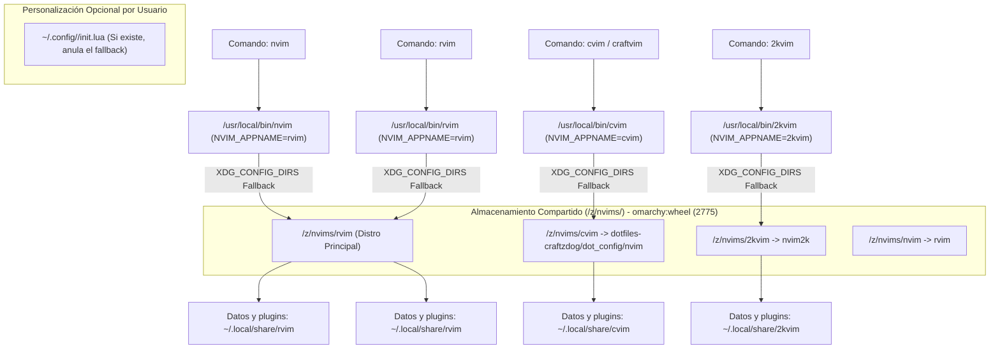

# 🚀 Arquitectura Neovim Compartida (`/z/nvims`)

> [!NOTE]
> **Navegación de Capa:**
> * Siguiente: [[05.2 - Configuracion Craftzdog (nvim) y Distro Propia (rvim)]]
> * Subir al Hub: [[05.0 - Suite de Desarrollo Neovim (MOC)|📑 Hub de Capa]]

Este módulo documenta el despliegue del entorno de edición multi-distribución basado en **Neovim >= 0.12**, garantizando que todos los usuarios del sistema (`omarchy`, `gracie`, `niri`, `sura`, `nyxuri`, `nyxuri-test`) dispongan de entornos totalmente aislados, funcionales y sin colisión:

1. **Configuración Principal por Defecto (`nvim` / `rvim`)**: La distribución propia de Roberto Flores mantenida en [`robert-flo/rvim`](https://github.com/robert-flo/rvim). Al invocar `nvim` en cualquier terminal, script de Git o herramienta externa, se abre directamente `rvim`. También accesible explícitamente mediante el wrapper `rvim`.
2. **Configuración IDE Completa Aislada (`cvim` / `craftvim`)**: Portada desde el fork [`robert-flo/dotfiles-craftzdog`](https://github.com/robert-flo/dotfiles-craftzdog), rama **`feat/late-2026`**, empleando el gestor de paquetes nativo de Neovim (`vim.pack`), tema Solarized Osaka, Snacks UI y mini.icons. Invocable mediante los comandos `cvim` o `craftvim` con aislamiento `NVIM_APPNAME="cvim"`.
3. **Configuración Minimalista Aislada (`2kvim`)**: Portada desde [`2KAbhishek/nvim2k`](https://github.com/2KAbhishek/nvim2k), invocable mediante el comando `2kvim` con aislamiento `NVIM_APPNAME="2kvim"`.
4. **Mantenimiento Automatizado con `forkhub`**: Toda la flota de Neovim se audita y sincroniza diariamente mediante [[07.5 - Catalogo y Manual de Herramientas CLI del Playbook#2 🍴 Gestión de Flota de Forks y Repositorios (forkhub)|forkhub]] a través del servicio y temporizador `forkhub.timer`.

---

## 🏛️ Diagrama de Arquitectura y Aislamiento

Siguiendo el principio de **compartir código y evitar duplicidad en disco**, las configuraciones base no se clonan por separado en el `$HOME` de cada usuario; residen de forma centralizada en el directorio compartido **`/z/nvims/`**.

A partir de Neovim 0.12, **no se requieren enlaces simbólicos en `$HOME/.config/` ni en `/etc/skel/`**. Los ejecutables globales utilizan el estándar nativo **`XDG_CONFIG_DIRS`** para resolver la configuración compartida directamente desde `/z/nvims/`. Si un usuario desea personalizar su entorno, simplemente crea su propio archivo local `~/.config/<NVIM_APPNAME>/init.lua`, el cual tiene precedencia inmediata sin alterar el sistema compartido:



> [!NOTE]
> **Por qué funciona la arquitectura nativa XDG en Neovim 0.12:**
> 1. **Resolución en Dos Capas:** Neovim busca primero en `$XDG_CONFIG_HOME/$NVIM_APPNAME` (privado de cada usuario). Si no existe, recurre automáticamente a `$XDG_CONFIG_DIRS/$NVIM_APPNAME` (`/z/nvims/<appname>`).
> 2. **Cero Symlinks:** No se inyectan enlaces simbólicos en `$HOME/.config/` ni en `/etc/skel/`, eliminando dependencias frágiles, scripts de enlace en reseteos de usuario y advertencias de rclone.
> 3. **Aislamiento de Estado:** Los paquetes compilados (`vim.pack`), parsers de tree-sitter y shada residen en `stdpath('data')` (`~/.local/share/<NVIM_APPNAME>`) y `stdpath('state')`, garantizando independencia absoluta entre perfiles.
> 4. **Permisos y Edición Directa:** `/z/nvims` pertenece a `omarchy:wheel` con setgid (`2775`) y ACLs (`default:group:wheel:rwx`), protegido y vigilado en tiempo real por `z-perms.service`. Roberto y los usuarios administradores pueden editar cualquier archivo de Neovim directamente sin requerir `sudo`.

---

## 🛠️ Procedimiento de Despliegue Paso a Paso

### Paso 1: Wrappers Globales de Sistema (`/usr/local/bin/`)

Para que los comandos `rvim`, `cvim` (`craftvim`), `2kvim` y `nvim` resuelvan nativamente el almacenamiento compartido sin symlinks de usuario:

```bash
# 1. Wrapper para distro propia (rvim)
sudo tee /usr/local/bin/rvim << 'EOF'
#!/usr/bin/env bash
# Invocación nativa XDG para rvim (cero symlinks en $HOME)
export NVIM_APPNAME="rvim"
export XDG_CONFIG_DIRS="/z/nvims:${XDG_CONFIG_DIRS:-/etc/xdg}"
exec /usr/bin/nvim "$@"
EOF

# 2. Wrapper para Craftzdog (cvim / craftvim)
sudo tee /usr/local/bin/cvim << 'EOF'
#!/usr/bin/env bash
# Invocación nativa XDG para cvim / Craftzdog (cero symlinks en $HOME)
export NVIM_APPNAME="cvim"
export XDG_CONFIG_DIRS="/z/nvims:${XDG_CONFIG_DIRS:-/etc/xdg}"
exec /usr/bin/nvim "$@"
EOF
sudo ln -sf cvim /usr/local/bin/craftvim

# 3. Wrapper para nvim2k (2kvim)
sudo tee /usr/local/bin/2kvim << 'EOF'
#!/usr/bin/env bash
# Invocación nativa XDG para 2kvim (cero symlinks en $HOME)
export NVIM_APPNAME="2kvim"
export XDG_CONFIG_DIRS="/z/nvims:${XDG_CONFIG_DIRS:-/etc/xdg}"
exec /usr/bin/nvim "$@"
EOF

# 4. Wrapper por defecto para comando nvim
sudo tee /usr/local/bin/nvim << 'EOF'
#!/usr/bin/env bash
# Wrapper predeterminado: si no se especifica otra distro, abre rvim
export NVIM_APPNAME="${NVIM_APPNAME:-rvim}"
export XDG_CONFIG_DIRS="/z/nvims:${XDG_CONFIG_DIRS:-/etc/xdg}"
exec /usr/bin/nvim "$@"
EOF

sudo chmod 755 /usr/local/bin/rvim /usr/local/bin/cvim /usr/local/bin/craftvim /usr/local/bin/2kvim /usr/local/bin/nvim
```

> [!TIP]
> Copias exactas de estos wrappers se encuentran preservadas en `assets/system/usr/local/bin/`.

---

### Paso 2: Creación del Repositorio Compartido en `/z/nvims`

```bash
# 1. Crear directorio compartido y permisos ACL
sudo install -d -o omarchy -g wheel -m 2775 /z/nvims
sudo setfacl -m g:wheel:rwx -m d:g:wheel:rwx /z/nvims

# 2. Habilitar safe.directory a nivel de sistema para /z/*
sudo git config --system safe.directory "/z/*"

# 3. Clonar los repositorios compartidos
cd /z/nvims
git clone https://github.com/robert-flo/rvim.git
git clone --branch feat/late-2026 --depth 1 https://github.com/robert-flo/dotfiles-craftzdog.git
git clone https://github.com/2KAbhishek/nvim2k.git

# 4. Enlaces de carpeta local para resolución de NVIM_APPNAME
ln -sfn dotfiles-craftzdog/dot_config/nvim cvim
ln -sfn nvim2k 2kvim
ln -sfn rvim nvim

# 5. Asegurar permisos colaborativos wheel
sudo /usr/local/bin/fix_shared_dir_perms.sh /z/nvims wheel
```

---

### Paso 3: Inicialización Headless y Soporte Multi-Usuario Automático

Dado que Neovim resuelve nativamente mediante `XDG_CONFIG_DIRS`, **no es necesario crear ningún symlink en `$HOME/.config/` ni en `/etc/skel/`**. Cualquier usuario del sistema puede invocar inmediatamente los editores:

```bash
# Inicialización Headless (descarga e indexación de plugins y parsers por usuario)
rvim --headless "+qa"
cvim --headless "+qa"
2kvim --headless "+qa"
nvim --headless "+qa"
```

---

### Paso 4: Monitoreo y Actualización Diaria de la Flota (`forkhub`)

Para mantener los forks de Craftzdog, nvim2k y rvim actualizados sin intervención manual ni sorpresas:
1. Las definiciones residen en `/etc/forkhub/repos.d/*.conf`.
2. Se pueden auditar en cualquier momento ejecutando `forkhub status` o `forkhub update --group neovim`.
3. El servicio systemd `forkhub.service` y su temporizador `forkhub.timer` realizan comprobaciones desatendidas diarias a las 04:30 AM.

---

## 🔍 Pasos de Verificación y Aislamiento

```bash
# 1. Ruta de configuración de nvim (debe resolver a rvim)
nvim --headless -c "echo stdpath('config')" -c "qa"

# 2. Ruta de configuración de cvim (debe resolver a ~/.config/cvim)
cvim --headless -c "echo stdpath('config')" -c "qa"

# 3. Disponibilidad de los comandos globales
which nvim rvim cvim craftvim 2kvim

# 4. Estado de salud de la flota
forkhub status
```

---

## 🔗 Navegación de Capa

- [[05.2 - Configuracion Craftzdog (nvim) y Distro Propia (rvim)|➡️ Siguiente Nota]]
- [[05.0 - Suite de Desarrollo Neovim (MOC)|📑 Volver al Hub de Capa]]
