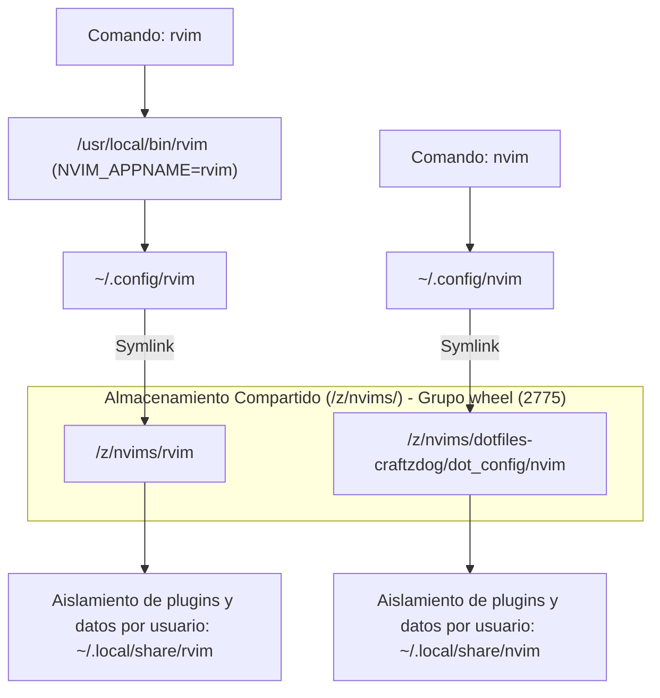

## 🏛️ Diagrama de Arquitectura y Aislamiento

Siguiendo el principio de **compartir código y evitar duplicidad en disco**, las configuraciones base no se clonan por separado en el `$HOME` de cada usuario; residen de forma centralizada en el directorio compartido **`/z/nvims/`** y se enlazan simbólicamente:



> [!NOTE]
> **Por qué funciona el código compartido en Neovim 0.12:**
> En Neovim, los paquetes (`vim.pack`), los parsers de tree-sitter y el archivo de sesiones (shada) residen en `stdpath('data')` (`~/.local/share/nvim` o `~/.local/share/rvim`) y `stdpath('state')`, **no** en `stdpath('config')`. Por lo tanto, compartir el código Lua en `/z/nvims` permite sincronización inmediata al 100% sin interferencias entre cuentas de usuario.

---

## 🛠️ Procedimiento de Despliegue Paso a Paso

### Paso 1: Wrapper Global de Sistema (`/usr/local/bin/rvim`)

Para que el comando `rvim` esté disponible de forma global para cualquier usuario y sesión:

```bash
sudo tee /usr/local/bin/rvim << 'EOF'
#!/usr/bin/env bash
# Wrapper para invocar Neovim usando la configuración aislada 'rvim'
# Utiliza NVIM_APPNAME para separar configuración (~/.config/rvim), plugins, caché y estado.
NVIM_APPNAME="rvim" exec nvim "$@"
EOF

sudo chmod 755 /usr/local/bin/rvim
```

> [!TIP]
> Una copia exacta de este wrapper se encuentra preservada en `assets/system/usr/local/bin/rvim`.

---

### Paso 2: Creación del Repositorio Compartido en `/z/nvims`

```bash
# 1. Crear directorio compartido y permisos ACL
sudo install -d -o "$USER" -g wheel -m 2775 /z/nvims
sudo setfacl -m g:wheel:rwx -m d:g:wheel:rwx /z/nvims

# 2. Habilitar safe.directory a nivel de sistema para /z/*
sudo git config --system --add safe.directory '/z/*'

# 3. Clonar los repositorios compartidos
cd /z/nvims
git clone --branch feat/late-2026 --depth 1 https://github.com/robert-flo/dotfiles-craftzdog.git
git clone https://github.com/robert-flo/rvim.git

sudo chmod -R g+rX /z/nvims
```

---

### Paso 3: Enlace Simbólico e Inicialización en Todos los Usuarios

```bash
TARGET_USERS=("omarchy" "niri" "nyxuri" "nyxuri-test")

for u in "${TARGET_USERS[@]}"; do
    if id "$u" &>/dev/null; then
        echo "==> Enlazando Neovim dual compartido para $u..."
        sudo -u "$u" -H bash -c '
        set -euo pipefail
        cd "$HOME"

        # 1. Limpieza de configuraciones previas no vinculadas
        if [ -d "$HOME/.config/nvim" ] && [ ! -L "$HOME/.config/nvim" ]; then
            rm -rf "$HOME/.config/nvim"
        fi
        rm -rf "$HOME/.local/share/nvim" "$HOME/.local/state/nvim" "$HOME/.cache/nvim"
        [ -d "$HOME/.dotfiles-craftzdog" ] && rm -rf "$HOME/.dotfiles-craftzdog"
        [ -d "$HOME/rvim" ] && rm -rf "$HOME/rvim"

        # 2. Enlaces simbólicos hacia /z/nvims
        mkdir -p "$HOME/.config" "$HOME/.local/bin"
        ln -sfn /z/nvims/dotfiles-craftzdog/dot_config/nvim "$HOME/.config/nvim"
        ln -sfn /z/nvims/rvim "$HOME/.config/rvim"
        ln -sfn /usr/local/bin/rvim "$HOME/.local/bin/rvim"

        # 3. Inicialización Headless (descarga e indexación vim.pack)
        nvim --headless "+qa" 2>/dev/null || true
        rvim --headless "+qa" 2>/dev/null || true
        '
    fi
done
```

---

## 🔍 Pasos de Verificación y Aislamiento

```bash
# 1. Ruta de configuración de nvim (debe resolver a ~/.config/nvim)
nvim --headless -c "echo stdpath('config')" -c "qa"

# 2. Ruta de configuración de rvim (debe resolver a ~/.config/rvim)
rvim --headless -c "echo stdpath('config')" -c "qa"

# 3. Disponibilidad del comando global
which rvim

# 4. Verificación de permisos en /z/nvims
ls -ld /z/nvims
```

### Salida esperada:
```text
/home/<usuario>/.config/nvim
/home/<usuario>/.config/rvim
/usr/local/bin/rvim
drwxrwsr-x+ ... omarchy wheel ... /z/nvims
```

---

## 🔗 Próximos Pasos

- [[05.2 - Configuracion Craftzdog (nvim) y Distro Propia (rvim)|➡️ Configuración Craftzdog y Distro Propia rvim]]
- [[06.1 - Gestion de Dotfiles con dotbare|➡️ Continuar con Capa 06: Gestión de Dotfiles]]
- [[00.0 - Mapa General del Sistema (MOC)|🏠 Volver al Índice General]]
