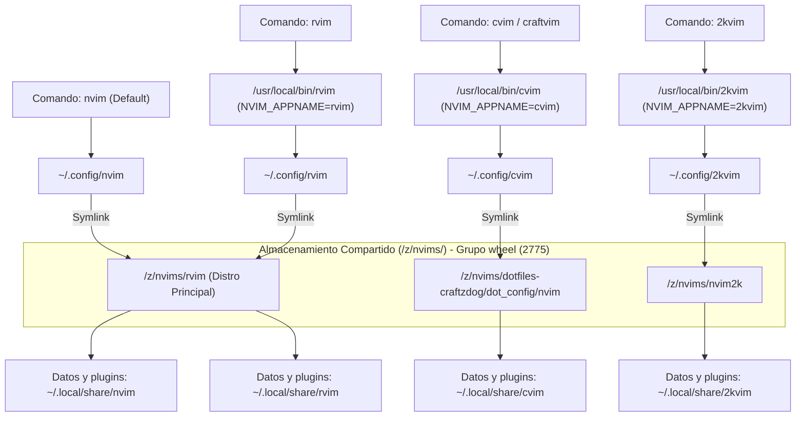

# 🚀 Arquitectura Neovim Compartida (`/z/nvims`)

> [!NOTE]
> **Navegación de Capa:**
> * Siguiente: [[05.2 - Configuracion Craftzdog (nvim) y Distro Propia (rvim)]]
> * Subir al Hub: [[05.0 - Suite de Desarrollo Neovim (MOC)|📑 Hub de Capa]]

Este módulo documenta el despliegue del entorno de edición multi-distribución basado en **Neovim >= 0.12**, garantizando que todos los usuarios del sistema (`omarchy`, `gracie`, `niri`, `sura`, `nyxuri`, `nyxuri-test`) dispongan de entornos totalmente aislados, funcionales y sin colisión:

1. **Configuración Principal por Defecto (`nvim` / `rvim`)**: La distribución propia de Roberto Flores mantenida en [`robert-flo/rvim`](https://github.com/robert-flo/rvim). Al invocar `nvim` en cualquier terminal, script de Git o herramienta externa, se abre directamente `rvim`. También accesible explícitamente mediante el wrapper `rvim`.
2. **Configuración IDE Completa Aislada (`cvim` / `craftvim`)**: Portada desde el fork [`robert-flo/dotfiles-craftzdog`](https://github.com/robert-flo/dotfiles-craftzdog), rama **`feat/late-2026`**, empleando el gestor de paquetes nativo de Neovim (`vim.pack`), tema Solarized Osaka, Snacks UI y mini.icons. Invocable mediante los comandos `cvim` o `craftvim` con aislamiento `NVIM_APPNAME="cvim"`.
3. **Configuración Minimalista Aislada (`2kvim`)**: Portada desde [`2KAbhishek/nvim2k`](https://github.com/2KAbhishek/nvim2k), invocable mediante el comando `2kvim` con aislamiento `NVIM_APPNAME="2kvim"`.
4. **Mantenimiento Automatizado con `forkhub`**: Toda la flota de Neovim se audita y sincroniza diariamente mediante [[07.5 - Catalogo y Manual de Herramientas CLI del Playbook#2 🍴 Gestión de Flota de Forks y Repositorios (forkhub)|forkhub]] a través del servicio y temporizador `forkhub.timer`.

---

## 🏛️ Diagrama de Arquitectura y Aislamiento

Siguiendo el principio de **compartir código y evitar duplicidad en disco**, las configuraciones base no se clonan por separado en el `$HOME` de cada usuario; residen de forma centralizada en el directorio compartido **`/z/nvims/`** y se enlazan simbólicamente:



> [!NOTE]
> **Por qué funciona el código compartido en Neovim 0.12:**
> En Neovim, los paquetes (`vim.pack`), los parsers de tree-sitter y el archivo de sesiones (shada) residen en `stdpath('data')` (`~/.local/share/<NVIM_APPNAME>`) y `stdpath('state')`, **no** en `stdpath('config')`. Por lo tanto, compartir el código Lua en `/z/nvims` permite sincronización inmediata al 100% sin interferencias entre cuentas de usuario.

---

## 🛠️ Procedimiento de Despliegue Paso a Paso

### Paso 1: Wrappers Globales de Sistema (`/usr/local/bin/`)

Para que los comandos `rvim`, `cvim` (`craftvim`) y `2kvim` estén disponibles de forma global para cualquier usuario y sesión:

```bash
# 1. Wrapper para distro propia (rvim)
sudo tee /usr/local/bin/rvim << 'EOF'
#!/usr/bin/env bash
# Wrapper para invocar Neovim usando la configuración aislada 'rvim'
NVIM_APPNAME="rvim" exec nvim "$@"
EOF

# 2. Wrapper para Craftzdog (cvim / craftvim)
sudo tee /usr/local/bin/cvim << 'EOF'
#!/usr/bin/env bash
# Wrapper para invocar Neovim usando la configuración aislada 'cvim' (Craftzdog)
NVIM_APPNAME="cvim" exec nvim "$@"
EOF
sudo ln -sf /usr/local/bin/cvim /usr/local/bin/craftvim

# 3. Wrapper para nvim2k (2kvim)
sudo tee /usr/local/bin/2kvim << 'EOF'
#!/usr/bin/env bash
# Wrapper para invocar Neovim usando la configuración aislada '2kvim' (nvim2k)
NVIM_APPNAME="2kvim" exec nvim "$@"
EOF

sudo chmod 755 /usr/local/bin/rvim /usr/local/bin/cvim /usr/local/bin/2kvim
```

> [!TIP]
> Copias exactas de estos wrappers se encuentran preservadas en `assets/system/usr/local/bin/`.

---

### Paso 2: Creación del Repositorio Compartido en `/z/nvims`

```bash
# 1. Crear directorio compartido y permisos ACL
sudo install -d -o "$USER" -g wheel -m 2775 /z/nvims
sudo setfacl -m g:wheel:rwx -m d:g:wheel:rwx /z/nvims

# 2. Habilitar safe.directory a nivel de sistema para /z/*
sudo git config --system --add safe.directory '/z/*'

# 3. Clonar los repositorios compartidos
cd /z/nvims
git clone https://github.com/robert-flo/rvim.git
git clone --branch feat/late-2026 --depth 1 https://github.com/robert-flo/dotfiles-craftzdog.git
git clone https://github.com/2KAbhishek/nvim2k.git

# 4. Asegurar que git ignore diferencias de fileMode originadas por setgid/ACLs
git -C /z/nvims/rvim config core.filemode false
git -C /z/nvims/dotfiles-craftzdog config core.filemode false
git -C /z/nvims/nvim2k config core.filemode false

sudo chmod -R g+rwX /z/nvims
```

---

### Paso 3: Enlace Simbólico e Inicialización en Todos los Usuarios

```bash
TARGET_USERS=("omarchy" "niri" "niri-test" "nyxuri" "nyxuri-test" "nyxuri-legacy")

for u in "${TARGET_USERS[@]}"; do
    if id "$u" &>/dev/null; then
        echo "==> Enlazando Neovim multi-entorno compartido para $u..."
        sudo -u "$u" -H bash -c '
        set -euo pipefail
        cd "$HOME"

        mkdir -p "$HOME/.config" "$HOME/.local/bin"

        # 1. Enlaces simbólicos hacia /z/nvims (rvim como DEFAULT de nvim)
        ln -sfn /z/nvims/rvim "$HOME/.config/nvim"
        ln -sfn /z/nvims/rvim "$HOME/.config/rvim"
        ln -sfn /z/nvims/dotfiles-craftzdog/dot_config/nvim "$HOME/.config/cvim"
        ln -sfn /z/nvims/nvim2k "$HOME/.config/2kvim"

        # 2. Wrappers locales de conveniencia
        ln -sfn /usr/local/bin/rvim "$HOME/.local/bin/rvim"
        ln -sfn /usr/local/bin/cvim "$HOME/.local/bin/cvim"
        ln -sfn /usr/local/bin/2kvim "$HOME/.local/bin/2kvim"

        # 3. Inicialización Headless (descarga e indexación de plugins)
        nvim --headless "+qa" 2>/dev/null || true
        cvim --headless "+qa" 2>/dev/null || true
        2kvim --headless "+qa" 2>/dev/null || true
        '
    fi
done

# Replicar en /etc/skel para futuras cuentas de usuario
sudo mkdir -p /etc/skel/.config
sudo ln -sfn /z/nvims/rvim /etc/skel/.config/nvim
sudo ln -sfn /z/nvims/rvim /etc/skel/.config/rvim
sudo ln -sfn /z/nvims/dotfiles-craftzdog/dot_config/nvim /etc/skel/.config/cvim
sudo ln -sfn /z/nvims/nvim2k /etc/skel/.config/2kvim
```

---

### Paso 4: Monitoreo y Actualización Diaria de la Flota (`forkhub`)

Para mantener los forks de Craftzdog, nvim2k y rvim actualizados sin intervención manual ni sorpresas:
1. Las definiciones residen en `/etc/forkhub/repos.d/*.conf`.
2. Se pueden auditar en cualquier momento ejecutando `forkhub status` o `forkhub update --group neovim`.
3. El servicio systemd `forkhub.service` y su temporizador `forkhub.timer` realizan comprobaciones desatendidas diarias a las 04:30 AM.

---

## 🔍 Pasos de Verificación y Aislamiento

```bash
# 1. Ruta de configuración de nvim (debe resolver a rvim)
nvim --headless -c "echo stdpath('config')" -c "qa"

# 2. Ruta de configuración de cvim (debe resolver a ~/.config/cvim)
cvim --headless -c "echo stdpath('config')" -c "qa"

# 3. Disponibilidad de los comandos globales
which nvim rvim cvim craftvim 2kvim

# 4. Estado de salud de la flota
forkhub status
```

---

## 🔗 Navegación de Capa

- [[05.2 - Configuracion Craftzdog (nvim) y Distro Propia (rvim)|➡️ Siguiente Nota]]
- [[05.0 - Suite de Desarrollo Neovim (MOC)|📑 Volver al Hub de Capa]]
