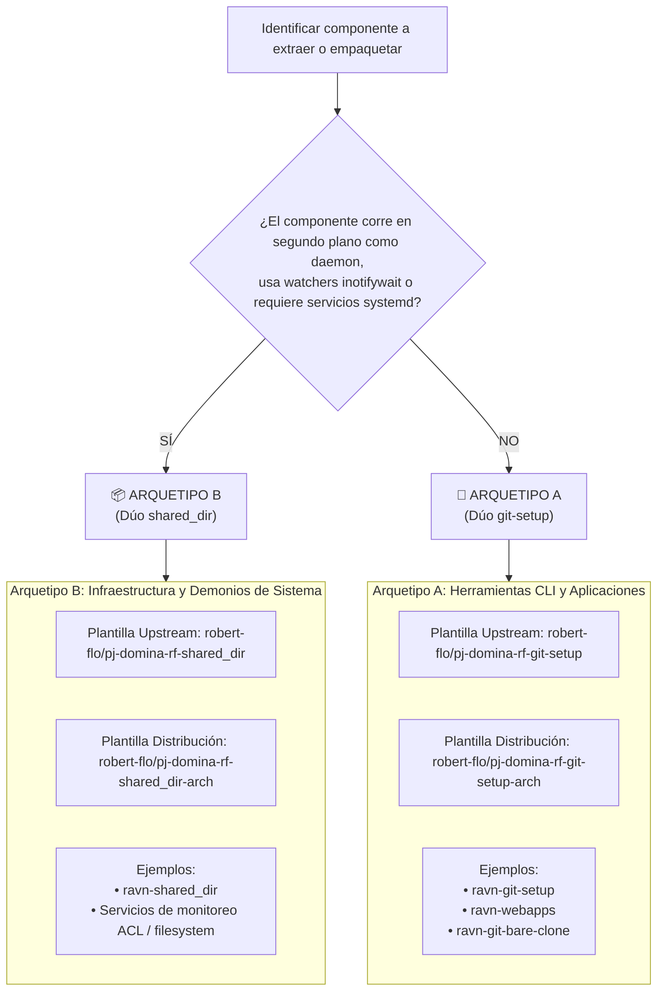

# 📦 Estándar de Dúo Repositorios y Árbol de Decisión (`git-setup` vs. `shared_dir`)

> [!NOTE]
> **Navegación de Capa:**
> * Anterior: [[07.5 - Catalogo y Manual de Herramientas CLI del Playbook]]
> * Subir al Hub: [[07.0 - Referencias del Sistema (MOC)|📑 Hub de Capa 07]]
> * Índice Maestro: [[00.0 - Mapa General del Sistema (MOC)|🏠 Inicio (MOC)]]
> * Registro Formal: [[docs/adr/0002-arbol-de-decision-y-estandar-duo-repositorios|ADR 0002 — Árbol de Decisión y Estándar de Dúo de Repositorios]]

Este documento es la **guía canónica de referencia para agentes y desarrolladores** para resolver la extracción de herramientas, utilidades de terminal, webapps, configuraciones globales y demonios fuera de los forks de dotfiles (`fo-omarchy`, `niri-dotfiles`) hacia paquetes Pacman distribuidos por `omarchy-personal-repo`.

---

## 🎯 Principio Fundamental: Una Sola Puerta a `/`

Siguiendo el [[docs/adr/0001-una-sola-puerta-y-meta-workspace|ADR 0001]], ningún archivo de ejecución en `/usr/` debe colocarse manualmente o mediante scripts huérfanos. Todo software global entra exclusivamente como **paquete Pacman compilado y firmado**.

Para cumplir este principio sin contaminar los repositorios de código fuente con metadatos específicos de Arch Linux, se adopta la arquitectura de **Dúo de Repositorios**:
1. **Repositorio Upstream (`robert-flo/ravn-<nombre>`):** Contiene el código fuente agnóstico, assets y un `Makefile` con soporte `DESTDIR`.
2. **Repositorio de Distribución Arch (`robert-flo/ravn-<nombre>-arch`):** Contiene el `PKGBUILD`, `.SRCINFO` y workflows de GitHub Actions para packaging continuo.

---

## 🌳 Árbol de Decisión Canónico

Cuando se requiera empaquetar una nueva utilidad o extraer código de dotfiles, aplicá el siguiente criterio:



---

## ⚖️ Tabla Comparativa de Arquetipos

| Característica | Arquetipo A (`git-setup` style) | Arquetipo B (`shared_dir` style) |
| :--- | :--- | :--- |
| **Tipo de Software** | CLI binaries, scripts bash, webapps, entradas `.desktop`, paquetes de iconos. | Demonios, listeners de filesystem, servicios del kernel/ACLs. |
| **Tiempo de Vida** | Efímero (se ejecuta, cumple su función y termina). | Persistente (ejecución continua bajo `systemd`). |
| **Unidades Systemd** | Ninguna. | Obligatorias (`.service`, `.timer`, `.path`) en `/usr/lib/systemd/system/`. |
| **Lógica de Instalación** | `Makefile` estándar (`install -Dm755`, `install -Dm644`). | `Makefile` + scripts auxiliares de daemon y recarga de systemd. |
| **Plantilla Madre Upstream** | `robert-flo/pj-domina-rf-git-setup` | `robert-flo/pj-domina-rf-shared_dir` |
| **Plantilla Madre Arch** | `robert-flo/pj-domina-rf-git-setup-arch` | `robert-flo/pj-domina-rf-shared_dir-arch` |

---

## 🛠️ Procedimiento de Extracción Paso a Paso

### 1. Extracción del Código Fuente (Repo Upstream)
1. Crear el repositorio en GitHub: `robert-flo/ravn-<herramienta>`.
2. Estructurar el directorio:
   - `bin/`: Binarios y scripts ejecutables.
   - `applications/`: Archivos `.desktop` (si aplica).
   - `icons/`: Iconos vectoriales o rasterizados (si aplica).
   - `Makefile`: Con soporte explícito de `$(DESTDIR)`:
     ```makefile
     install:
     	install -d $(DESTDIR)/usr/bin $(DESTDIR)/usr/share/applications $(DESTDIR)/usr/share/icons
     	install -m 755 bin/* $(DESTDIR)/usr/bin/
     	install -m 644 applications/* $(DESTDIR)/usr/share/applications/
     	cp -dr --no-preserve=ownership icons/* $(DESTDIR)/usr/share/icons/
     ```
3. Publicar release semántico en GitHub (tag `v1.0.0`).

### 2. Creación del Repositorio de Distribución Arch
1. Crear el repositorio en GitHub: `robert-flo/ravn-<herramienta>-arch`.
2. Crear `PKGBUILD`:
   ```bash
   pkgname=ravn-<herramienta>
   pkgver=1.0.0
   pkgrel=1
   pkgdesc="Descripción de la herramienta"
   arch=('any')
   url="https://github.com/robert-flo/$pkgname"
   license=('MIT')
   source=("$pkgname-$pkgver.tar.gz::$url/archive/refs/tags/v$pkgver.tar.gz")
   sha256sums=('...')

   package() {
     cd "$srcdir/$pkgname-$pkgver"
     make DESTDIR="$pkgdir" install
   }
   ```
3. Generar `.SRCINFO`:
   ```bash
   makepkg --printsrcinfo > .SRCINFO
   ```
4. Configurar el workflow de CI para publicar el paquete en `omarchy-personal-repo`.

### 3. Saneamiento de Dotfiles y Eliminación de Deuda Técnica
1. Remover los archivos del fork original (`fo-omarchy` o `niri-dotfiles`).
2. Comprobar que `git rebase` contra el upstream oficial funcione con **0 conflictos**.
3. Instalar globalmente el paquete con `sudo pacman -Syu ravn-<herramienta>`.
4. Verificar que esté disponible para todos los perfiles (`omarchy`, `niri`, `nyxuri`).

---

## 🧭 Casos Prácticos Documentados

### Caso 1: Webapps Globales (`ravn-webapps`)
- **Problema previo:** 60+ lanzadores `.desktop` e iconos residían en `fo-omarchy/applications/`, generando conflictos en cada rebase con `quattro` y estando limitados al usuario `omarchy`.
- **Resolución:**
  - Arquetipo: **A** (`git-setup`).
  - Repos: `robert-flo/ravn-webapps` + `robert-flo/ravn-webapps-arch`.
  - Destino: `/usr/share/applications/` y `/usr/share/icons/hicolor/`.
  - Resultado: Disponibilidad global en todos los escritorios sin ruido en el fork.

### Caso 2: Monitor de Permisos Compartidos (`ravn-shared_dir`)
- **Problema previo:** Scripts en `/usr/local/bin` y servicios de systemd en `/etc/systemd/system` colocados a mano.
- **Resolución:**
  - Arquetipo: **B** (`shared_dir`).
  - Repos: `robert-flo/ravn-shared_dir` + `robert-flo/ravn-shared_dir-arch`.
  - Destino: `/usr/bin/` y `/usr/lib/systemd/system/`.
