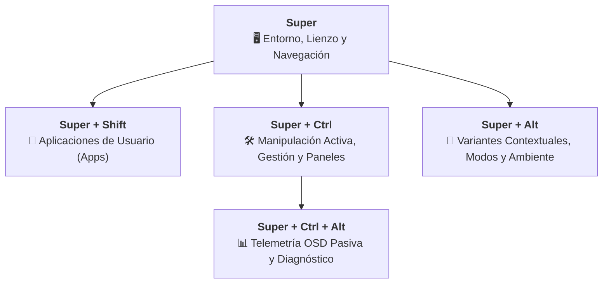

# 🪟 Propuesta de Reorganización Lógica de Atajos: Taxonomía de 5 Familias

> [!NOTE] Propósito del Documento
> Este documento formula una **propuesta arquitectónica integral** para reorganizar los atajos de teclado de la estación de trabajo (Niri + Clavis Shell).
> **Objetivo:** Transformar un esquema que creció orgánicamente en una estructura taxonómica predecible, elegante y con memoria muscular intuitiva, garantizando **cero colisiones con Niri upstream** y operando exclusivamente a nivel de nuestros dotfiles (`/z/rf-dotfiles`).
>
> *Documento puramente consultivo y de análisis. No aplica cambios inmediatos en el sistema.*

---

## 🔍 1. Diagnóstico del Esquema Actual: ¿Por qué se siente poco coherente?

Al analizar la configuración activa actual (`07.1` y `binds.kdl`), surgen varias inconsistencias cognitivas:

1. **Sobrecarga y mezcla en `Super + <Tecla>`:**
   - Conviven atajos de control de ventanas (`Q`, `F`, `C`, `V`), navegación (`H, J, K, L`), paneles de sistema (`Space`, `N`, `A`, `/`, `BackSpace`) y lanzadores de aplicaciones pesadas (`Return`, `T`, `E`, `D`).
   - *Efecto:* Pulsar `Super + N` abre un panel de widgets, pero `Super + E` abre un programa GUI (Nautilus), y `Super + C` no es Chrome ni Calculadora, sino centrar columna.
2. **Invasión del plano de aplicaciones (`Super + Shift`):**
   - Se diseñó para lanzar aplicaciones mnemotécnicas (`Shift + B` = Browser, `Shift + N` = Neovim, `Shift + O` = Obsidian).
   - Sin embargo, convive con paneles internos de Clavis: `Super + Shift + W` (Keystone Hub) y `Super + Shift + T` (Keystone Tools). Además, `Super + Shift + 1..9` se asignó a slots de wallpapers, rompiendo la convención universal de window managers donde los números con Shift o Ctrl manipulan workspaces.
3. **Dispersión en `Super + Ctrl` y `Super + Alt`:**
   - Niri upstream usa `Ctrl` para *mover* (`Ctrl + H/J/K/L` mueve ventanas; `Ctrl + 1..9` mueve columnas a workspaces).
   - Al mismo tiempo, en nuestros dotfiles se mezclan utilidades dispares (`Ctrl + E` = Emojis, `Ctrl + W` = Wallpaper aleatorio, `Ctrl + ,` = Ajustes).
   - `Alt` se usa de forma irregular: `Super + Alt + V` (Portapapeles), `Super + Alt + W` (Selector de wallpapers), `Super + Alt + N` (Modo noche), `Super + Alt + E` (Traductor rápido, compitiendo con la `E` de Explorer y Emoji).
4. **Anomalías asimétricas:**
   - El bloqueo de pantalla usa `Alt + Shift + L`, rompiendo la regla de que la tecla maestra de la estación de trabajo es siempre `Super`.

---

## 🏛️ 2. El Modelo Taxonómico Propuesto: 5 Familias Modificadoras

Para lograr que el teclado sea un instrumento 100% predecible, cada familia de modificadores asume un **único propósito conceptual**:

### Regla Mnemotécnica de Oro
* **¿Afecta al escritorio, al foco o al lienzo?** ➔ Usa **`Super`**.
* **¿Abre una aplicación de usuario?** ➔ Usa **`Super + Shift + <Inicial>`**.
* **¿Mueve cosas, gestiona el sistema o abre paneles de control?** ➔ Usa **`Super + Ctrl`**.
* **¿Cambia el ambiente visual, estética o activa un modo alterno?** ➔ Usa **`Super + Alt`**.
* **¿Es una consulta rápida OSD sin robar foco?** ➔ Usa **`Super + Ctrl + Alt`**.

---

## 📊 3. Desglose Detallado por Familias

### 🟢 Familia 1: `Super + <Tecla>` (Lienzo, Navegación y Foco)
*Mantiene el 100% de upstream Niri intacto. Cero apps dispersas.*

| Atajo | Acción | Estado / Cambio Propuesto | Lógica Arquitectónica |
| :--- | :--- | :--- | :--- |
| **`Super + Return`** | **Terminal Principal (Kitty)** | Mantiene | Entrada universal a la CLI. |
| **`Super + Space`** | **Spotlight Universal** | Mantiene | Buscador y lanzador global del sistema. |
| **`Super + O`** *(o `Tab`)* | **Overview** | Mantiene | Vista general de pájaro de todos los espacios. |
| **`Super + Q`** | **Cerrar Ventana** | Mantiene | Cierre de ventana activa (`close-window`). |
| **`Super + H / J / K / L`** | **Foco Direccional (Vim)** | Mantiene (Upstream) | Movimiento puro de cursor. |
| **`Super + Flechas`** | **Foco Direccional** | Mantiene (Upstream) | Alternativa ergonómica. |
| **`Super + 1 ... 9`** | **Ir a Workspace 1 al 9** | Mantiene (Upstream) | Navegación directa entre escritorios. |
| **`Super + F`** | **Maximizar Columna** | Mantiene (Upstream) | Expandir columna respetando gaps. |
| **`Super + M`** | **Maximizar a Bordes** | Mantiene (Upstream) | Maximizado completo a marcos de pantalla. |
| **`Super + C`** | **Centrar Columna** | Mantiene (Upstream) | Centrado de la columna activa. |
| **`Super + V`** | **Alternar Flotante / Tiled** | Mantiene (Upstream) | Conmutar capa de la ventana activa. |
| **`Super + G`** *(o `W`)* | **Alternar Modo Pestañas** | Mantiene (Upstream) | Columnas tabuladas. |
| **`Super + ,` / `.`** | **Consumir / Expulsar Ventana** | Mantiene (Upstream) | Integración lateral en columnas. |
| **`Super + -` / `=`** | **Ajustar Ancho de Columna** | Mantiene (Upstream) | Paso fino de dimensión horizontal. |
| **`Super + BackSpace`** | **Menú de Energía** | Mantiene | Salida segura del sistema (difícil de pulsar por error). |
| **`Super + /`** | **Mapa de Atajos Gráfico** | Mantiene | Guía visual integrada de Clavis. |
| **`Super + Esc`** | **Inhibidor de Atajos** | Mantiene (Upstream) | Pasarela para KVM y máquinas virtuales. |
| *`Super + T`* | *Alacritty* | 🔄 **Se traslada a `Shift + T`** | Libera `Super+T` para mantener `Super` limpio de apps. |
| *`Super + E`* | *Nautilus* | 🔄 **Se traslada a `Shift + E`** | Libera `Super+E` para unificar lanzadores en Shift. |
| *`Super + D`* | *Orbit Launcher* | 🔄 **Se traslada a `Shift + D`** | Mantiene simetría de aplicaciones directas. |

---

### 🟣 Familia 2: `Super + Shift + <Letra>` (Lanzadores Directos de Aplicaciones)
*Toda invocación de un programa concreto reside aquí bajo su inicial mnemotécnica.*

| Atajo | Aplicación | Mnemotecnia | Estado / Beneficio |
| :--- | :--- | :--- | :--- |
| **`Super + Shift + Return`** | **Scratchpad Terminal (Kitty 75%)** | Terminal flotante | Mantiene. Sesión persistente con Herdr. |
| **`Super + Shift + B`** | **Navegador Web (Zen / Chrome)** | **B**rowser | Mantiene. Estándar Omarchy. |
| **`Super + Shift + N`** | **Editor Neovim** | **N**eovim | Mantiene. Abre Neovim en Kitty. |
| **`Super + Shift + O`** | **Base de Conocimiento (Obsidian)** | **O**bsidian | Mantiene. Abre la bóveda principal. |
| **`Super + Shift + E`** | **Explorador de Archivos (Nautilus)** | **E**xplorer / Archivos | 🌟 **Nuevo en esta familia.** Sustituye `Super + E`. |
| **`Super + Shift + T`** | **Terminal Secundaria (Alacritty)** | **T**erminal ligera | 🌟 **Nuevo en esta familia.** Sustituye `Super + T`. |
| **`Super + Shift + D`** | **Lanzador Radial Orbit M3** | **D**esktop Orbit | 🌟 **Nuevo en esta familia.** Sustituye `Super + D`. |
| **`Super + Shift + Space`** | **Búsqueda Web en Spotlight** | Web Search | Mantiene. Modo directo en buscador. |
| **`Super + Shift + S`** | **Captura de Área Interactiva** | **S**creenshot | Mantiene. Estándar cross-platform. |
| **`Super + Shift + F`** | **Pantalla Completa (Fullscreen)** | **F**ullscreen total | Mantiene (Upstream Niri). |
| **`Super + Shift + H/J/K/L`** | **Foco a Monitor Adyacente** | Monitor Focus | Mantiene (Upstream Niri). |

> [!TIP] Despeje de Colisiones en esta familia
> - Se retiran de aquí **Keystone Hub** (`Shift + W`) y **Keystone Tools** (`Shift + T`), reubicándolos en la familia de Control (`Super + Ctrl`), ya que son paneles del entorno y no aplicaciones de usuario.
> - Se retiran los slots de wallpapers favoritos (`Shift + 1..9`), liberando los números para la gestión coherente de monitores o workspaces.

---

### 🔵 Familia 3: `Super + Ctrl + <Letra>` (Control Activo, Paneles Clavis y Movimiento)
*`Ctrl` representa el control administrativo y la manipulación de elementos existentes.*

| Atajo | Acción | Lógica / Mnemotecnia | Estado / Beneficio |
| :--- | :--- | :--- | :--- |
| **`Super + Ctrl + H / J / K / L`** | **Mover Columna / Ventana** | Mover en lienzo | Mantiene (Upstream Niri). |
| **`Super + Ctrl + 1 ... 9`** | **Mover Columna a Workspace 1..9** | Mover entre espacios | Mantiene (Upstream Niri). |
| **`Super + Ctrl + Inicio / Fin`** | **Mover al Principio / Fin** | Extremos del lienzo | Mantiene (Upstream Niri). |
| **`Super + Ctrl + Return`** | **Terminal Tiling con Herdr** | Sesión de trabajo | Mantiene. Terminal en mosaico persistente. |
| **`Super + Ctrl + ,`** | **Centro de Control Clavis** | Preferencias / Ajustes | Mantiene. Coma (`,`) es el estándar universal de Preferences. |
| **`Super + Ctrl + K`** | **Keystone: Central Hub** | **K**eystone Hub | 🌟 **Nuevo.** Reemplaza el caótico `Super + Shift + W`. |
| **`Super + Ctrl + T`** | **Keystone: Tools y Monitoreo** | **T**ools de Keystone | 🌟 **Nuevo.** Reemplaza `Super + Shift + T` evitando choque con apps. |
| **`Super + Ctrl + N`** | **Panel Dashboard / Notificaciones** | **N**otificaciones | 🌟 **Unificado.** Panel lateral izquierdo de Clavis. |
| **`Super + Ctrl + A`** | **Panel Quicksettings / Acciones** | **A**cciones rápidas | 🌟 **Unificado.** Panel lateral derecho de Clavis. |
| **`Super + Ctrl + E`** | **Selector Rápido de Emojis** | **E**mojis Fuzzel | Mantiene. Utilidad de inserción de texto. |
| **`Super + Ctrl + Print`** | **Extracción de Texto OCR** | Captura OCR Tesseract | Mantiene. Copia inmediata al portapapeles. |
| **`Super + Ctrl + L`** | **Bloquear Pantalla (Clavis Lock)** | **L**ockscreen | 🌟 **Nuevo.** Reemplaza el asimétrico `Alt + Shift + L`. |
| **`Super + Ctrl + Q`** | **Cerrar Sesión (Logout)** | **Q**uit Session | 🌟 **Nuevo.** Reemplaza `Super + Shift + E` evitando choque con Explorer. |

---

### 🟡 Familia 4: `Super + Alt + <Letra>` (Variantes Contextuales, Modos y Ambiente)
*`Alt` = "Modo Alterno" o estética. Agrupa todo lo relativo a fondos de pantalla, modo noche y variantes de apps.*

| Atajo | Acción | Detalle | Beneficio |
| :--- | :--- | :--- | :--- |
| **`Super + Alt + W`** | **Selector Visual de Wallpapers** | Selector en Spotlight | Mantiene. W = Wallpaper. |
| **`Super + Alt + 1 ... 9`** | **Slots Favoritos de Wallpapers** | Asignación directa 1..9 | 🌟 **Nuevo.** Reubica los slots favoritos a la familia visual de `W` (`Alt`). |
| **`Super + Alt + Shift + W`** | **Fondo de Pantalla Aleatorio** | Cambio instantáneo | 🌟 **Nuevo.** Agrupa todo lo referente a fondos bajo `W`. |
| **`Super + Alt + V`** | **Historial de Portapapeles** | Modo clipboard Spotlight | Mantiene. Variante de Pegar (`V`). |
| **`Super + Alt + N`** | **Modo Cuidado Ocular (Eye Care)** | Filtro cálido 4000 K | Mantiene. N = Night mode. |
| **`Super + Alt + T`** | **Traductor Interactivo ES↔EN** | Ventana de traducción | 🌟 **Nuevo.** Cambia de `Alt + E` a `T` (Translate) para evitar confusión con Explorer/Emoji. |
| **`Super + Alt + B`** | **Navegador en Modo Privado** | Ventana incógnito | 🌟 **Nuevo.** Variante privada del Browser (`Shift + B`). |
| **`Super + Alt + R`** | **Recarga en Caliente de Niri** | Reload de configuración | Mantiene. R = Reload. |

---

### 🔴 Familia 5: `Super + Ctrl + Alt + <Letra>` (Telemetría OSD Pasiva)
*Combinación de 3 modificadores: información contextual flotante sin robo de foco.*

| Atajo | Acción | Salida | Estado |
| :--- | :--- | :--- | :--- |
| **`Super + Ctrl + Alt + T`** | **Aviso OSD de Fecha y Hora** | Notificación emergente formateada | Mantiene. |
| *`Super + Ctrl + Alt + B`* | *Telemetría de Batería y Energía* | Notificación de estado de energía | *Propuesto para futuro módulo OSD.* |
| *`Super + Ctrl + Alt + S`* | *Telemetría de Recursos (CPU / RAM)* | Notificación de uso de recursos | *Propuesto para futuro módulo OSD.* |

---

## 🛡️ 4. Análisis de Cero Choques con Upstream Niri

| Función Upstream de Niri | Atajo Upstream | ¿Se respeta en la propuesta? | Comentario |
| :--- | :--- | :---: | :--- |
| Foco de columnas y ventanas | `Mod + H/J/K/L` / Flechas | ✅ **100% Intacto** | No se altera ninguna navegación por defecto. |
| Mover columnas y ventanas | `Mod + Ctrl + H/J/K/L` | ✅ **100% Intacto** | Coincide con la familia de manipulación. |
| Foco y movimiento a monitores | `Mod + Shift` / `Mod + Shift + Ctrl` | ✅ **100% Intacto** | Estándar multimonitor conservado. |
| Maximizar columna / bordes | `Mod + F` / `Mod + M` | ✅ **100% Intacto** | Comportamiento canónico de Niri. |
| Fullscreen total | `Mod + Shift + F` | ✅ **100% Intacto** | Estándar de Niri. |
| Dimensiones de ventana | `Mod + -` / `Mod + =` | ✅ **100% Intacto** | Ajuste proporcional preservado. |
| Espacios de trabajo (Workspaces) | `Mod + 1..9` / `Mod + Ctrl + 1..9` | ✅ **100% Intacto** | La liberación de `Shift + 1..9` refuerza la consistencia. |
| Inhibidor de atajos | `Mod + Escape` | ✅ **100% Intacto** | Imprescindible para VMs y remote desktop. |

---

## 📋 5. Hoja de Ruta para una Futura Implementación (Cuando se decida aplicar)

Si en el futuro se aprueba formalmente esta propuesta, el plan de ejecución se desglosaría en:

1. **Fase 1: Ajuste de Dotfiles (`/z/rf-dotfiles`)**
   - Actualizar `dot_config/niri/clavis/binds.kdl` con los nuevos bindings de Quickshell (Keystone a `Ctrl+K/T`, Lockscreen a `Ctrl+L`, etc.).
   - Actualizar `dot_config/niri/config.kdl` con las nuevas familias (`Shift+E` Nautilus, `Shift+T` Alacritty, `Alt+1..9` wallpapers, `Alt+T` translate).
2. **Fase 2: Gobernanza y Chezmoi**
   - Push mediante PR a `robert-flo/rf-dotfiles`.
   - `chezmoi apply` en los perfiles `niri` y `niri-classic`.
3. **Fase 3: Actualización Canónica del Vault Workstation**
   - Sincronizar automáticamente la nota canónica `07.1` en `PJ-NIRI-rf-omarchy-workstation` para cumplir el **Principio Innegociable #6**.
