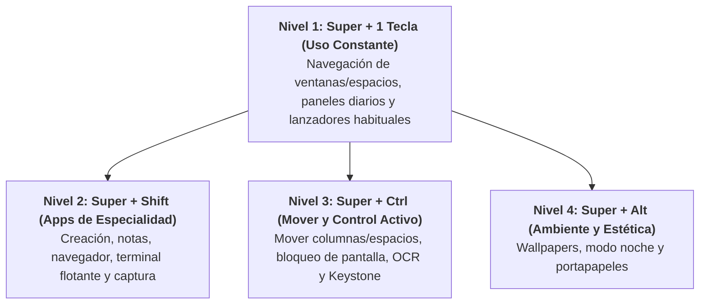

# 🪟 Propuesta de Atajos: Ergonomía Pragmática, 2 Teclas y Cero Malabarismos

> [!NOTE] Filosofía de Diseño
> **Regla de oro del usuario:** *La navegación es lo más importante. Pocas teclas es lo mejor (máximo 2 teclas para lo frecuente). Los paneles y lanzadores de uso diario (`Super + A`, `Super + N`, `Super + E`) deben estar a un toque directo. Cero malabarismos de 4 teclas.*
>
> Esta propuesta ajusta la arquitectura eliminando rigideces teóricas y optimizando la **economía de dedos y memoria muscular**.

---

## 🧭 1. Los Tres Principios Innegociables de Ergonomía

1. **Economía de 2 Teclas para el 80% del tiempo (`Super + Tecla`):**
   - La navegación de ventanas y escritorios debe ser instantánea (`Super + Flechas`, `Super + 1..9`).
   - Las herramientas de consulta constante no se esconden: **`Super + N`** (Notificaciones / Dashboard) y **`Super + A`** (Acciones Rápidas / Quicksettings) se quedan a 2 teclas porque se abren decenas de veces al día.
   - Los lanzadores más usados van a un solo toque: Terminal (`Super + Return`), Explorador (`Super + E`), Buscador (`Super + Space`), Menú Radial (`Super + D`).
2. **Cero Malabarismos de 4 Teclas:**
   - Se destierra cualquier combinación del tipo `Super + Ctrl + Alt + Tecla`. Si una función requiere 4 teclas simultáneas, es un fallo de diseño ergonómico.
3. **Cero Conflictos con Niri Upstream:**
   - La manipulación del scroll infinito de Niri se mantiene 100% natural sin reescribir la base del gestor de ventanas.

---

## 📊 2. Matriz de Atajos Reorganizada por Uso Real

### 🟢 Nivel 1: `Super + <Tecla>` (Navegación + Lanzadores Diarios de 2 Teclas)
*Lo que usas todo el día con una sola mano o navegación inmediata.*

| Atajo | Acción | Justificación Ergonómica |
| :--- | :--- | :--- |
| **`Super + Flechas`** / **`H J K L`** | **Mover Foco entre Ventanas/Columnas** | Navegación direccional pura e instantánea. |
| **`Super + 1 ... 9`** | **Ir a Workspace 1 al 9** | Cambio de escritorio a 2 teclas sin modificadores extra. |
| **`Super + Return`** | **Terminal Principal (Kitty)** | Entrada rápida a línea de comandos. |
| **`Super + Space`** | **Spotlight Universal** | Búsqueda global de aplicaciones y archivos. |
| **`Super + N`** | **Dashboard & Notificaciones** | 🌟 **Acceso directo.** Calendario, clima y avisos a 1 toque. |
| **`Super + A`** | **Acciones Rápidas (Quicksettings)** | 🌟 **Acceso directo.** Red, bluetooth, audio y brillo a 1 toque. |
| **`Super + E`** | **Explorador de Archivos (Nautilus)** | 🌟 **Acceso directo.** Apertura inmediata de carpetas. |
| **`Super + D`** | **Menú Radial Orbit (M3)** | Lanzador visual rápido de utilidades. |
| **`Super + Q`** | **Cerrar Ventana** | Cierre rápido de aplicación enfocada. |
| **`Super + O`** *(o `Tab`)* | **Overview** | Vista panorámica de todos los espacios de trabajo. |
| **`Super + F`** | **Maximizar Columna** | Expande la columna actual en pantalla. |
| **`Super + C`** | **Centrar Columna** | Centra la columna enfocada en el monitor. |
| **`Super + V`** | **Alternar Flotante** | Pasa la ventana de mosaico a capa flotante. |
| **`Super + G`** *(o `W`)* | **Alternar Pestañas (Tabbed)** | Agrupa ventanas en columnas con pestañas. |
| **`Super + ,` / `.`** | **Consumir / Expulsar Ventana** | Añadir o extraer ventana de una columna. |
| **`Super + -` / `=`** | **Ajustar Ancho de Columna (±10%)** | Ajuste fino del tamaño horizontal. |
| **`Super + BackSpace`** | **Menú de Energía** | Apagar / reiniciar sin riesgo de pulsación accidental. |
| **`Super + /`** | **Mapa de Atajos Gráfico** | Referencia visual en pantalla de Clavis. |

---

### 🟣 Nivel 2: `Super + Shift + <Tecla>` (Apps de Especialidad y Creación)
*`Shift` funciona como el pedal de aceleración para abrir entornos de trabajo específicos.*

| Atajo | Acción / Herramienta | Mnemotecnia / Propósito |
| :--- | :--- | :--- |
| **`Super + Shift + Return`** | **Terminal Scratchpad (Kitty 75%)** | Terminal flotante desplegable tipo Quake vinculada a Herdr. |
| **`Super + Shift + B`** | **Navegador Web (Zen / Chrome)** | **B**rowser de internet. |
| **`Super + Shift + N`** | **Editor Neovim** | **N**eovim en ventana Kitty dedicada. |
| **`Super + Shift + O`** | **Base de Conocimiento (Obsidian)** | **O**bsidian / Bóveda de notas de trabajo. |
| **`Super + Shift + S`** | **Captura de Pantalla Interactiva** | **S**creenshot seleccionando área con el cursor. |
| **`Super + Shift + F`** | **Pantalla Completa (Fullscreen)** | **F**ullscreen total sin marcos ni barras (Niri upstream). |
| **`Super + Shift + Space`** | **Búsqueda Web en Spotlight** | Modo web directo en el buscador. |
| **`Super + Shift + Flechas / HJKL`**| **Foco a Monitor Adyacente** | Navegación multimonitor izquierda / derecha / arriba / abajo. |

---

### 🔵 Nivel 3: `Super + Ctrl + <Tecla>` (Manipulación de Ventanas y Control Activo)
*`Ctrl` es la tecla de control: para mover cosas físicamente o ejecutar acciones del sistema.*

| Atajo | Acción | Ergonomía / Beneficio |
| :--- | :--- | :--- |
| **`Super + Ctrl + Flechas` / `HJKL`** | **Mover Columna / Ventana en el Lienzo** | Reorganizar columnas en el scroll de Niri (Upstream). |
| **`Super + Ctrl + 1 ... 9`** | **Mover Ventana/Columna a Workspace 1..9** | Traslado directo al escritorio destino (Upstream). |
| **`Super + Ctrl + Return`** | **Terminal Tiling con Herdr** | Lanza Kitty vinculado a sesión persistente de trabajo. |
| **`Super + Ctrl + Print`** | **Extracción de Texto OCR (Tesseract)** | Seleccionar área y copiar texto al portapapeles. |
| **`Super + Ctrl + L`** | **Bloquear Pantalla (Clavis Lockscreen)** | 🌟 **Simple y simétrico.** Elimina el incómodo `Alt + Shift + L`. |
| **`Super + Ctrl + ,`** | **Centro de Control Clavis** | Ajustes profundos del sistema (Preferences `,`). |
| **`Super + Ctrl + K`** | **Keystone: Central Hub** | Hub central de información (**K**eystone). |
| **`Super + Ctrl + T`** | **Keystone: Panel de Herramientas** | Herramientas de monitoreo de Keystone. |
| **`Super + Ctrl + E`** | **Selector Rápido de Emojis** | Menú Fuzzel con catálogo de emojis al portapapeles. |
| **`Super + Ctrl + Q`** | **Cerrar Sesión Niri (Logout)** | Diálogo seguro para salir del entorno gráfico. |

---

### 🟡 Nivel 4: `Super + Alt + <Tecla>` (Ambiente, Estética y Cosmética)
*`Alt` = Aspecto y modos alternos. Concentra todo lo visual y comodidades.*

| Atajo | Acción | Lógica |
| :--- | :--- | :--- |
| **`Super + Alt + W`** | **Selector Visual de Wallpapers** | Abre el catálogo visual en Spotlight. |
| **`Super + Alt + 1 ... 9`** | **Slots Favoritos de Fondo de Pantalla** | Cambia al wallpaper favorito 1 al 9 (agrupado lógicamente con `W`). |
| **`Super + Alt + Shift + W`** | **Fondo de Pantalla Aleatorio Instantáneo** | Cambia inmediatamente de fondo. |
| **`Super + Alt + V`** | **Historial del Portapapeles** | Variante de Pegar (**V**) en Spotlight. |
| **`Super + Alt + N`** | **Modo Cuidado Ocular (Eye Care)** | Filtro nocturno cálido 4000 K (**N**ight). |
| **`Super + Alt + T`** | **Traductor Rápido de Selección** | Traduce entre Español e Inglés (**T**ranslate). |
| **`Super + Alt + Space`** *(o `Enter`)* | **Aviso OSD Flotante de Fecha y Hora** | 🌟 **Simplificado.** Notificación OSD sin malabarismos de 4 teclas. |
| **`Super + Alt + R`** | **Recarga en Caliente de Niri** | Aplica cambios de `config.kdl` al vuelo (**R**eload). |

---

## 💡 Resumen de Mejoras Frente al Esquema Anterior

1. **`Super + A` y `Super + N` quedan preservados en 2 teclas:** Al ser herramientas de consulta constante, pulsar `Super + A` para controles rápidos o `Super + N` para el dashboard sigue siendo inmediato.
2. **`Super + E` para Nautilus se mantiene:** No hace falta meter `Shift` para abrir tus carpetas personales.
3. **Cero malabarismos:** El atajo `Super + Ctrl + Alt + T` de fecha y hora se reemplaza por una opción simple de 3 teclas (`Super + Alt + Espacio` o `Super + Alt + T`), eliminando la fatiga en las manos.
4. **Cero colisiones con Niri:** El core de navegación, foco y redimensionado de Niri upstream sigue 100% puro y funcional.
5. **Bloqueo de pantalla intuitivo:** `Super + Ctrl + L` sustituye a `Alt + Shift + L`, integrándose con la tecla maestra `Super`.
