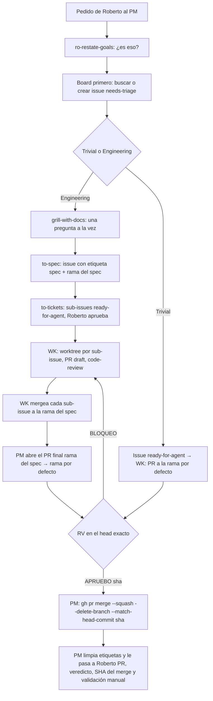
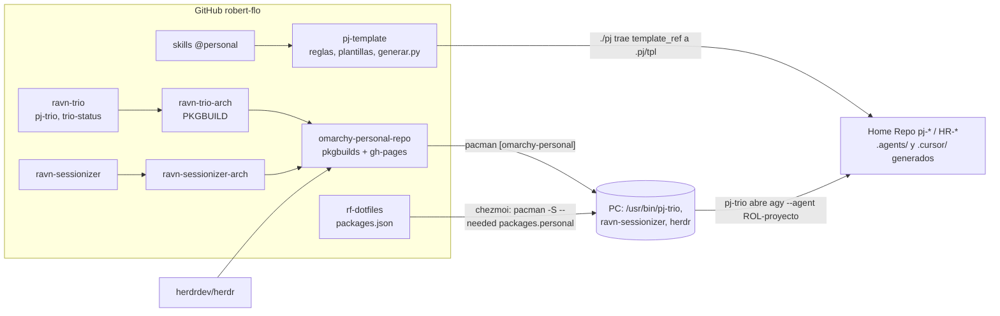

# 🧩 Cómo funciona el trío local (PM · WK · RV, `pj-trio`, herdr)

> [!NOTE]
> **Navegación de Capa:**
> * Anterior: [[08.3 - Topologia Canonica de Repositorios, Worktrees y GitHub Workflows|08.3 - Topología Canónica]] · Crear un Home Repo: nota 08.7 (en el PR [#165](https://github.com/robert-flo/PJ-NIRI-rf-omarchy-workstation/pull/165))
> * Subir al Hub: [[08.0 - AI Developer Workflows (MOC)|📑 Hub de Capa 08]]
> * Índice Maestro: [[00.0 - Mapa General del Sistema (MOC)|🏠 Inicio (MOC)]]
> * Relacionadas: [[03.3 - Terminal GPU (Ghostty) y Multiplexores (tmux, herdr)|03.3 herdr]], [[docs/adr/0003-chezmoi-unificacion-dotfiles-y-paquetes|ADR 0003 — Chezmoi SSoT]]

> [!IMPORTANT]
> **Esta nota explica, no manda.** Es un mapa para vos y tus agentes. Cada regla tiene **un solo dueño** (un archivo en otro repo) y acá solo se resume y se enlaza. Si esta nota y el dueño no coinciden, **manda el dueño** y esta nota se corrige por PR. Todo lo que dice se leyó el 2026-11-16 en los repos enlazados (pj-template en `515e282`, ravn-trio `main` en `bc3226e`, v0.1.7).

---

## 0. En 30 segundos

| Pieza | Qué es | Dueño (de dónde sale) |
|---|---|---|
| **Trío** | Tres agentes fijos por proyecto: `PM-<proyecto>`, `WK-<proyecto>`, `RV-<proyecto>` | [pj-template `GLOSSARY.md`](https://github.com/robert-flo/pj-template/blob/main/GLOSSARY.md), [ADR 0001](https://github.com/robert-flo/pj-template/blob/main/docs/adr/0001-trio-fijo-por-proyecto.md) |
| **Home Repo / meta-repo** (`pj-*`, `HR-*`) | El repo donde vive el trío: `proyecto.yml`, `AGENTS.md`, `./pj`, `.trio/` | hijo de [pj-template](https://github.com/robert-flo/pj-template/blob/main/docs/pj-template.md); ejemplo de referencia [pj-omarchy](https://github.com/robert-flo/pj-omarchy) |
| **Reglas y fichas** | `.agents/reglas/`, `.agents/agents/` (agy) y `.cursor/` (Cursor), generados por `./pj` | [pj-template](https://github.com/robert-flo/pj-template) (`scripts/generar.py`) |
| **herdr** | Gestor de workspaces de terminal para agentes de código | [herdrdev/herdr](https://github.com/herdrdev/herdr), paquete en [omarchy-personal-repo](https://github.com/robert-flo/omarchy-personal-repo/blob/main/pkgbuilds/herdr/PKGBUILD) |
| **`pj-trio`** | Abre el trío de **un ticket** en tres tabs de herdr | [robert-flo/ravn-trio](https://github.com/robert-flo/ravn-trio) (paquete [ravn-trio-arch](https://github.com/robert-flo/ravn-trio-arch)) |
| **`ravn-sessionizer`** (`rs`, `ri`) | Un `fzf` para saltar entre workspaces, repos, agentes e issues, y lanzar tríos | [robert-flo/ravn-sessionizer](https://github.com/robert-flo/ravn-sessionizer) (paquete [ravn-sessionizer-arch](https://github.com/robert-flo/ravn-sessionizer-arch)) |
| **Instalación** | `herdr`, `ravn-trio`, `ravn-sessionizer` están en `packages.personal` | [rf-dotfiles `.chezmoidata/packages.json`](https://github.com/robert-flo/rf-dotfiles/blob/master/.chezmoidata/packages.json) |

---

## 1. Los roles

Dueño: [`comun.md` §El trío](https://github.com/robert-flo/pj-template/blob/main/.agents/reglas/comun.md), [`pm.md`](https://github.com/robert-flo/pj-template/blob/main/.agents/reglas/pm.md), [`wk.md`](https://github.com/robert-flo/pj-template/blob/main/.agents/reglas/wk.md), [`rv.md`](https://github.com/robert-flo/pj-template/blob/main/.agents/reglas/rv.md).

| Rol | Hace | Nunca hace |
|---|---|---|
| **PM** | Es la **única puerta**: Roberto solo habla con el PM. Convierte pedidos en specs y tickets `ready-for-agent` (flujo de Matt Pocock), supervisa los repos de `repos:` en `proyecto.yml`, lanza al WK y al RV, y **mergea** tras el `APRUEBO`. | Escribir código de producción ni archivos del repo (todo cambio entra como issue que hace el WK). |
| **WK** | Toma issues `ready-for-agent`, programa en un worktree propio, abre el PR (draft → listo) con prueba real y `code-review` limpio. | Mergear a la rama por defecto, planear specs, `grill`/`to-spec`/`to-tickets`/`triage`. |
| **RV** | Revisa el PR **en un head exacto**: lo prueba en un worktree y comenta en el PR `APRUEBO <sha>` o `BLOQUEO` con archivo y línea. | Programar, commitear, mergear, cerrar PRs o cambiar etiquetas. |

- Skills por rol: [`plantillas/roles.yml`](https://github.com/robert-flo/pj-template/blob/main/plantillas/roles.yml) (+ `skills_extra` del hijo). Vienen de `robert-flo/skills@personal`.
- WK y RV se pueden abrir solos (`mainAgent: true`) si Roberto quiere; en ese caso le hablan a él y lo mandan de vuelta al PM.

### Quién mergea (Home Repos)

> [!IMPORTANT]
> **En los Home Repos mergea el PM**, solo después del comentario `APRUEBO <sha>` del RV, con squash y atado al head aprobado:
> `gh pr merge <N> --squash --delete-branch --match-head-commit <sha>`
> Si el head cambió después del `APRUEBO`, el PM no mergea y pide otra revisión. El WK y el RV nunca mergean a la rama por defecto.
> Dueño: [ADR 0014](https://github.com/robert-flo/pj-template/blob/main/docs/adr/0014-el-pm-mergea-tras-apruebo.md), [`comun.md` §Git](https://github.com/robert-flo/pj-template/blob/main/.agents/reglas/comun.md) y [`pm.md` paso 8](https://github.com/robert-flo/pj-template/blob/main/.agents/reglas/pm.md). Roberto confirmó el 2026-11-16 que esta regla del template manda en los Home Repos (ver §8, todavía hay archivos que dicen lo contrario).

---

## 2. Ciclo de vida de una tarea

Dueño: [`pm.md` §Tu flujo](https://github.com/robert-flo/pj-template/blob/main/.agents/reglas/pm.md), [`wk.md` §Tu flujo](https://github.com/robert-flo/pj-template/blob/main/.agents/reglas/wk.md), tablero en [`comun.md` §El tablero](https://github.com/robert-flo/pj-template/blob/main/.agents/reglas/comun.md), etiquetas en [`schema/etiquetas.tsv`](https://github.com/robert-flo/pj-template/blob/main/schema/etiquetas.tsv).

**El tablero es GitHub Issues** (no TickTick): el estado se lee en etiquetas y en el estado del issue/PR.

| Etiqueta | Significa |
|---|---|
| `needs-triage` | Idea sin revisar |
| `needs-info` | Falta información o trabado (`ON HOLD: <motivo>` en un comentario) |
| `spec` | Spec padre: agrupa tickets, **nunca** lleva `ready-for-agent` |
| `ready-for-agent` | Listo para el WK (cada criterio dice qué prueba lo cierra) |
| `ready-to-merge` | PR final aprobado por el RV |
| `wontfix` | Descartado |

Un issue cerrado queda **sin etiquetas de triage**. `scripts/etiquetas.sh` crea las etiquetas en cada repo en cada sync.

### Engineering (con spec)



Detalles que importan (todos de las reglas enlazadas):
- **Rama del spec** `<número>-<slug>`: la crea el PM desde la rama por defecto al publicar el spec; los PR del WK van a ella. Nunca hay commits directos ni a la rama por defecto ni a la del spec.
- **Worktree del WK** (regla de pj-template): `git worktree add ../.wt-<repo>-<número> -b <número>-<slug> <base>`; al terminar, `git worktree remove` y el clon principal queda limpio en la rama por defecto.
- **PR**: body con la skill `pr` (`## Summary`, `## Evidence`, `## Merge Danger`), `Closes #N`; las capturas van a `robert-flo/assets`, nunca commiteadas en el repo de código.
- **Git**: identidad `Roberto Flores <25asab015@ujmd.edu.sv>`, `git pull --rebase --autostash` antes de cada push, nunca `--force`, **ningún trailer ni firma de agente**.
- En agy el PM lanza al WK/RV con `invoke_subagent`; fuera de agy el encargo queda escrito en GitHub y el otro rol lo toma de ahí. GitHub es siempre el registro.

### Variante herdr (`pj-trio`, un ticket)

Cuando el trío corre en herdr, el PM recibe un **arranque** ([`trio-pm-prompt.md`](https://github.com/robert-flo/ravn-trio/blob/main/trio-pm-prompt.md)) que le da un flujo por ticket:
1. Lee el issue (`gh issue view <n> -R <dueño>/<miembro> --comments`) y escribe `.trio/<ticket>/plan.md`; commit + push del meta-repo.
2. Worktree **nuevo** por ticket: `<miembro>-wt-<ticket>-<fecha>` con rama `feat/<ticket>-<slug>` desde `origin/HEAD`.
3. Le manda el trabajo al WK con `herdr agent prompt`, espera con `herdr agent wait … --timeout 600000` y confirma con `herdr agent read` + `wk.md`.
4. Igual con el RV (`rv.md` + comentario `APRUEBO <sha>` / `BLOQUEO`). Con BLOQUEO vuelve al paso 3.
5. Cierre: `trio-status … hecho cierre`, commit + push del meta-repo y `worktree remove`.

> [!WARNING]
> Ese arranque (ravn-trio v0.1.7) todavía dice que el PM **no** mergea y deja `needs-roberto merge`. Choca con ADR 0014; ver §8.

---

## 3. Runtime: el trío en herdr

### `pj-trio`

Dueño: [ravn-trio `README.md`](https://github.com/robert-flo/ravn-trio/blob/main/README.md) y [`runtime/scripts/start`](https://github.com/robert-flo/ravn-trio/blob/main/runtime/scripts/start).

```bash
pj-trio [--dry-run] [--no-kickoff] [--print-kickoff] <proyecto> <ticket> [--repo <miembro>]
# ejemplo (pj-omarchy/.trio/README.md):
pj-trio pj-omarchy <ticket> --repo <dir del miembro en proyecto.yml>
```

Qué hace, en orden:
1. **Resuelve el proyecto** (ruta o nombre; busca en `$PJ_TRIO_ROOT`, el padre de `$PWD` o `/z-drive/tries`). Si el meta-repo no está, lo clona con try-clone (`PJ_TRIO_NO_CLONE=1` lo apaga). `--repo` acepta ruta, `dir`, `dueño/repo` o nombre corto único.
2. **Carga `trio.conf` por capas** (gana la última): `/usr/share/ravn/trio/trio.conf` (o `trio.conf.example`) → `/zt/ravn/trio/trio.conf` (máquina) → `<proyecto>/.trio/trio.conf`; `PJ_TRIO_CONFIG` reemplaza todo. Ahí viven `PM_KIND`/`WK_KIND`/`RV_KIND` (default `agy`; vacío = shell para arrancar a mano), la identidad git y la integración de herdr ([`trio.conf.example`](https://github.com/robert-flo/ravn-trio/blob/main/trio.conf.example)).
3. **Verifica** que `agy agents` tenga `PM-/WK-/RV-<proyecto>` (si falta alguno, para) y que la integración de herdr esté instalada (`herdr integration install antigravity-cli` si no).
4. **Workspace** `trio <proyecto>#<ticket>` (o `trio <proyecto>/<miembro>#<ticket>`) con **tres tabs a pantalla completa** `pm`, `wk`, `rv`; paneles `PM-<ticket>`, `WK-<ticket>`, `RV-<ticket>`.
5. **Agentes herdr** `pm|wk|rv-<miembro corto>-<ticket>` (≤32 caracteres, se quitan `pj-domina-`, `rf-`, `fo-`; hash si no cabe). Cada uno arranca con `agy --agent <ROL>-<proyecto>`. Con `--repo`, el código actual abre los agentes **en el clon del miembro** y suma el meta-repo con `--add-dir` ([`start` L123-125](https://github.com/robert-flo/ravn-trio/blob/main/runtime/scripts/start#L123-L125), [`trio_herdr.sh` L205-209](https://github.com/robert-flo/ravn-trio/blob/main/runtime/lib/trio_herdr.sh#L205-L209)).
6. **Arranque del PM**: renderiza el prompt en `.trio/<ticket>/kickoff.md` y se lo pasa a agy con `-i` (una línea que apunta al archivo, porque herdr 0.9.5 rechaza saltos de línea en argumentos).
7. **Identidad git** local (`TRIO_GIT_NAME`/`TRIO_GIT_EMAIL`) en meta-repo y miembro; el PM no la toca.
8. Imprime cómo adjuntarte: `herdr workspace focus <id> && herdr`.

**Idempotente:** con los mismos argumentos reutiliza workspace y tabs, no duplica agentes y avisa si el trío de ese ticket ya corre.

### Estado: `.trio/<ticket>/` y `trio-status`

- **Handoff único** en el meta-repo (nunca en el miembro), commiteado: `plan.md` (PM), `wk.md` (WK), `rv.md` (RV), `status.json` (PM) y `kickoff.md`. Nombran solo roles, nunca plataformas.
- **`trio-status`** (alias de `pj-trio status`) **escribe** `status.json` y opcionalmente avisa con `notify-send`; no es un visor. Para ver el estado leés el archivo:

```bash
trio-status [--dry-run] [--notify] [--cola-de <agente>] [--error <texto>] [--pr <url>] [--head <sha>] [--intentos N] <trio_dir> <estado> <paso>
cat <proyecto>/.trio/<ticket>/status.json
```

  Esquema: `ticket`, `estado` (`en-curso` | `hecho` | `needs-roberto`), `paso` (`plan` | `wk` | `rv` | `merge` | `cierre`), `error`, `intentos`, `timestamp`, `pr`, `head`, `cola`.
- **Pausa:** la única pausa que implementa `pj-trio` es la del diálogo de confianza de agy («Do you trust the contents of this project?»): avisa con `notify-send` y espera tu Enter. No hay comando de pausa/reanudar del trío; «reanudar» es volver a correr `pj-trio` con los mismos argumentos (idempotente).

### `ravn-sessionizer`

Dueño: [ravn-sessionizer `README.md`](https://github.com/robert-flo/ravn-sessionizer/blob/main/README.md). Plugin de herdr `ravn.sessionizer` (`herdr plugin link /usr/share/ravn/sessionizer`); los atajos se agregan a mano en `~/.config/herdr/config.toml`.

| Atajo / alias | Vista | Qué hace |
|---|---|---|
| `prefix+f` | **pick** | Workspaces abiertos + repos y `pj-*` por frecencia; `enter` abre o enfoca |
| `prefix+a` | **agents** | Agentes ordenados blocked › done › working › idle; `enter` enfoca el pane |
| `prefix+t` | **trio** | Issues abiertos de todos los miembros de todos los `pj-*` (`ready-for-agent` primero); `enter` lanza o enfoca el trío |
| `rs` | `ravn-sessionizer repos` | Proyecto `pj-*` → repo miembro; clona **solo ese** repo con try-clone si falta |
| `ri` | `ravn-sessionizer issues` | Proyecto → repo → issue; `enter` corre `pj-trio start <pj> <issue> --repo <miembro>` |

- Lee los proyectos y miembros de GitHub (`proyecto.yml` de cada `pj-*` del dueño, entradas `repo:`), sin clonar el `pj-*`; caché 1 h de proyectos y 5 min de issues.
- Si ya hay un workspace `trio <pj>[/<miembro>]#<n>`, lo enfoca en vez de lanzar otro.
- Config en `/etc/ravn/sessionizer.conf`; estado y caché en `~/.local/state/ravn-sessionizer` y `~/.cache/ravn-sessionizer`.

ravn-trio además trae su propio plugin de herdr `ravn.trio`: la acción **New trio** y un link handler para URLs de issues de GitHub (clic en la URL → trío de ese issue en el proyecto del panel) ([`herdr-plugin.toml`](https://github.com/robert-flo/ravn-trio/blob/main/herdr-plugin.toml)).

### Comandos del día a día

| Cuándo | Comando |
|---|---|
| Después de clonar o hacer pull de un Home Repo | `./pj listo` (pull, template, generar, hooks, `agy`, clonar, check; `--abrir` arranca el PM) |
| Ver si el Home Repo está sano | `./pj check` |
| Hablar con el PM (agy) | `agy --agent PM-<proyecto>` desde la raíz del meta-repo |
| Hablar con el PM (Cursor) | abrir el meta-repo: el PM es la regla `alwaysApply` `.cursor/rules/pm-<proyecto>.mdc` |
| Trío de un ticket en herdr | `ri` (o `prefix+t`), o `pj-trio <proyecto> <ticket> --repo <miembro>` |
| Probar sin tocar herdr | `pj-trio --dry-run …` · `pj-trio --print-kickoff …` |
| Saltar entre workspaces/agentes | `prefix+f` / `prefix+a` |
| Ver en qué va un ticket | `cat <proyecto>/.trio/<ticket>/status.json` |

---

## 4. De dónde sale cada pieza



- **pj-template genera los agentes.** El hijo versiona solo sus archivos (`proyecto.yml`, `AGENTS.md`, `README.md`, `.gitignore`, `./pj`, `.github/workflows/pj-template.yml`, más `extras:`). `./pj` baja pj-template al SHA de `template_ref` en `.pj/tpl` y genera, ignorados por git: `.agents/agents/{PM,WK,RV}-<proyecto>.md` (agy), `.agents/reglas/`, `.agents/skills/`, `.cursor/rules/pm-<proyecto>.mdc`, `.cursor/rules/no-cursor-coauthor.mdc` y `.cursor/agents/{wk,rv}-<proyecto>.md` (Cursor). `./pj agy` enlaza las fichas en `~/.gemini/config/agents` porque agy interactivo solo resuelve `--agent` con agentes globales. Dueño: [`docs/pj-template.md`](https://github.com/robert-flo/pj-template/blob/main/docs/pj-template.md).
- **El template se actualiza solo:** el workflow del hijo abre un PR `pj-template/sync-<run>` que sube `template_ref`; `vigilar-hijos.yml` mide la deriva a diario.
- **ravn-trio da `/usr/bin/pj-trio`** (symlink a `/usr/share/ravn/trio/pj-trio`), más `trio-status`, el prompt del PM, `trio.conf.example` y el plugin en `/usr/share/ravn/trio/`. Depende de `bash git jq libnotify github-cli herdr>=0.9.5` ([ravn-trio-arch](https://github.com/robert-flo/ravn-trio-arch/blob/main/README.md)).
- **`[omarchy-personal]` sirve los paquetes:** `omarchy-personal-repo` tiene los PKGBUILDs en `main` y publica el repo pacman firmado en `gh-pages` ([README](https://github.com/robert-flo/omarchy-personal-repo/blob/main/README.md)). Su `herdr` es 0.9.5 y gana al de `[omarchy]` porque `[omarchy-personal]` va antes en `pacman.conf` ([PKGBUILD](https://github.com/robert-flo/omarchy-personal-repo/blob/main/pkgbuilds/herdr/PKGBUILD)).
- **rf-dotfiles/chezmoi los instala:** `herdr`, `ravn-trio` y `ravn-sessionizer` están en `packages.personal` de [`packages.json`](https://github.com/robert-flo/rf-dotfiles/blob/master/.chezmoidata/packages.json); `run_onchange_before_01-install-packages.sh.tmpl` los instala con `pacman -S --needed` si `pacman -Si` los encuentra. La regla de la estación está en [[docs/adr/0003-chezmoi-unificacion-dotfiles-y-paquetes|ADR 0003]].

---

## 5. Los dos mundos

| | **Trío local** (esta nota) | **Isla Grok Bot** |
|---|---|---|
| Dónde corre | Tu PC: agy (en herdr con `pj-trio`) o Cursor | Bots en la nube con cloud agents |
| De dónde salen las reglas | [pj-template](https://github.com/robert-flo/pj-template) → `.agents/`, `.cursor/` del Home Repo | [robert-flo/fleet](https://github.com/robert-flo/fleet) (`templates/`, `bots/`, ADRs; equipo fijo en [ADR 0019](https://github.com/robert-flo/fleet/blob/main/docs/adr/0019-equipo-fijo-por-proyecto.md)) |
| Quién mergea | El PM, tras `APRUEBO <sha>` del RV (ADR 0014 de pj-template) | Solo con la orden de Roberto (p. ej. [`bots/PM-HR-CLAVIS.md`](https://github.com/robert-flo/fleet/blob/main/bots/PM-HR-CLAVIS.md)) |

- Los dos mundos pueden tener tríos con el **mismo nombre** (`PM-HR-CLAVIS` local y en fleet); está bien.
- El **único puente es GitHub**: issues, PRs y comentarios. **Un issue lo trabaja un solo mundo.**
- Estas tres reglas las decidió Roberto en chat el 2026-11-16; todavía no las registra ningún ADR (ver §8).

---

## 6. Fallas comunes y cómo diagnosticarlas

Solo las que dejaron rastro en los repos (PRs, issues, código).

| Síntoma | Causa / diagnóstico | Arreglo |
|---|---|---|
| El agente no ve `.agents/reglas/` | El Home Repo no se generó después del clone o pull | `./pj` o `./pj listo` (lo dice el `AGENTS.md` del hijo) |
| `pj-trio` para diciendo que faltan agentes | `agy agents` no tiene `PM-/WK-/RV-<proyecto>` | `./pj agy` una vez por máquina |
| El PM se queda en «Do you trust the contents of this project?» | Diálogo de confianza de agy ([ravn-trio#6](https://github.com/robert-flo/ravn-trio/pull/6), [#8](https://github.com/robert-flo/ravn-trio/pull/8)) | Aceptalo en herdr y Enter. La confianza la da la estación (`trustedWorkspaces` con `/z-drive/tries`) |
| herdr dice timeout / `agent_not_ready` al arrancar | agy ya quedó lanzado en el pane; no es fallo ([ravn-trio#21](https://github.com/robert-flo/ravn-trio/pull/21)) | Mirá el pane; si el PM no arrancó, `pj-trio` imprime el `agy … -i …` para recuperarlo |
| El PM no recibió el arranque | `pj-trio --print-kickoff <proyecto> <ticket> --repo <miembro>` y pegáselo ([#19](https://github.com/robert-flo/ravn-trio/pull/19), [#20](https://github.com/robert-flo/ravn-trio/pull/20)) | — |
| Nombre de agente inválido en herdr | Más de 32 caracteres o caracteres raros; corregido en v0.1.1 ([#5](https://github.com/robert-flo/ravn-trio/pull/5)) | Actualizá `ravn-trio` |
| `status.json` en `needs-roberto` | El PM reintentó un paso una vez y volvió a fallar (wait vencido, agente blocked/stalled/ausente, idle sin `wk.md`/`rv.md`); `cola` trae el final del panel | Leé `error` y `cola`, arreglá y volvé a correr `pj-trio` |
| `pj-trio` instalado es viejo aunque hay tags nuevos | Antes, el chequeo diario de ravn-trio-arch buscaba GitHub Releases (solo existía v0.1.3) y el PKGBUILD usaba un tarball vendoreado | En curso: [ravn-trio-arch#13](https://github.com/robert-flo/ravn-trio-arch/pull/13) (fuente del tag público) y [ravn-trio#22](https://github.com/robert-flo/ravn-trio/pull/22) (release automático). Mientras: `pacman -Si ravn-trio` dice qué sirve el canal |
| `ri` falla con `Argument list too long` | JSON grande a `jq`; corregido en [ravn-sessionizer#13](https://github.com/robert-flo/ravn-sessionizer/pull/13) | Actualizá `ravn-sessionizer` |
| El template del hijo está viejo | `template_ref` atrasado | Mergear el PR `pj-template/sync-<run>` del hijo; `vigilar-hijos` abre un issue si hay deriva |

---

## 7. Un solo dueño por dato

Cada hecho tiene un dueño; los demás enlazan, no copian.

| Dato | Dueño |
|---|---|
| Reglas de rol, git, tablero, merge | [pj-template `.agents/reglas/`](https://github.com/robert-flo/pj-template/tree/main/.agents/reglas) + ADRs en [`docs/adr/`](https://github.com/robert-flo/pj-template/tree/main/docs/adr) |
| Términos (trío, rama del spec, listo para mergear) | [pj-template `GLOSSARY.md`](https://github.com/robert-flo/pj-template/blob/main/GLOSSARY.md) |
| Etiquetas | [pj-template `schema/etiquetas.tsv`](https://github.com/robert-flo/pj-template/blob/main/schema/etiquetas.tsv) |
| Datos de un proyecto (repos, specs, notas) | `proyecto.yml` del Home Repo |
| Arquitectura de un proyecto | `AGENTS.md` del Home Repo |
| Comportamiento de `pj-trio`, `trio-status`, arranque del PM | [ravn-trio](https://github.com/robert-flo/ravn-trio) |
| Empaquetado | los repos `-arch` y [omarchy-personal-repo](https://github.com/robert-flo/omarchy-personal-repo) |
| Qué paquetes se instalan | [rf-dotfiles `packages.json`](https://github.com/robert-flo/rf-dotfiles/blob/master/.chezmoidata/packages.json) |
| Dónde se clona cada repo (`/z-home-repos`, `/z-drive/tries`) | [[08.3 - Topologia Canonica de Repositorios, Worktrees y GitHub Workflows\|08.3]] |
| Reglas del mundo Grok Bot | [robert-flo/fleet](https://github.com/robert-flo/fleet) |

Consecuencias: los agentes no editan `.agents/` ni `.cursor/` del hijo (se generan); un cambio de reglas es un issue en pj-template; un cambio de datos va en `proyecto.yml`.

---

## 8. Desfases conocidos (2026-11-16)

Cosas que hoy no cuadran entre dueños. Se arreglan en el dueño, no acá.

- **Regla de merge.** ADR 0014 y `pm.md`/`comun.md` dicen que el PM mergea tras el `APRUEBO`. Todavía dicen «solo con orden de Roberto»: el arranque del PM de ravn-trio ([`trio-pm-prompt.md`](https://github.com/robert-flo/ravn-trio/blob/main/trio-pm-prompt.md) pasos 6-7 y §Límites, y el README «Merge (solo Roberto)», de [ravn-trio#10](https://github.com/robert-flo/ravn-trio/pull/10)), `wk.md` paso 9 (trivial), `ready-to-merge` en `etiquetas.tsv`, «Rama del spec» en `GLOSSARY.md` y el `AGENTS.md` de pj-omarchy. Los tres últimos están en [pj-template#36](https://github.com/robert-flo/pj-template/pull/36) y [pj-omarchy#25](https://github.com/robert-flo/pj-omarchy/pull/25).
- **Dónde vive `pj-trio`.** [`docs/pj-template.md` §Trío en herdr](https://github.com/robert-flo/pj-template/blob/main/docs/pj-template.md) y [`pj-omarchy/.trio/README.md`](https://github.com/robert-flo/pj-omarchy/blob/main/.trio/README.md) dicen que es `scripts/pj-trio` de este vault; hoy viene de ravn-trio y el vault ya no tiene ese script.
- **Directorio de los agentes con `--repo`.** El README de ravn-trio dice que el `cwd` es el meta-repo y el miembro va por `--add-dir`, y que el arranque viaja por `herdr agent prompt`; el código (v0.1.4+) hace lo contrario (abre en el miembro, meta-repo por `--add-dir`) y pasa el arranque con `agy -i` + `kickoff.md`.
- **Dos flujos de WK.** Las reglas de pj-template piden worktree `../.wt-<repo>-<n>` sobre la rama del spec; el arranque de ravn-trio pide `<miembro>-wt-<ticket>-<fecha>` con `feat/<ticket>-<slug>` desde `origin/HEAD`.
- **Cursor en herdr.** `pj-trio` solo documenta e integra el kind `agy`; no hay nada para correr el trío de Cursor en herdr. Cursor se usa abriendo el meta-repo.
- **Versión de herdr.** [[03.3 - Terminal GPU (Ghostty) y Multiplexores (tmux, herdr)|03.3]] dice que herdr viene de `[omarchy]` (0.9.1); ravn-trio pide `herdr>=0.9.5`, que hoy sirve `[omarchy-personal]`. `robert-flo/omarchy-pkgs` también tiene un `pkgbuilds/herdr`.
- **Los dos mundos** (§5) no tienen ADR todavía, ni en pj-template ni en fleet.
