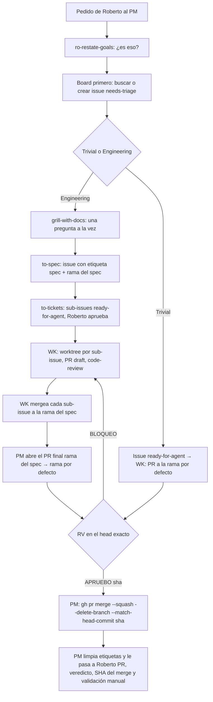
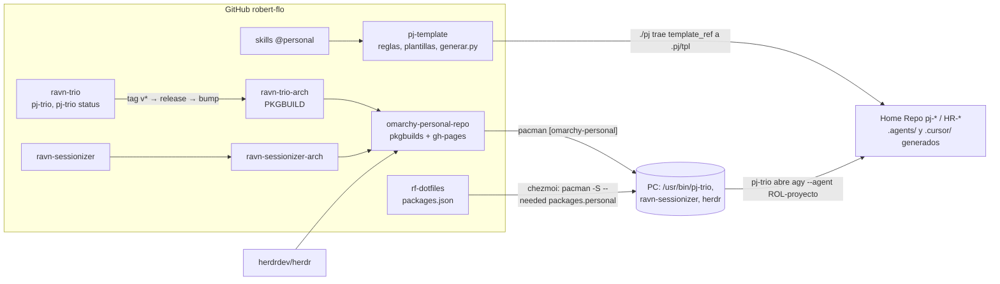

# 🧩 Cómo funciona el trío local (PM · WK · RV, `pj-trio`, herdr)

> [!NOTE]
> **Navegación de Capa:**
> * Anterior: [[08.7 - Runbook - Crear un Home Repo|08.7 - Runbook: Crear un Home Repo]] · Topología: [[08.3 - Topologia Canonica de Repositorios, Worktrees y GitHub Workflows|08.3 - Topología Canónica]]
> * Subir al Hub: [[08.0 - AI Developer Workflows (MOC)|📑 Hub de Capa 08]]
> * Índice Maestro: [[00.0 - Mapa General del Sistema (MOC)|🏠 Inicio (MOC)]]
> * Relacionadas: [[03.3 - Terminal GPU (Ghostty) y Multiplexores (tmux, herdr)|03.3 herdr]], [[docs/adr/0003-chezmoi-unificacion-dotfiles-y-paquetes|ADR 0003 — Chezmoi SSoT]]

> [!IMPORTANT]
> **Esta nota explica, no manda.** Es un mapa para vos y tus agentes. Cada regla tiene **un solo dueño** (un archivo en otro repo) y acá solo se resume y se enlaza. Si esta nota y el dueño no coinciden, **manda el dueño** y esta nota se corrige por PR. Para el trío local, la fuente de verdad del runtime es **ravn-trio** (decisión de Roberto del 2026-11-16, registrada en el [ADR 0016 de pj-template](https://github.com/robert-flo/pj-template/blob/main/docs/adr/0016-el-trio-en-herdr-vive-en-ravn-trio.md), [pj-template#37](https://github.com/robert-flo/pj-template/pull/37), mergeado en `3ab9413`); las reglas de rol salen de **pj-template**.
>
> Leído el 2026-11-16, con los links fijados a estos commits: pj-template `1c9ff73`, ravn-trio `31027d1` (v0.1.7), ravn-trio-arch `cc66a4f`, ravn-sessionizer `3a4a976`, pj-omarchy `36fa1f0`, HR-CLAVIS `4e1f4ac`, fleet `fd59412`, omarchy-personal-repo `41d177e`, rf-dotfiles `56dc2cd`.
>
> **Actualizado el 2026-11-16 (noche)** tras los merges de [ravn-trio#23](https://github.com/robert-flo/ravn-trio/pull/23) (v0.1.8, `73c3905`: el arranque del PM mergea tras el `APRUEBO` y `pj-trio --base`) y [pj-template#37](https://github.com/robert-flo/pj-template/pull/37) (`3ab9413`, ADR 0016). Los links fijados siguen apuntando a los commits de arriba: muestran el estado **anterior** en `trio-pm-prompt.md`, el README de ravn-trio, `wk.md` y `docs/pj-template.md`. Ante la duda, mirá `main` del dueño.

---

## 0. En 30 segundos

| Pieza | Qué es | Dueño (de dónde sale) |
|---|---|---|
| **Trío** | Tres agentes fijos por proyecto: `PM-<proyecto>`, `WK-<proyecto>`, `RV-<proyecto>` | [pj-template `GLOSSARY.md`](https://github.com/robert-flo/pj-template/blob/1c9ff731b1cba8027fc508f4b9f47ecfd0dd81bd/GLOSSARY.md), [ADR 0001](https://github.com/robert-flo/pj-template/blob/1c9ff731b1cba8027fc508f4b9f47ecfd0dd81bd/docs/adr/0001-trio-fijo-por-proyecto.md) |
| **Home Repo / meta-repo** (`pj-*`, `HR-*`) | El repo donde vive el trío: `proyecto.yml`, `AGENTS.md`, `./pj`, `.trio/`. Cómo crear uno: [[08.7 - Runbook - Crear un Home Repo\|08.7]] | hijo de [pj-template](https://github.com/robert-flo/pj-template/blob/1c9ff731b1cba8027fc508f4b9f47ecfd0dd81bd/docs/pj-template.md); referencia: [pj-omarchy](https://github.com/robert-flo/pj-omarchy/tree/36fa1f072585f27a6a1770be7a2da501de4d10ba) y [HR-CLAVIS](https://github.com/robert-flo/HR-CLAVIS/tree/4e1f4acc815ac9ac6d28c564622c8150bfdb1f15) |
| **Reglas y fichas** | `.agents/reglas/`, `.agents/agents/` (agy) y `.cursor/` (Cursor), generados por `./pj` | [pj-template](https://github.com/robert-flo/pj-template/tree/1c9ff731b1cba8027fc508f4b9f47ecfd0dd81bd) (`scripts/generar.py`) |
| **herdr** | Gestor de workspaces de terminal para agentes de código | [herdrdev/herdr](https://github.com/herdrdev/herdr/tree/v0.9.5), paquete en [omarchy-personal-repo](https://github.com/robert-flo/omarchy-personal-repo/blob/41d177e9318f56e2f2de113b7496da2d9d6d6937/pkgbuilds/herdr/PKGBUILD) |
| **`pj-trio`** | Abre el trío de **un ticket** en tres tabs de herdr | [robert-flo/ravn-trio](https://github.com/robert-flo/ravn-trio/tree/31027d1d5d2e452243b226430fafe763d116ff21) (paquete [ravn-trio-arch](https://github.com/robert-flo/ravn-trio-arch/tree/cc66a4f51c315d93bed10038f69f3750ce551312)) |
| **`ravn-sessionizer`** (`rs`, `ri`) | Un `fzf` para saltar entre workspaces, repos, agentes e issues, y lanzar tríos (solo de `pj-*`, ver §8) | [robert-flo/ravn-sessionizer](https://github.com/robert-flo/ravn-sessionizer/tree/3a4a9766c32d259ad1c599fd6310c7fa77bcd45a) (paquete [ravn-sessionizer-arch](https://github.com/robert-flo/ravn-sessionizer-arch)) |
| **Instalación** | `herdr`, `ravn-trio`, `ravn-sessionizer` están en `packages.personal` | [rf-dotfiles `.chezmoidata/packages.json`](https://github.com/robert-flo/rf-dotfiles/blob/56dc2cd6d139f106229087cc5369f1627151b993/.chezmoidata/packages.json) |

---

## 1. Los roles

Dueño: [`comun.md` §El trío](https://github.com/robert-flo/pj-template/blob/1c9ff731b1cba8027fc508f4b9f47ecfd0dd81bd/.agents/reglas/comun.md), [`pm.md`](https://github.com/robert-flo/pj-template/blob/1c9ff731b1cba8027fc508f4b9f47ecfd0dd81bd/.agents/reglas/pm.md), [`wk.md`](https://github.com/robert-flo/pj-template/blob/1c9ff731b1cba8027fc508f4b9f47ecfd0dd81bd/.agents/reglas/wk.md), [`rv.md`](https://github.com/robert-flo/pj-template/blob/1c9ff731b1cba8027fc508f4b9f47ecfd0dd81bd/.agents/reglas/rv.md).

| Rol | Hace | Nunca hace |
|---|---|---|
| **PM** | Es la **única puerta**: Roberto solo habla con el PM. Convierte pedidos en specs y tickets `ready-for-agent` (flujo de Matt Pocock), supervisa los repos de `repos:` en `proyecto.yml`, lanza al WK y al RV, y **mergea** a la rama por defecto tras el `APRUEBO`. | Escribir código de producción ni archivos del repo (todo cambio entra como issue que hace el WK). |
| **WK** | Toma issues `ready-for-agent`, programa en un worktree propio, abre el PR (draft → listo) con prueba real y `code-review` limpio. En un spec, mergea sus propios PR a la **rama del spec**. | Mergear a la rama por defecto, planear specs, `grill`/`to-spec`/`to-tickets`/`triage`. |
| **RV** | Revisa el PR **en un head exacto**: lo prueba en un worktree y comenta en el PR `APRUEBO <sha>` o `BLOQUEO` con archivo y línea. | Programar, commitear, mergear, cerrar PRs o cambiar etiquetas. |

- Skills por rol: [`plantillas/roles.yml`](https://github.com/robert-flo/pj-template/blob/1c9ff731b1cba8027fc508f4b9f47ecfd0dd81bd/plantillas/roles.yml) (+ `skills_extra` del hijo). Vienen de `robert-flo/skills@personal`.
- WK y RV se pueden abrir solos (`mainAgent: true`) si Roberto quiere; en ese caso le hablan a él y lo mandan de vuelta al PM.

### Quién mergea (Home Repos, mundo local)

> [!IMPORTANT]
> **En los Home Repos mergea el PM**, solo después del comentario `APRUEBO <sha>` del RV, con squash y atado al head aprobado:
> `gh pr merge <N> --squash --delete-branch --match-head-commit <sha>`
> Si el head cambió después del `APRUEBO`, el PM no mergea y pide otra revisión. El WK y el RV nunca mergean a la rama por defecto.
> Dueño: [ADR 0014](https://github.com/robert-flo/pj-template/blob/1c9ff731b1cba8027fc508f4b9f47ecfd0dd81bd/docs/adr/0014-el-pm-mergea-tras-apruebo.md) (2026-10-26), [`comun.md` L96](https://github.com/robert-flo/pj-template/blob/1c9ff731b1cba8027fc508f4b9f47ecfd0dd81bd/.agents/reglas/comun.md#L96) y [`pm.md` L26](https://github.com/robert-flo/pj-template/blob/1c9ff731b1cba8027fc508f4b9f47ecfd0dd81bd/.agents/reglas/pm.md#L26). Roberto confirmó el 2026-11-16 que esta regla manda en los Home Repos. En el mundo Grok Bot la regla es otra, a propósito (§5).

---

## 2. Ciclo de vida de una tarea

Dueño: [`pm.md` §Tu flujo](https://github.com/robert-flo/pj-template/blob/1c9ff731b1cba8027fc508f4b9f47ecfd0dd81bd/.agents/reglas/pm.md), [`wk.md` §Tu flujo](https://github.com/robert-flo/pj-template/blob/1c9ff731b1cba8027fc508f4b9f47ecfd0dd81bd/.agents/reglas/wk.md), tablero en [`comun.md` §El tablero](https://github.com/robert-flo/pj-template/blob/1c9ff731b1cba8027fc508f4b9f47ecfd0dd81bd/.agents/reglas/comun.md), etiquetas en [`schema/etiquetas.tsv`](https://github.com/robert-flo/pj-template/blob/1c9ff731b1cba8027fc508f4b9f47ecfd0dd81bd/schema/etiquetas.tsv).

**El tablero es GitHub Issues** (no TickTick): el estado se lee en etiquetas y en el estado del issue/PR.

| Etiqueta | Significa |
|---|---|
| `needs-triage` | Idea sin revisar |
| `needs-info` | Falta información o trabado (`ON HOLD: <motivo>` en un comentario) |
| `spec` | Spec padre: agrupa tickets, **nunca** lleva `ready-for-agent` |
| `ready-for-agent` | Listo para el WK (cada criterio dice qué prueba lo cierra) |
| `ready-to-merge` | PR final aprobado por el RV; el PM mergea tras el `APRUEBO` |
| `wontfix` | Descartado |

Un issue cerrado queda **sin etiquetas de triage**. `scripts/etiquetas.sh` crea las etiquetas en cada repo en cada sync.

### Engineering (con spec)



Detalles que importan (todos de las reglas enlazadas):
- **Rama del spec** `<número>-<slug>`: la crea el PM desde la rama por defecto al publicar el spec; los PR del WK van a ella. Nunca hay commits directos ni a la rama por defecto ni a la del spec.
- **Worktree del WK** (regla de pj-template): `git worktree add ../.wt-<repo>-<número> -b <número>-<slug> <base>`; al terminar, `git worktree remove` y el clon principal queda limpio en la rama por defecto.
- **PR**: body con la skill `pr` (`## Summary`, `## Evidence`, `## Merge Danger`), `Closes #N`; las capturas van a `robert-flo/assets`, nunca commiteadas en el repo de código.
- **Git**: identidad `Roberto Flores <25asab015@ujmd.edu.sv>`, `git pull --rebase --autostash` antes de cada push, nunca `--force`, **ningún trailer ni firma de agente**.
- En agy el PM lanza al WK/RV con `invoke_subagent`; fuera de agy el encargo queda escrito en GitHub y el otro rol lo toma de ahí. GitHub es siempre el registro.

### Variante herdr (`pj-trio`, un ticket)

Cuando el trío corre en herdr, el PM recibe un **arranque** ([`trio-pm-prompt.md`](https://github.com/robert-flo/ravn-trio/blob/31027d1d5d2e452243b226430fafe763d116ff21/trio-pm-prompt.md)) con un flujo por ticket:
1. Lee el issue (`gh issue view <n> -R <dueño>/<miembro> --comments`) y escribe `.trio/<ticket>/plan.md`; commit + push del meta-repo.
2. Worktree **nuevo** por ticket: `<miembro>-wt-<ticket>-<fecha>` con rama `feat/<ticket>-<slug>` desde `origin/<rama del spec>` si se lanzó con `--base` (sub-issue, ADR 0006) o desde `origin/HEAD` (trivial).
3. Le manda el trabajo al WK con `herdr agent prompt`, espera con `herdr agent wait … --timeout 600000` y confirma con `herdr agent read` + `wk.md`.
4. Igual con el RV (`rv.md` + comentario `APRUEBO <sha>` / `BLOQUEO`). Con BLOQUEO vuelve al paso 3.
5. Merge: con `APRUEBO <sha>` sobre el head exacto, el PM mergea con `gh pr merge <pr> --squash --delete-branch --match-head-commit <sha>` (v0.1.8, ADR 0014). Si el head cambió, vuelve al RV.
6. Cierre (después del merge): el PM escribe `hecho cierre` con su `{{TRIO_STATUS}}`, commit + push del meta-repo y `worktree remove`.

> [!WARNING]
> Hasta v0.1.7 ese arranque le decía al PM que **no** mergeara y dejara `needs-roberto merge`. Desde v0.1.8 ([ravn-trio#23](https://github.com/robert-flo/ravn-trio/pull/23), `73c3905`, en `[omarchy-personal]` como `ravn-trio-0.1.8-1`) mergea tras el `APRUEBO` ([`trio-pm-prompt.md` L34-39](https://github.com/robert-flo/ravn-trio/blob/73c3905/trio-pm-prompt.md#L34-L39)). Verificá la versión instalada con `pacman -Q ravn-trio`.

---

## 3. Runtime: el trío en herdr

### `pj-trio`

Dueño: [ravn-trio `README.md`](https://github.com/robert-flo/ravn-trio/blob/31027d1d5d2e452243b226430fafe763d116ff21/README.md) y [`runtime/scripts/start`](https://github.com/robert-flo/ravn-trio/blob/31027d1d5d2e452243b226430fafe763d116ff21/runtime/scripts/start). Si el README y el código no cuadran, se describe el código (§8).

```bash
pj-trio [--dry-run] [--no-kickoff] [--print-kickoff] <proyecto> <ticket> [--repo <miembro>] [--base <rama>]
# ejemplo (pj-omarchy/.trio/README.md):
pj-trio pj-omarchy <ticket> --repo <dir del miembro en proyecto.yml>
```

Qué hace, en orden:
1. **Resuelve el proyecto** (ruta o nombre; busca en `$PJ_TRIO_ROOT`, el padre de `$PWD` o `/z-drive/tries`, **no** en `/z-home-repos`). Si el meta-repo no está, lo clona con try-clone (`PJ_TRIO_NO_CLONE=1` lo apaga). Con un Home Repo `HR-*` pasá la ruta: `pj-trio /z-home-repos/<HR> <ticket> --repo <miembro>`; si no, termina con una segunda copia en `/z-drive/tries`. `--repo` acepta ruta, `dir`, `dueño/repo` o nombre corto único.
2. **Carga `trio.conf` por capas** (gana la última): `/usr/share/ravn/trio/trio.conf` (o `trio.conf.example`) → `/zt/ravn/trio/trio.conf` (máquina) → `<proyecto>/.trio/trio.conf`; `PJ_TRIO_CONFIG` reemplaza todo ([`trio_config.sh` L13-29](https://github.com/robert-flo/ravn-trio/blob/31027d1d5d2e452243b226430fafe763d116ff21/runtime/lib/trio_config.sh#L13-L29)). Ahí viven `PM_KIND`/`WK_KIND`/`RV_KIND` (default `agy`; vacío = shell para arrancar a mano), la identidad git y la integración de herdr ([`trio.conf.example`](https://github.com/robert-flo/ravn-trio/blob/31027d1d5d2e452243b226430fafe763d116ff21/trio.conf.example)).
3. **Verifica** que `agy agents` tenga `PM-/WK-/RV-<proyecto>` (si falta alguno, para) y que la integración de herdr esté instalada (`herdr integration install antigravity-cli` si no).
4. **Workspace** `trio <proyecto>#<ticket>` (o `trio <proyecto>/<miembro>#<ticket>`) con **tres tabs a pantalla completa** `pm`, `wk`, `rv`; paneles `PM-<ticket>`, `WK-<ticket>`, `RV-<ticket>`.
5. **Agentes herdr** `pm|wk|rv-<miembro corto>-<ticket>` (≤32 caracteres, se quitan `pj-domina-`, `rf-`, `fo-`; hash si no cabe). Cada uno arranca con `agy --agent <ROL>-<proyecto>`. Con `--repo`, los agentes abren **en el clon del miembro** y el meta-repo se suma con `--add-dir` ([`start` L123-125](https://github.com/robert-flo/ravn-trio/blob/31027d1d5d2e452243b226430fafe763d116ff21/runtime/scripts/start#L123-L125), [`trio_herdr.sh` L205-209](https://github.com/robert-flo/ravn-trio/blob/31027d1d5d2e452243b226430fafe763d116ff21/runtime/lib/trio_herdr.sh#L205-L209)).
6. **Arranque del PM** (kind `agy`): renderiza el prompt en `.trio/<ticket>/kickoff.md` y se lo pasa a agy con `-i` (una línea que apunta al archivo, porque herdr 0.9.5 rechaza saltos de línea en argumentos) ([`trio_herdr.sh` L218-228](https://github.com/robert-flo/ravn-trio/blob/31027d1d5d2e452243b226430fafe763d116ff21/runtime/lib/trio_herdr.sh#L218-L228)). Con otro kind lo manda con `herdr agent prompt`.
7. **Identidad git** local (`TRIO_GIT_NAME`/`TRIO_GIT_EMAIL`) en meta-repo y miembro; el PM no la toca.
8. Imprime cómo adjuntarte: `herdr workspace focus <id> && herdr`.

**Idempotente:** con los mismos argumentos reutiliza workspace y tabs, no duplica agentes y avisa si el trío de ese ticket ya corre.

### Estado: `.trio/<ticket>/` y `pj-trio status`

- **Handoff único** en el meta-repo (nunca en el miembro), que el PM commitea: `plan.md` (PM), `wk.md` (WK), `rv.md` (RV) y `status.json` (PM) ([`trio-pm-prompt.md` L12](https://github.com/robert-flo/ravn-trio/blob/31027d1d5d2e452243b226430fafe763d116ff21/trio-pm-prompt.md#L12)). Nombran solo roles, nunca plataformas. `pj-trio` deja ahí también `kickoff.md` (el arranque renderizado).
- **`pj-trio status`** **escribe** `status.json` y opcionalmente avisa con `notify-send`; no es un visor. Desde tu shell se usa como subcomando, porque el paquete solo pone `pj-trio` en `/usr/bin`: `trio-status` queda en `/usr/share/ravn/trio/` ([`Makefile` L24](https://github.com/robert-flo/ravn-trio/blob/31027d1d5d2e452243b226430fafe763d116ff21/Makefile#L24), [L34](https://github.com/robert-flo/ravn-trio/blob/31027d1d5d2e452243b226430fafe763d116ff21/Makefile#L34), [`commands.tsv` L4](https://github.com/robert-flo/ravn-trio/blob/31027d1d5d2e452243b226430fafe763d116ff21/runtime/commands.tsv#L4)). El PM no tiene ese problema: su arranque trae la ruta ya resuelta (`{{TRIO_STATUS}}`, [`trio_config.sh` L55-62](https://github.com/robert-flo/ravn-trio/blob/31027d1d5d2e452243b226430fafe763d116ff21/runtime/lib/trio_config.sh#L55-L62)). Para ver el estado leés el archivo:

```bash
pj-trio status [--dry-run] [--notify] [--cola-de <agente>] [--error <texto>] [--pr <url>] [--head <sha>] [--intentos N] <trio_dir> <estado> <paso>
cat <proyecto>/.trio/<ticket>/status.json
```

  Esquema: `ticket`, `estado` (`en-curso` | `hecho` | `needs-roberto`), `paso` (`plan` | `wk` | `rv` | `merge` | `cierre`), `error`, `intentos`, `timestamp`, `pr`, `head`, `cola`.
- **Pausa:** la única pausa que implementa `pj-trio` es la espera de tu Enter ante el diálogo de confianza de agy («Do you trust the contents of this project?»), y solo en el camino de `herdr agent prompt` ([`trio_agy.sh` L42-57](https://github.com/robert-flo/ravn-trio/blob/31027d1d5d2e452243b226430fafe763d116ff21/runtime/lib/trio_agy.sh#L42-L57), llamado desde [`trio_herdr.sh` L63](https://github.com/robert-flo/ravn-trio/blob/31027d1d5d2e452243b226430fafe763d116ff21/runtime/lib/trio_herdr.sh#L63)). Con agy y arranque por `-i` casi nunca aparece: lo normal es el aviso de timeout o `agent_not_ready` (§6). No hay comando de pausa/reanudar del trío; «reanudar» es volver a correr `pj-trio` con los mismos argumentos (idempotente).

### `ravn-sessionizer`

Dueño: [ravn-sessionizer `README.md`](https://github.com/robert-flo/ravn-sessionizer/blob/3a4a9766c32d259ad1c599fd6310c7fa77bcd45a/README.md). Plugin de herdr `ravn.sessionizer` (`herdr plugin link /usr/share/ravn/sessionizer`); los atajos se agregan a mano en `~/.config/herdr/config.toml`.

| Atajo / alias | Vista | Qué hace |
|---|---|---|
| `prefix+f` | **pick** | Workspaces abiertos + repos y `pj-*` por frecencia; `enter` abre o enfoca |
| `prefix+a` | **agents** | Agentes ordenados blocked › done › working › idle; `enter` enfoca el pane |
| `prefix+t` | **trio** | Issues abiertos de todos los miembros de todos los `pj-*` (`ready-for-agent` primero); `enter` lanza o enfoca el trío |
| `rs` | `ravn-sessionizer repos` | Proyecto `pj-*` → repo miembro; clona **solo ese** repo con try-clone si falta |
| `ri` | `ravn-sessionizer issues` | Proyecto → repo → issue; `enter` corre `pj-trio start <pj> <issue> --repo <miembro>` |

- Lee los proyectos y miembros de GitHub (`proyecto.yml` de cada repo **`pj-*`** del dueño, entradas `repo:`), sin clonar el meta-repo; caché 1 h de proyectos y 5 min de issues. Los repos `HR-*` no entran (§8).
- Si ya hay un workspace `trio <pj>[/<miembro>]#<n>`, lo enfoca en vez de lanzar otro.
- Config en `/etc/ravn/sessionizer.conf`; estado y caché en `~/.local/state/ravn-sessionizer` y `~/.cache/ravn-sessionizer`.

ravn-trio además trae su propio plugin de herdr `ravn.trio`: la acción **New trio** y un link handler para URLs de issues de GitHub (clic en la URL → trío de ese issue en el proyecto del panel) ([`herdr-plugin.toml`](https://github.com/robert-flo/ravn-trio/blob/31027d1d5d2e452243b226430fafe763d116ff21/herdr-plugin.toml)).

### Comandos del día a día

| Cuándo | Comando |
|---|---|
| Después de clonar o hacer pull de un Home Repo | `./pj listo` (pull, template, generar, hooks, `agy`, clonar, check; `--abrir` arranca el PM) |
| Ver si el Home Repo está sano | `./pj check` |
| Hablar con el PM (agy) | `agy --agent PM-<proyecto>` desde la raíz del meta-repo |
| Hablar con el PM (Cursor) | abrir el meta-repo: el PM es la regla `alwaysApply` `.cursor/rules/pm-<proyecto>.mdc` |
| Trío de un ticket en herdr (`pj-*`) | `ri` (o `prefix+t`), o `pj-trio <proyecto> <ticket> --repo <miembro>` |
| Trío de un ticket en herdr (`HR-*`) | solo a mano: `pj-trio <proyecto> <ticket> [--repo <miembro>]` |
| Probar sin tocar herdr | `pj-trio --dry-run …` · `pj-trio --print-kickoff …` |
| Saltar entre workspaces/agentes | `prefix+f` / `prefix+a` |
| Ver en qué va un ticket | `cat <proyecto>/.trio/<ticket>/status.json` |

---

## 4. De dónde sale cada pieza



- **pj-template genera los agentes.** El hijo versiona solo sus archivos (`proyecto.yml`, `AGENTS.md`, `README.md`, `.gitignore`, `./pj`, `.github/workflows/pj-template.yml`, más `extras:`). `./pj` baja pj-template al SHA de `template_ref` en `.pj/tpl` y genera, ignorados por git: `.agents/agents/{PM,WK,RV}-<proyecto>.md` (agy), `.agents/reglas/`, `.agents/skills/`, `.cursor/rules/pm-<proyecto>.mdc`, `.cursor/rules/no-cursor-coauthor.mdc` y `.cursor/agents/{wk,rv}-<proyecto>.md` (Cursor). `./pj agy` enlaza las fichas en `~/.gemini/config/agents` porque agy interactivo solo resuelve `--agent` con agentes globales. Dueño: [`docs/pj-template.md`](https://github.com/robert-flo/pj-template/blob/1c9ff731b1cba8027fc508f4b9f47ecfd0dd81bd/docs/pj-template.md).
- **El template se actualiza solo:** el workflow del hijo abre un PR `pj-template/sync-<run>` que sube `template_ref`; `vigilar-hijos.yml` mide la deriva a diario y, desde [pj-template#34](https://github.com/robert-flo/pj-template/pull/34), cuenta como hijo a cualquier repo con `template_ref` en su `proyecto.yml`, sin importar el nombre (también `HR-*`, como HR-CLAVIS en [`family.yml`](https://github.com/robert-flo/pj-template/blob/1c9ff731b1cba8027fc508f4b9f47ecfd0dd81bd/family.yml); [`vigilar-hijos.yml`](https://github.com/robert-flo/pj-template/blob/1c9ff731b1cba8027fc508f4b9f47ecfd0dd81bd/.github/workflows/vigilar-hijos.yml)). Ojo: lo que genera un hijo depende de **su** `template_ref` (§8).
- **ravn-trio da `/usr/bin/pj-trio`** (symlink a `/usr/share/ravn/trio/pj-trio`), más `trio-status`, el prompt del PM, `trio.conf.example` y el plugin en `/usr/share/ravn/trio/`. Depende de `bash git jq libnotify github-cli herdr>=0.9.5` ([ravn-trio-arch README](https://github.com/robert-flo/ravn-trio-arch/blob/cc66a4f51c315d93bed10038f69f3750ce551312/README.md)). El PKGBUILD baja la fuente del tag público, y cada tag `v*` de ravn-trio crea su release y avisa a ravn-trio-arch ([ravn-trio-arch#13](https://github.com/robert-flo/ravn-trio-arch/pull/13), [ravn-trio#22](https://github.com/robert-flo/ravn-trio/pull/22), mergeados el 2026-11-16). `[omarchy-personal]` ya sirve `ravn-trio-0.1.7-1`.
- **`[omarchy-personal]` sirve los paquetes:** `omarchy-personal-repo` tiene los PKGBUILDs en `main` y publica el repo pacman firmado en `gh-pages` ([README](https://github.com/robert-flo/omarchy-personal-repo/blob/41d177e9318f56e2f2de113b7496da2d9d6d6937/README.md)). Su `herdr` es 0.9.5 y gana al de `[omarchy]` porque `[omarchy-personal]` va antes en `pacman.conf` ([PKGBUILD](https://github.com/robert-flo/omarchy-personal-repo/blob/41d177e9318f56e2f2de113b7496da2d9d6d6937/pkgbuilds/herdr/PKGBUILD)).
- **rf-dotfiles/chezmoi los instala:** `herdr`, `ravn-trio` y `ravn-sessionizer` están en `packages.personal` de [`packages.json`](https://github.com/robert-flo/rf-dotfiles/blob/56dc2cd6d139f106229087cc5369f1627151b993/.chezmoidata/packages.json); `run_onchange_before_01-install-packages.sh.tmpl` los instala con `pacman -S --needed` si `pacman -Si` los encuentra. La regla de la estación está en [[docs/adr/0003-chezmoi-unificacion-dotfiles-y-paquetes|ADR 0003]].

---

## 5. Los dos mundos

Son dos mundos con **reglas distintas a propósito**; no es una contradicción.

| | **Trío local** (esta nota) | **Isla Grok Bot** |
|---|---|---|
| Dónde corre | Tu PC: agy (en herdr con `pj-trio`) o Cursor | Bots en la nube con cloud agents |
| Runtime y reglas | ravn-trio (runtime) + pj-template (`.agents/`, `.cursor/` del Home Repo) | [robert-flo/fleet](https://github.com/robert-flo/fleet/tree/fd5941272db1e9f440386154bc2457f065bf0a2b): fichas en `bots/`, reglas en `templates/pm.md`; equipo fijo en [ADR 0019](https://github.com/robert-flo/fleet/blob/fd5941272db1e9f440386154bc2457f065bf0a2b/docs/adr/0019-equipo-fijo-por-proyecto.md) |
| Quién mergea | El PM, tras `APRUEBO <sha>` del RV (ADR 0014 de pj-template) | Solo con la orden de Roberto (p. ej. [`bots/PM-HR-CLAVIS.md` L17](https://github.com/robert-flo/fleet/blob/fd5941272db1e9f440386154bc2457f065bf0a2b/bots/PM-HR-CLAVIS.md#L17)) |

- Los dos mundos pueden tener tríos con el **mismo nombre** (`PM-HR-CLAVIS` local y en fleet); está bien.
- El **único puente es GitHub**: issues, PRs y comentarios. **Un issue lo trabaja un solo mundo.**
- Estas reglas las decidió Roberto en chat el 2026-11-16; todavía no las registra ningún ADR (§8). Hoy hay archivos que mezclan los dos mundos (§8).

---

## 6. Fallas comunes y cómo diagnosticarlas

Solo las que dejaron rastro en los repos (PRs, issues, código).

| Síntoma | Causa / diagnóstico | Arreglo |
|---|---|---|
| El agente no ve `.agents/reglas/` | El Home Repo no se generó después del clone o pull | `./pj listo` (genera, instala los hooks y enlaza en agy; ver [[08.7 - Runbook - Crear un Home Repo#A. Poner en marcha un Home Repo en una PC (`./pj listo`)\|08.7 §A]]) |
| `pj-trio` para diciendo que faltan agentes | `agy agents` no tiene `PM-/WK-/RV-<proyecto>` | `./pj agy` una vez por máquina |
| herdr avisa timeout o `agent_not_ready` al arrancar | agy ya quedó lanzado en el pane, probablemente frente al diálogo de confianza; no es fallo ([`trio_herdr.sh` L237-239](https://github.com/robert-flo/ravn-trio/blob/31027d1d5d2e452243b226430fafe763d116ff21/runtime/lib/trio_herdr.sh#L237-L239), [ravn-trio#21](https://github.com/robert-flo/ravn-trio/pull/21)) | Mirá el pane y aceptá el diálogo de agy si está ahí |
| «el PM no arrancó» | `herdr agent start` falló con otro error; solo en ese caso `pj-trio` imprime el `agy --agent … -i …` para recuperarlo ([`trio_herdr.sh` L249-252](https://github.com/robert-flo/ravn-trio/blob/31027d1d5d2e452243b226430fafe763d116ff21/runtime/lib/trio_herdr.sh#L249-L252)) | Corré en el pane el comando que imprimió |
| El PM no recibió el arranque | — ([#19](https://github.com/robert-flo/ravn-trio/pull/19), [#20](https://github.com/robert-flo/ravn-trio/pull/20)) | `pj-trio --print-kickoff <proyecto> <ticket> --repo <miembro>` y pegáselo |
| Nombre de agente inválido en herdr | Más de 32 caracteres o caracteres raros; corregido en v0.1.1 ([#5](https://github.com/robert-flo/ravn-trio/pull/5)) | Actualizá `ravn-trio` |
| `trio-status: command not found` | No está en el PATH; solo `pj-trio` va a `/usr/bin` | `pj-trio status …` (o `/usr/share/ravn/trio/trio-status`) |
| `status.json` en `needs-roberto` | El PM reintentó un paso una vez y volvió a fallar (wait vencido, agente blocked/stalled/ausente, idle sin `wk.md`/`rv.md`); `cola` trae el final del panel | Leé `error` y `cola`, arreglá y volvé a correr `pj-trio` |
| `ri` no muestra trío para un `HR-*` | ravn-sessionizer solo toma repos `pj-*` como proyectos (§8) | `pj-trio <proyecto> <ticket>` a mano |
| El `pj-trio` instalado quedó viejo | Hasta el 2026-11-16 el chequeo de ravn-trio-arch buscaba GitHub Releases (solo había v0.1.3) y usaba un tarball vendoreado; resuelto con [ravn-trio-arch#13](https://github.com/robert-flo/ravn-trio-arch/pull/13) y [ravn-trio#22](https://github.com/robert-flo/ravn-trio/pull/22) | `pacman -Si ravn-trio` dice qué sirve el canal; `sudo pacman -Syu` |
| `ri` falla con `Argument list too long` | JSON grande a `jq`; corregido en [ravn-sessionizer#13](https://github.com/robert-flo/ravn-sessionizer/pull/13) | Actualizá `ravn-sessionizer` |
| El template del hijo está viejo | `template_ref` atrasado | Mergear el PR `pj-template/sync-<run>` del hijo; `vigilar-hijos` abre un issue si hay deriva |

---

## 7. Un solo dueño por dato

Cada hecho tiene un dueño; los demás enlazan, no copian.

| Dato | Dueño |
|---|---|
| Runtime del trío local: `pj-trio`, `pj-trio status`, arranque del PM | [ravn-trio](https://github.com/robert-flo/ravn-trio/tree/31027d1d5d2e452243b226430fafe763d116ff21) (fuente de verdad: [ADR 0016 de pj-template](https://github.com/robert-flo/pj-template/blob/main/docs/adr/0016-el-trio-en-herdr-vive-en-ravn-trio.md), mergeado con [pj-template#37](https://github.com/robert-flo/pj-template/pull/37)) |
| Reglas de rol, git, tablero, merge | [pj-template `.agents/reglas/`](https://github.com/robert-flo/pj-template/tree/1c9ff731b1cba8027fc508f4b9f47ecfd0dd81bd/.agents/reglas) + ADRs en [`docs/adr/`](https://github.com/robert-flo/pj-template/tree/1c9ff731b1cba8027fc508f4b9f47ecfd0dd81bd/docs/adr) (los de antigravity-fleet, repo borrado el 2026-10-26, quedan como historia en `docs/adr-antigravity/`) |
| Términos (trío, rama del spec, listo para mergear) | [pj-template `GLOSSARY.md`](https://github.com/robert-flo/pj-template/blob/1c9ff731b1cba8027fc508f4b9f47ecfd0dd81bd/GLOSSARY.md) |
| Etiquetas | [pj-template `schema/etiquetas.tsv`](https://github.com/robert-flo/pj-template/blob/1c9ff731b1cba8027fc508f4b9f47ecfd0dd81bd/schema/etiquetas.tsv) |
| Datos de un proyecto (repos, specs, notas) | `proyecto.yml` del Home Repo |
| Arquitectura de un proyecto | `AGENTS.md` del Home Repo |
| Empaquetado | los repos `-arch` y [omarchy-personal-repo](https://github.com/robert-flo/omarchy-personal-repo/tree/41d177e9318f56e2f2de113b7496da2d9d6d6937) |
| Qué paquetes se instalan | [rf-dotfiles `packages.json`](https://github.com/robert-flo/rf-dotfiles/blob/56dc2cd6d139f106229087cc5369f1627151b993/.chezmoidata/packages.json) |
| Cómo crear un Home Repo | [[08.7 - Runbook - Crear un Home Repo\|08.7]] |
| Dónde se clona cada repo (`/z-home-repos`, `/z-drive/tries`) | [[08.3 - Topologia Canonica de Repositorios, Worktrees y GitHub Workflows\|08.3]] |
| Reglas del mundo Grok Bot | [robert-flo/fleet](https://github.com/robert-flo/fleet/tree/fd5941272db1e9f440386154bc2457f065bf0a2b) |

Consecuencias: los agentes no editan `.agents/` ni `.cursor/` del hijo (se generan); un cambio de reglas es un issue en pj-template; un cambio de datos va en `proyecto.yml`.

---

## 8. Desfases conocidos (2026-11-16)

Cosas que hoy no cuadran entre dueños. Se arreglan en el dueño, no acá.

### Ya mergeado hoy

- [ravn-trio#23](https://github.com/robert-flo/ravn-trio/pull/23) (v0.1.8, `73c3905`): el arranque del PM mergea tras el `APRUEBO <sha>` (ADR 0014) y `pj-trio --base <rama>` hace que un sub-issue parta de la rama del spec. Paquete publicado en `[omarchy-personal]`.
- [pj-template#37](https://github.com/robert-flo/pj-template/pull/37) (`3ab9413`): ADR 0016 (ravn-trio es la fuente de verdad del trío en herdr); `docs/pj-template.md` ya apunta a ravn-trio, `wk.md` paso 3 usa los worktrees de ravn-trio con base `<rama del spec>` u `origin/HEAD`, y en un trivial mergea el PM tras el `APRUEBO`; `schema/etiquetas.tsv` (`ready-to-merge`) ya dice que mergea el PM.
- [pj-omarchy#27](https://github.com/robert-flo/pj-omarchy/pull/27) (`36fa1f0`): [`.trio/README.md` L7](https://github.com/robert-flo/pj-omarchy/blob/36fa1f072585f27a6a1770be7a2da501de4d10ba/.trio/README.md#L7) ya dice que `pj-trio` viene del paquete `ravn-trio` y L16 usa los nombres `pm|wk|rv-<miembro corto>-<ticket>`.
- [pj-template#34](https://github.com/robert-flo/pj-template/pull/34) (`1c9ff73`): `vigilar-hijos` detecta los hijos por `template_ref`, también `HR-*`.

### Sin PR todavía

- **El README de ravn-trio todavía mezcla nombres.** En `main` ([L67](https://github.com/robert-flo/ravn-trio/blob/73c3905/README.md#L67)) el agente del WK figura como `wk-<proyecto>-<ticket>`, y más abajo ([L128](https://github.com/robert-flo/ravn-trio/blob/73c3905/README.md#L128)) como `wk-<miembro corto>-<ticket>`, que es lo que hace el código.
- **`pj-trio` no conoce `/z-home-repos`.** Con un `HR-*` por nombre no lo encuentra y clona otra copia en `/z-drive/tries` (§3). Hasta que ravn-trio lo arregle: pasar la ruta o `PJ_TRIO_ROOT=/z-home-repos`.
- **`.trio/README.md` de HR-CLAVIS** también dice «El estado se ve con `trio-status`» y usa `pj-trio HR-CLAVIS <ticket>` por nombre (cae en el punto anterior).

- **`trio-status` como visor en pj-omarchy.** [`pj-omarchy/.trio/README.md` L16](https://github.com/robert-flo/pj-omarchy/blob/36fa1f072585f27a6a1770be7a2da501de4d10ba/.trio/README.md#L16) dice «El estado se ve con `trio-status`», pero `trio-status` no está en el PATH y solo escribe `status.json` (§3). [pj-omarchy#27](https://github.com/robert-flo/pj-omarchy/pull/27) no lo tocó.
- **`ri`, `rs` y `prefix+t` no ven los `HR-*`.** ravn-sessionizer filtra los proyectos con `test("^pj-"; "i")` ([`ses_github.sh` L50](https://github.com/robert-flo/ravn-sessionizer/blob/3a4a9766c32d259ad1c599fd6310c7fa77bcd45a/runtime/lib/ses_github.sh#L50)); HR-CLAVIS cae en «sin pj» y no lanza trío ([`issues` L9](https://github.com/robert-flo/ravn-sessionizer/blob/3a4a9766c32d259ad1c599fd6310c7fa77bcd45a/runtime/scripts/issues#L9)).
- **pj-omarchy mezcla los dos mundos.** Su extra [`.agents/grokbot.md` L3](https://github.com/robert-flo/pj-omarchy/blob/36fa1f072585f27a6a1770be7a2da501de4d10ba/.agents/grokbot.md#L3) dice que los bots de Grok Bot leen «exactamente las mismas fichas, reglas y skills que agy y Cursor» (pj-template), pero la ficha [`fleet/bots/PM-pj-omarchy.md`](https://github.com/robert-flo/fleet/blob/fd5941272db1e9f440386154bc2457f065bf0a2b/bots/PM-pj-omarchy.md#L7) carga `templates/pm.md` de fleet y mergea solo con orden ([L17](https://github.com/robert-flo/fleet/blob/fd5941272db1e9f440386154bc2457f065bf0a2b/bots/PM-pj-omarchy.md#L17)).
- **La ficha de PM-HR-CLAVIS se contradice.** [`fleet/bots/PM-HR-CLAVIS.md` L17](https://github.com/robert-flo/fleet/blob/fd5941272db1e9f440386154bc2457f065bf0a2b/bots/PM-HR-CLAVIS.md#L17) dice «Mergeás solo cuando Roberto te lo ordena», pero [L26](https://github.com/robert-flo/fleet/blob/fd5941272db1e9f440386154bc2457f065bf0a2b/bots/PM-HR-CLAVIS.md#L26) dice que mandan las reglas del `AGENTS.md` del Home Repo, y [HR-CLAVIS `AGENTS.md` L10](https://github.com/robert-flo/HR-CLAVIS/blob/4e1f4acc815ac9ac6d28c564622c8150bfdb1f15/AGENTS.md#L10) dice que el PM mergea tras el `APRUEBO` sin esperar orden.
- **La confianza de agy no tiene dueño.** ravn-trio dice que la da «la workstation» (`trustedWorkspaces` con `/z-drive/tries`, [README L118](https://github.com/robert-flo/ravn-trio/blob/31027d1d5d2e452243b226430fafe763d116ff21/README.md#L118), [`trio_agy.sh` L6](https://github.com/robert-flo/ravn-trio/blob/31027d1d5d2e452243b226430fafe763d116ff21/runtime/lib/trio_agy.sh#L6)), pero ningún repo de robert-flo configura `trustedWorkspaces`: ni este vault ni rf-dotfiles.
- **ADR 0014 vs el WK en la rama del spec.** [ADR 0014 L13](https://github.com/robert-flo/pj-template/blob/1c9ff731b1cba8027fc508f4b9f47ecfd0dd81bd/docs/adr/0014-el-pm-mergea-tras-apruebo.md#L13) dice «El WK y el RV siguen sin mergear», pero `wk.md` paso 9 hace que el WK mergee sus PR a la rama del spec. Esta nota acota la regla a la rama por defecto (§1).
- **pj-omarchy genera reglas viejas.** El ejemplo de referencia tiene `template_ref` `96863b1` ([`proyecto.yml` L6](https://github.com/robert-flo/pj-omarchy/blob/36fa1f072585f27a6a1770be7a2da501de4d10ba/proyecto.yml#L6)), anterior a pj-template#33 y #36. Hasta que entre su PR de sync, `./pj` le genera reglas que todavía dicen lo viejo.
- **Cursor en herdr.** herdr 0.9.5 sí tiene la integración `cursor` ([`src/cli/integration.rs` L176](https://github.com/herdrdev/herdr/blob/v0.9.5/src/cli/integration.rs#L176)); lo que falta es que ravn-trio arme los argumentos para Cursor, porque hoy solo sabe los de agy (`--agent`, `--add-dir`, `-i`). Cursor se usa abriendo el meta-repo.
- **Versión de herdr.** [[03.3 - Terminal GPU (Ghostty) y Multiplexores (tmux, herdr)|03.3]] dice que herdr viene de `[omarchy]` (0.9.1); ravn-trio pide `herdr>=0.9.5`, que hoy sirve `[omarchy-personal]`. `robert-flo/omarchy-pkgs` también tiene un `pkgbuilds/herdr`.
- **Los dos mundos** (§5) no tienen ADR todavía, ni en pj-template ni en fleet.
