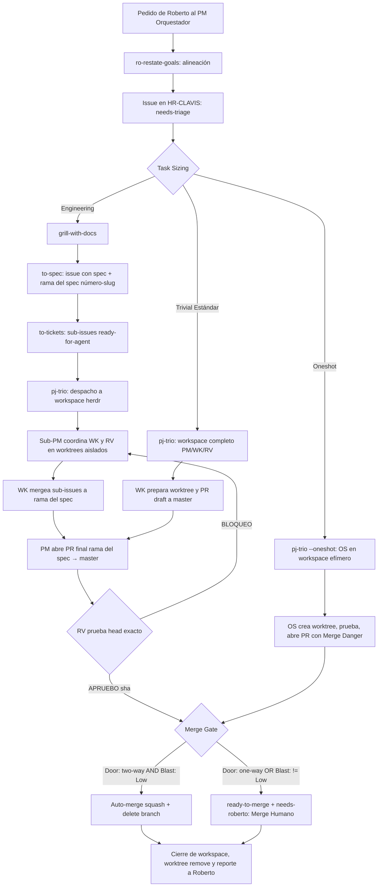
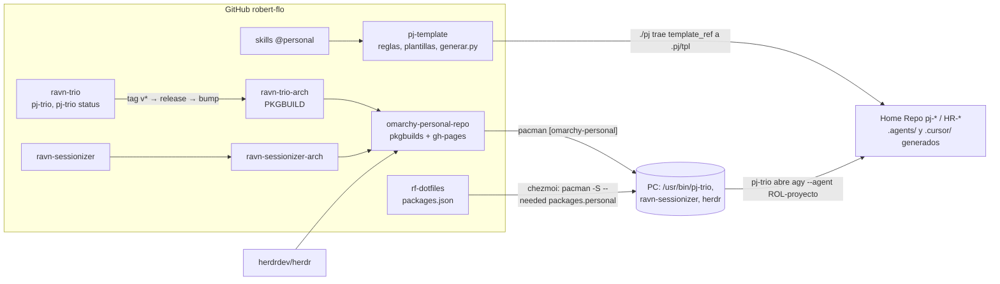

# 🧩 Cómo funciona el trío local (PM · WK · RV · OS, `pj-trio`, herdr)

> [!NOTE]
> **Navegación de Capa:**
> * Anterior: [[08.7 - Runbook - Crear un Home Repo|08.7 - Runbook: Crear un Home Repo]] · Topología: [[08.3 - Topologia Canonica de Repositorios, Worktrees y GitHub Workflows|08.3 - Topología Canónica]]
> * Subir al Hub: [[08.0 - AI Developer Workflows (MOC)|📑 Hub de Capa 08]]
> * Índice Maestro: [[00.0 - Mapa General del Sistema (MOC)|🏠 Inicio (MOC)]]
> * Relacionadas: [[03.3 - Terminal GPU (Ghostty) y Multiplexores (tmux, herdr)|03.3 herdr]], [[docs/adr/0003-chezmoi-unificacion-dotfiles-y-paquetes|ADR 0003 — Chezmoi SSoT]]

> [!IMPORTANT]
> **Esta nota explica, no manda.** Es un mapa para vos y tus agentes. Cada regla tiene **un solo dueño** (un archivo en otro repo) y acá solo se resume y se enlaza. Si esta nota y el dueño no coinciden, **manda el dueño** y esta nota se corrige por PR. Para el trío local, la fuente de verdad del runtime es **ravn-trio** (versión actual v0.1.13); las reglas de rol salen de **pj-template**; la topología de worktrees sale de **ravn-git-bare-clone** (v0.2.1).
>
> Actualizado el 2026-11-17 tras la validación de punta a punta del trío en herdr, modo oneshot, fleet/watch, atajos de inicio rápido y publicación desatendida en el canal `[omarchy-personal]`.

---

## 0. En 30 segundos

| Pieza | Qué es | Dueño (de dónde sale) |
|---|---|---|
| **Trío** | Tres agentes fijos por proyecto (`PM-<proyecto>`, `WK-<proyecto>`, `RV-<proyecto>`) más el ejecutor atómico (`OS-<proyecto>`) | [pj-template `GLOSSARY.md`](https://github.com/robert-flo/pj-template/blob/main/GLOSSARY.md), [ADR 0001](https://github.com/robert-flo/pj-template/blob/main/docs/adr/0001-trio-fijo-por-proyecto.md) |
| **Home Repo / meta-repo** (`pj-*`, `HR-*`) | El repo donde vive el trío: `proyecto.yml`, `AGENTS.md`, `./pj`, `.trio/`. Cómo crear uno: [[08.7 - Runbook - Crear un Home Repo\|08.7]] | hijo de [pj-template](https://github.com/robert-flo/pj-template/blob/main/docs/pj-template.md); referencia: [HR-CLAVIS](https://github.com/robert-flo/HR-CLAVIS) y [pj-omarchy](https://github.com/robert-flo/pj-omarchy) |
| **Reglas y fichas** | `.agents/reglas/`, `.agents/agents/` (agy) y `.cursor/` (Cursor), generados por `./pj` | [pj-template](https://github.com/robert-flo/pj-template) (`scripts/generar.py`) |
| **herdr** | Gestor de workspaces de terminal para agentes de código | [herdrdev/herdr](https://github.com/herdrdev/herdr), paquete en [omarchy-personal-repo](https://github.com/robert-flo/omarchy-personal-repo) |
| **`pj-trio`** | Despacha el trío de **un ticket** en herdr (3 pestañas `pm/wk/rv`, o 1 pestaña `os` con `--oneshot`) | [robert-flo/ravn-trio](https://github.com/robert-flo/ravn-trio) (paquete [ravn-trio-arch](https://github.com/robert-flo/ravn-trio-arch)) |
| **`pj-trio fleet` / `watch`** | Inspección y monitoreo de la flota de tríos y agentes activos en herdr | [robert-flo/ravn-trio](https://github.com/robert-flo/ravn-trio) |
| **`ravn-git-bare-clone`** (`ravn-wt`) | Gestor de bare clones y worktrees canónicos con detección automática de Home Repos | [robert-flo/ravn-git-bare-clone](https://github.com/robert-flo/ravn-git-bare-clone) (paquete [ravn-git-bare-clone-arch](https://github.com/robert-flo/ravn-git-bare-clone-arch)) |
| **`ravn-sessionizer`** (`rs`, `ri`) | Un `fzf` para saltar entre workspaces, repos, agentes e issues, y lanzar tríos (soporta `pj-*` y `HR-*`) | [robert-flo/ravn-sessionizer](https://github.com/robert-flo/ravn-sessionizer) (paquete [ravn-sessionizer-arch](https://github.com/robert-flo/ravn-sessionizer-arch)) |
| **Atajos de arranque** | `make pm`, `make wk`, `make rv`, `make os` (modo `--solo`, instantáneos) | `Makefile` y `./pj agy` de pj-template |
| **Instalación** | Todos empaquetados en `packages.personal` y servidos por `[omarchy-personal]` | [rf-dotfiles `.chezmoidata/packages.json`](https://github.com/robert-flo/rf-dotfiles/blob/master/.chezmoidata/packages.json) |

---

## 1. Los roles

Dueño: [`comun.md` §El trío](https://github.com/robert-flo/pj-template/blob/main/.agents/reglas/comun.md), [`pm.md`](https://github.com/robert-flo/pj-template/blob/main/.agents/reglas/pm.md), [`wk.md`](https://github.com/robert-flo/pj-template/blob/main/.agents/reglas/wk.md), [`rv.md`](https://github.com/robert-flo/pj-template/blob/main/.agents/reglas/rv.md).

| Rol | Hace | Nunca hace |
|---|---|---|
| **PM Orquestador** (Home Repo) | Es la **única puerta** ante Roberto. Mantiene el tablero global, define specs/tickets, supervisa los repos hijos, despacha el trabajo técnico a subagentes o a `herdr` (`pj-trio`), supervisa con `fleet`/`watch`, y **mergea** a `master` al verificar el Merge Gate tras el veredicto `APRUEBO`. | Compilar, correr tests pesados ni escribir código en su sesión principal (mantiene su ventana de contexto limpia para gobernar). |
| **Sub-PM** (en herdr) | Orquestador local del workspace del ticket en herdr. Prepara `plan.md`, crea el worktree con `ravn-git-bare-clone`, instruye al WK vía `herdr agent prompt`, solicita revisión al RV, evalúa el Merge Gate y ejecuta el auto-merge si es seguro. | Trabajar fuera de su workspace o modificar la arquitectura global del meta-repo. |
| **WK** (Worker) | Toma issues `ready-for-agent`, programa exclusivamente en su worktree aislado, ejecuta pruebas reales (`onboarding.yml` §como_probar), pasa `/code-review`, abre el PR draft con la sección `## Merge Danger`, y en un spec mergea sus PRs a la **rama del spec**. | Mergear a `master`, planear specs, saltarse pruebas reales ni omitir la reversibilidad en el PR. |
| **RV** (Reviewer) | Revisa el PR **en un head exacto**: levanta worktree `rv-<pr>`, corre la verificación estricta (`onboarding.yml` §exige), y comenta en GitHub y en `rv.md`: `APRUEBO <sha>` o `BLOQUEO` con archivo y línea. | Programar, commitear, mergear, cerrar PRs o alterar etiquetas de triage. |
| **OS** (Oneshot) | Toma tickets triviales y de bajo riesgo (`Door: two-way` + `Blast Radius: Low`) de punta a punta: worktree, prueba real, code-review, PR con `## Merge Danger`, espera CI y auto-mergea al cumplir el Merge Gate. | Tomar tareas de arquitectura (`Engineering`), saltarse pruebas o auto-mergear cambios one-way o de alto radio de impacto. |

- Skills por rol: [`plantillas/roles.yml`](https://github.com/robert-flo/pj-template/blob/main/plantillas/roles.yml). Vienen de `robert-flo/skills@personal`.
- Arranque directo: `make pm`, `make wk`, `make rv`, `make os` abren cada rol en agy en segundos (modo rápido `--solo`).

### Quién mergea y el Merge Gate Canónico

> [!IMPORTANT]
> **En los Home Repos mergea el PM (o el OS en tickets simples)**, solo tras el comentario `APRUEBO <sha>` del RV (o aprobación del gate), sujeto a la regla del **Merge Gate**:
>
> 1. **Auto-merge:** Aplica si y solo si el PR clasifica en su sección `## Merge Danger` como:
>    - `Door: two-way` (completamente reversible) **Y**
>    - `Blast Radius: Low` (impacto acotado a configs, docs o módulos atómicos)
>    En ese caso, el PM/OS ejecuta:
>    `gh pr merge <N> --squash --delete-branch --match-head-commit <sha>`
>    seguido de la eliminación del worktree y cierre del workspace.
> 2. **Escalación Humana (`needs-roberto`):** Si el cambio es `Door: one-way` o `Blast Radius != Low`, el PR queda en `ready-to-merge` con `needs-roberto` para que Roberto revise y ejecute el merge manual.
>
> Dueño: [ADR 0014](https://github.com/robert-flo/pj-template/blob/main/docs/adr/0014-el-pm-mergea-tras-apruebo.md), [ADR 0018](https://github.com/robert-flo/pj-template/blob/main/docs/adr/0018-el-pm-mergea-y-el-wk-mergea-al-spec.md), y reglas de `comun.md` y `pm.md`.

---

## 2. Ciclo de vida de una tarea

Dueño: [`pm.md` §Tu flujo](https://github.com/robert-flo/pj-template/blob/main/.agents/reglas/pm.md), [`wk.md` §Tu flujo](https://github.com/robert-flo/pj-template/blob/main/.agents/reglas/wk.md), tablero en [`comun.md` §El tablero](https://github.com/robert-flo/pj-template/blob/main/.agents/reglas/comun.md), etiquetas en [`schema/etiquetas.tsv`](https://github.com/robert-flo/pj-template/blob/main/schema/etiquetas.tsv).

### Tablero y Estados

| Etiqueta | Significa |
|---|---|
| `needs-triage` | Idea o pedido nuevo sin evaluar |
| `needs-info` | Bloqueado por falta de definición (`ON HOLD: <motivo>`) |
| `spec` | Spec padre: agrupa tickets, nunca lleva `ready-for-agent` |
| `ready-for-agent` | Listo para implementación (criterios claros y prueba real definida) |
| `ready-to-merge` | Aprobado por el RV; esperando merge del PM o confirmación de Roberto si es high risk |
| `wontfix` | Descartado |

### Flujo Completo



### Protocolo de Comunicación en herdr (`PM -> WK -> RV -> PM`)

En un trío corriendo en herdr (`pj-trio`), los agentes interactúan de forma desacoplada y determinista:
1. **Kickoff:** El sub-PM genera `.trio/<clave>/plan.md` y crea el worktree con `ravn-git-bare-clone`. Luego manda el trabajo al WK:
   `herdr agent prompt wk-<clave> "Leé .trio/<clave>/plan.md y el issue #N. Trabajá en tu worktree..."`
2. **Ejecución del WK:** El WK trabaja exclusivamente en `/z/repos/<repo>/<n>-<slug>`, ejecuta los comandos de prueba reales de `onboarding.yml`, corre `/code-review`, sube el PR con la skill `pr` (incluyendo `## Merge Danger`), escribe `.trio/<clave>/wk.md` y notifica al PM:
   `herdr agent prompt pm-<clave> "Terminé el ticket #N. PR #M abierto. Detalles en .trio/<clave>/wk.md."`
3. **Revisión del RV:** El sub-PM valida `wk.md` y solicita revisión al RV:
   `herdr agent prompt rv-<clave> "Revisá el PR #M en el head <sha>. Validá según las reglas del RV..."`
   El RV crea su worktree `rv-<pr>`, corre la verificación estricta de `onboarding.yml` §exige, comenta en GitHub `APRUEBO <sha>` o `BLOQUEO`, redacta `.trio/<clave>/rv.md` y avisa al sub-PM.
4. **Merge Gate y Limpieza:** El sub-PM lee el `APRUEBO`, valida el Merge Gate (`Door: two-way` + `Blast Radius: Low`), ejecuta el merge con `--match-head-commit`, borra el worktree, marca `status.json` en `hecho` y cierra el workspace de herdr.

---

## 3. Runtime: el trío en herdr

### `pj-trio` (v0.1.13)

Dueño: [robert-flo/ravn-trio](https://github.com/robert-flo/ravn-trio).

```bash
# Trío estándar (3 pestañas: pm, wk, rv)
pj-trio <proyecto> <ticket> --repo <miembro> [--base <rama>]

# Modo Oneshot (1 sola pestaña: os)
pj-trio <proyecto> <ticket> --repo <miembro> --oneshot

# Inspeccionar el estado de toda la flota
pj-trio fleet

# Monitorear activamente la flota
pj-trio watch
```

- **`--oneshot` / `-1`:** Crea un workspace con un solo panel `os` ejecutando `OS-<proyecto>`. Diseñado para cambios pequeños y atómicos que no justifican la sobrecarga de 3 agentes.
- **`fleet`:** Muestra una tabla clara con el estado de cada ticket en `.trio/`, el paso actual (`plan`, `wk`, `rv`, `merge`, `cierre`), el PR, y el estado de los agentes vivos en herdr.
- **`watch`:** Modo continuo interactivo que refresca `fleet` periódicamente, ideal para monitorear el progreso sin tener que entrar a inspeccionar panel por panel.
- **`trio-status`:** Disponible globalmente en `/usr/bin/trio-status`. Actualiza el archivo `.trio/<clave>/status.json` y puede disparar notificaciones de escritorio con `--notify`.

### Atajos de Arranque Rápido (`make pm`, `make os`)

Implementados en pj-template (PR #62) y disponibles en todos los Home Repos:
- `make pm`: Inicia `PM-<proyecto>` en segundos usando `./pj agy pm --solo` (salta el pull y la regeneración).
- `make os`: Inicia `OS-<proyecto>` en segundos usando `./pj agy os --solo`.
- `make agy-pm` / `make agy-os`: Los targets clásicos completos (incluyen pull, `./pj listo` y regeneración).

### Estado: `.trio/<ticket>/` y `pj-trio status`

- **Handoff único** en el meta-repo (nunca en el miembro), que el PM commitea: `plan.md` (PM), `wk.md` (WK), `rv.md` (RV) y `status.json` (PM) ([`trio-pm-prompt.md` L12](https://github.com/robert-flo/ravn-trio/blob/31027d1d5d2e452243b226430fafe763d116ff21/trio-pm-prompt.md#L12)). Nombran solo roles, nunca plataformas. `pj-trio` deja ahí también `kickoff.md` (el arranque renderizado).
- **`pj-trio status`** **escribe** `status.json` y opcionalmente avisa con `notify-send`; no es un visor. Desde tu shell se usa como subcomando, porque el paquete solo pone `pj-trio` en `/usr/bin`: `trio-status` queda en `/usr/share/ravn/trio/` ([`Makefile` L24](https://github.com/robert-flo/ravn-trio/blob/31027d1d5d2e452243b226430fafe763d116ff21/Makefile#L24), [L34](https://github.com/robert-flo/ravn-trio/blob/31027d1d5d2e452243b226430fafe763d116ff21/Makefile#L34), [`commands.tsv` L4](https://github.com/robert-flo/ravn-trio/blob/31027d1d5d2e452243b226430fafe763d116ff21/runtime/commands.tsv#L4)). El PM no tiene ese problema: su arranque trae la ruta ya resuelta (`{{TRIO_STATUS}}`, [`trio_config.sh` L55-62](https://github.com/robert-flo/ravn-trio/blob/31027d1d5d2e452243b226430fafe763d116ff21/runtime/lib/trio_config.sh#L55-L62)). Para ver el estado leés el archivo:

```bash
pj-trio status [--dry-run] [--notify] [--cola-de <agente>] [--error <texto>] [--pr <url>] [--head <sha>] [--intentos N] <trio_dir> <estado> <paso>
cat <proyecto>/.trio/<ticket>/status.json
```

  Esquema: `ticket`, `estado` (`en-curso` | `hecho` | `needs-roberto`), `paso` (`plan` | `wk` | `rv` | `merge` | `cierre`), `error`, `intentos`, `timestamp`, `pr`, `head`, `cola`.
- **Pausa:** la única pausa que implementa `pj-trio` es la espera de tu Enter ante el diálogo de confianza de agy («Do you trust the contents of this project?»), y solo en el camino de `herdr agent prompt` ([`trio_agy.sh` L42-57](https://github.com/robert-flo/ravn-trio/blob/31027d1d5d2e452243b226430fafe763d116ff21/runtime/lib/trio_agy.sh#L42-L57), llamado desde [`trio_herdr.sh` L63](https://github.com/robert-flo/ravn-trio/blob/31027d1d5d2e452243b226430fafe763d116ff21/runtime/lib/trio_herdr.sh#L63)). Con agy y arranque por `-i` casi nunca aparece: lo normal es el aviso de timeout o `agent_not_ready` (§6). No hay comando de pausa/reanudar del trío; «reanudar» es volver a correr `pj-trio` con los mismos argumentos (idempotente).

### `ravn-sessionizer`

Dueño: [ravn-sessionizer `README.md`](https://github.com/robert-flo/ravn-sessionizer/blob/3a4a9766c32d259ad1c599fd6310c7fa77bcd45a/README.md). Plugin de herdr `ravn.sessionizer` (`herdr plugin link /usr/share/ravn/sessionizer`); los atajos se agregan a mano en `~/.config/herdr/config.toml`.

| Atajo / alias | Vista | Qué hace |
|---|---|---|
| `prefix+f` | **pick** | Workspaces abiertos + repos y `pj-*` por frecencia; `enter` abre o enfoca |
| `prefix+a` | **agents** | Agentes ordenados blocked › done › working › idle; `enter` enfoca el pane |
| `prefix+t` | **trio** | Issues abiertos de todos los miembros de todos los `pj-*` (`ready-for-agent` primero); `enter` lanza o enfoca el trío |
| `rs` | `ravn-sessionizer repos` | Proyecto `pj-*` → repo miembro; clona **solo ese** repo con try-clone si falta |
| `ri` | `ravn-sessionizer issues` | Proyecto → repo → issue; `enter` corre `pj-trio start <pj> <issue> --repo <miembro>` |

- Lee los proyectos y miembros de GitHub (`proyecto.yml` de cada repo **`pj-*`** del dueño, entradas `repo:`), sin clonar el meta-repo; caché 1 h de proyectos y 5 min de issues. Los repos `HR-*` no entran (§8).
- Si ya hay un workspace `trio <pj>[/<miembro>]#<n>`, lo enfoca en vez de lanzar otro.
- Config en `/etc/ravn/sessionizer.conf`; estado y caché en `~/.local/state/ravn-sessionizer` y `~/.cache/ravn-sessionizer`.

ravn-trio además trae su propio plugin de herdr `ravn.trio`: la acción **New trio** y un link handler para URLs de issues de GitHub (clic en la URL → trío de ese issue en el proyecto del panel) ([`herdr-plugin.toml`](https://github.com/robert-flo/ravn-trio/blob/31027d1d5d2e452243b226430fafe763d116ff21/herdr-plugin.toml)).

### Comandos del día a día

| Cuándo | Comando |
|---|---|
| Después de clonar o hacer pull de un Home Repo | `./pj listo` (pull, template, generar, hooks, `agy`, clonar, check; `--abrir` arranca el PM) |
| Ver si el Home Repo está sano | `./pj check` |
| Hablar con el PM (agy) | `agy --agent PM-<proyecto>` desde la raíz del meta-repo |
| Hablar con el PM (Cursor) | abrir el meta-repo: el PM es la regla `alwaysApply` `.cursor/rules/pm-<proyecto>.mdc` |
| Trío de un ticket en herdr (`pj-*`) | `ri` (o `prefix+t`), o `pj-trio <proyecto> <ticket> --repo <miembro>` |
| Trío de un ticket en herdr (`HR-*`) | solo a mano: `pj-trio <proyecto> <ticket> [--repo <miembro>]` |
| Probar sin tocar herdr | `pj-trio --dry-run …` · `pj-trio --print-kickoff …` |
| Saltar entre workspaces/agentes | `prefix+f` / `prefix+a` |
| Ver en qué va un ticket | `cat <proyecto>/.trio/<ticket>/status.json` |

---

## 4. De dónde sale cada pieza



- **pj-template genera los agentes.** El hijo versiona solo sus archivos (`proyecto.yml`, `AGENTS.md`, `README.md`, `.gitignore`, `./pj`, `.github/workflows/pj-template.yml`, más `extras:`). `./pj` baja pj-template al SHA de `template_ref` en `.pj/tpl` y genera, ignorados por git: `.agents/agents/{PM,WK,RV}-<proyecto>.md` (agy), `.agents/reglas/`, `.agents/skills/`, `.cursor/rules/pm-<proyecto>.mdc`, `.cursor/rules/no-cursor-coauthor.mdc` y `.cursor/agents/{wk,rv}-<proyecto>.md` (Cursor). `./pj agy` enlaza las fichas en `~/.gemini/config/agents` porque agy interactivo solo resuelve `--agent` con agentes globales. Dueño: [`docs/pj-template.md`](https://github.com/robert-flo/pj-template/blob/1c9ff731b1cba8027fc508f4b9f47ecfd0dd81bd/docs/pj-template.md).
- **El template se actualiza solo:** el workflow del hijo abre un PR `pj-template/sync-<run>` que sube `template_ref`; `vigilar-hijos.yml` mide la deriva a diario y, desde [pj-template#34](https://github.com/robert-flo/pj-template/pull/34), cuenta como hijo a cualquier repo con `template_ref` en su `proyecto.yml`, sin importar el nombre (también `HR-*`, como HR-CLAVIS en [`family.yml`](https://github.com/robert-flo/pj-template/blob/1c9ff731b1cba8027fc508f4b9f47ecfd0dd81bd/family.yml); [`vigilar-hijos.yml`](https://github.com/robert-flo/pj-template/blob/1c9ff731b1cba8027fc508f4b9f47ecfd0dd81bd/.github/workflows/vigilar-hijos.yml)). Ojo: lo que genera un hijo depende de **su** `template_ref` (§8).
- **ravn-trio da `/usr/bin/pj-trio`** (symlink a `/usr/share/ravn/trio/pj-trio`), más `trio-status`, el prompt del PM, `trio.conf.example` y el plugin en `/usr/share/ravn/trio/`. Depende de `bash git jq libnotify github-cli herdr>=0.9.5` ([ravn-trio-arch README](https://github.com/robert-flo/ravn-trio-arch/blob/cc66a4f51c315d93bed10038f69f3750ce551312/README.md)). El PKGBUILD baja la fuente del tag público, y cada tag `v*` de ravn-trio crea su release y avisa a ravn-trio-arch ([ravn-trio-arch#13](https://github.com/robert-flo/ravn-trio-arch/pull/13), [ravn-trio#22](https://github.com/robert-flo/ravn-trio/pull/22), mergeados el 2026-11-16). `[omarchy-personal]` ya sirve `ravn-trio-0.1.7-1`.
- **`[omarchy-personal]` sirve los paquetes:** `omarchy-personal-repo` tiene los PKGBUILDs en `main` y publica el repo pacman firmado en `gh-pages` ([README](https://github.com/robert-flo/omarchy-personal-repo/blob/41d177e9318f56e2f2de113b7496da2d9d6d6937/README.md)). Su `herdr` es 0.9.5 y gana al de `[omarchy]` porque `[omarchy-personal]` va antes en `pacman.conf` ([PKGBUILD](https://github.com/robert-flo/omarchy-personal-repo/blob/41d177e9318f56e2f2de113b7496da2d9d6d6937/pkgbuilds/herdr/PKGBUILD)).
- **rf-dotfiles/chezmoi los instala:** `herdr`, `ravn-trio` y `ravn-sessionizer` están en `packages.personal` de [`packages.json`](https://github.com/robert-flo/rf-dotfiles/blob/56dc2cd6d139f106229087cc5369f1627151b993/.chezmoidata/packages.json); `run_onchange_before_01-install-packages.sh.tmpl` los instala con `pacman -S --needed` si `pacman -Si` los encuentra. La regla de la estación está en [[docs/adr/0003-chezmoi-unificacion-dotfiles-y-paquetes|ADR 0003]].

---

## 5. Los dos mundos

Son dos mundos con **reglas distintas a propósito**; no es una contradicción.

| | **Trío local** (esta nota) | **Isla Grok Bot** |
|---|---|---|
| Dónde corre | Tu PC: agy (en herdr con `pj-trio`) o Cursor | Bots en la nube con cloud agents |
| Runtime y reglas | ravn-trio (runtime) + pj-template (`.agents/`, `.cursor/` del Home Repo) | [robert-flo/fleet](https://github.com/robert-flo/fleet/tree/fd5941272db1e9f440386154bc2457f065bf0a2b): fichas en `bots/`, reglas en `templates/pm.md`; equipo fijo en [ADR 0019](https://github.com/robert-flo/fleet/blob/fd5941272db1e9f440386154bc2457f065bf0a2b/docs/adr/0019-equipo-fijo-por-proyecto.md) |
| Quién mergea | El PM, tras `APRUEBO <sha>` del RV (ADR 0014 de pj-template) | Solo con la orden de Roberto (p. ej. [`bots/PM-HR-CLAVIS.md` L17](https://github.com/robert-flo/fleet/blob/fd5941272db1e9f440386154bc2457f065bf0a2b/bots/PM-HR-CLAVIS.md#L17)) |

- Los dos mundos pueden tener tríos con el **mismo nombre** (`PM-HR-CLAVIS` local y en fleet); está bien.
- El **único puente es GitHub**: issues, PRs y comentarios. **Un issue lo trabaja un solo mundo.**
- Estas reglas las decidió Roberto en chat el 2026-11-16; todavía no las registra ningún ADR (§8). Hoy hay archivos que mezclan los dos mundos (§8).

---

## 6. Fallas comunes y cómo diagnosticarlas

Solo las que dejaron rastro en los repos (PRs, issues, código).

| Síntoma | Causa / diagnóstico | Arreglo |
|---|---|---|
| El agente no ve `.agents/reglas/` | El Home Repo no se generó después del clone o pull | `./pj` o `./pj listo` (lo dice el `AGENTS.md` del hijo) |
| `pj-trio` para diciendo que faltan agentes | `agy agents` no tiene `PM-/WK-/RV-<proyecto>` | `./pj agy` una vez por máquina |
| herdr avisa timeout o `agent_not_ready` al arrancar | agy ya quedó lanzado en el pane, probablemente frente al diálogo de confianza; no es fallo ([`trio_herdr.sh` L237-239](https://github.com/robert-flo/ravn-trio/blob/31027d1d5d2e452243b226430fafe763d116ff21/runtime/lib/trio_herdr.sh#L237-L239), [ravn-trio#21](https://github.com/robert-flo/ravn-trio/pull/21)) | Mirá el pane y aceptá el diálogo de agy si está ahí |
| «el PM no arrancó» | `herdr agent start` falló con otro error; solo en ese caso `pj-trio` imprime el `agy --agent … -i …` para recuperarlo ([`trio_herdr.sh` L249-252](https://github.com/robert-flo/ravn-trio/blob/31027d1d5d2e452243b226430fafe763d116ff21/runtime/lib/trio_herdr.sh#L249-L252)) | Corré en el pane el comando que imprimió |
| El PM no recibió el arranque | — ([#19](https://github.com/robert-flo/ravn-trio/pull/19), [#20](https://github.com/robert-flo/ravn-trio/pull/20)) | `pj-trio --print-kickoff <proyecto> <ticket> --repo <miembro>` y pegáselo |
| Nombre de agente inválido en herdr | Más de 32 caracteres o caracteres raros; corregido en v0.1.1 ([#5](https://github.com/robert-flo/ravn-trio/pull/5)) | Actualizá `ravn-trio` |
| `trio-status: command not found` | No está en el PATH; solo `pj-trio` va a `/usr/bin` | `pj-trio status …` (o `/usr/share/ravn/trio/trio-status`) |
| `status.json` en `needs-roberto` | El PM reintentó un paso una vez y volvió a fallar (wait vencido, agente blocked/stalled/ausente, idle sin `wk.md`/`rv.md`); `cola` trae el final del panel | Leé `error` y `cola`, arreglá y volvé a correr `pj-trio` |
| `ri` no muestra trío para un `HR-*` | ravn-sessionizer solo toma repos `pj-*` como proyectos (§8) | `pj-trio <proyecto> <ticket>` a mano |
| El `pj-trio` instalado quedó viejo | Hasta el 2026-11-16 el chequeo de ravn-trio-arch buscaba GitHub Releases (solo había v0.1.3) y usaba un tarball vendoreado; resuelto con [ravn-trio-arch#13](https://github.com/robert-flo/ravn-trio-arch/pull/13) y [ravn-trio#22](https://github.com/robert-flo/ravn-trio/pull/22) | `pacman -Si ravn-trio` dice qué sirve el canal; `sudo pacman -Syu` |
| `ri` falla con `Argument list too long` | JSON grande a `jq`; corregido en [ravn-sessionizer#13](https://github.com/robert-flo/ravn-sessionizer/pull/13) | Actualizá `ravn-sessionizer` |
| El template del hijo está viejo | `template_ref` atrasado | Mergear el PR `pj-template/sync-<run>` del hijo; `vigilar-hijos` abre un issue si hay deriva |

---

## 7. Un solo dueño por dato

Cada hecho tiene un dueño; los demás enlazan, no copian.

| Dato | Dueño |
|---|---|
| Runtime del trío local: `pj-trio`, `pj-trio status`, arranque del PM, `--oneshot`, `fleet`, `watch` | [ravn-trio](https://github.com/robert-flo/ravn-trio) (versión actual v0.1.13) |
| Reglas de rol, git, tablero, merge gate y atajos rápidos | [pj-template `.agents/reglas/`](https://github.com/robert-flo/pj-template/tree/main/.agents/reglas) + ADRs en [`docs/adr/`](https://github.com/robert-flo/pj-template/tree/main/docs/adr) (ADR 0001 trío fijo, ADR 0014/0018 merge del PM, ADR 0019 worktrees) |
| Topología canónica de bare clones y worktrees | [ravn-git-bare-clone](https://github.com/robert-flo/ravn-git-bare-clone) (v0.2.1) |
| Sincronización de secretos para paquetes Arch | `PJ-NIRI-rf-omarchy-workstation/scripts/secrets/sync-arch-package-secrets.sh` y [`pj-template/docs/runbook-secrets-empaquetado-arch.md`](https://github.com/robert-flo/pj-template/blob/main/docs/runbook-secrets-empaquetado-arch.md) |
| Términos (trío, rama del spec, listo para mergear, Merge Gate) | [pj-template `GLOSSARY.md`](https://github.com/robert-flo/pj-template/blob/main/GLOSSARY.md) |
| Etiquetas de triage | [pj-template `schema/etiquetas.tsv`](https://github.com/robert-flo/pj-template/blob/main/schema/etiquetas.tsv) |
| Datos de un proyecto (repos, specs, notas) | `proyecto.yml` del Home Repo |
| Arquitectura de un proyecto | `AGENTS.md` del Home Repo |
| Empaquetado Arch de componentes del trío | los repos `*-arch` y [omarchy-personal-repo](https://github.com/robert-flo/omarchy-personal-repo) |
| Qué paquetes se instalan en el sistema | [rf-dotfiles `packages.json`](https://github.com/robert-flo/rf-dotfiles/blob/master/.chezmoidata/packages.json) |
| Cómo crear un Home Repo | [[08.7 - Runbook - Crear un Home Repo\|08.7]] |
| Topología de la estación (`/z-home-repos`, `/z/bare`, `/z/repos`, `/z-drive/tries`) | [[08.3 - Topologia Canonica de Repositorios, Worktrees y GitHub Workflows\|08.3]] |
| Reglas del mundo Grok Bot | [robert-flo/fleet](https://github.com/robert-flo/fleet) |

Consecuencias: los agentes no editan `.agents/` ni `.cursor/` del hijo (se generan); un cambio de reglas es un issue en pj-template; un cambio de datos va en `proyecto.yml`.

---

## 8. Desfases resueltos y estado actual (2026-11-17)

Durante las sesiones del 2026-11-16 y 2026-11-17 se cerraron y validaron de punta a punta los siguientes componentes:

### Resuelto e implementado (2026-11-17)

- **El PM mergea tras `APRUEBO <sha>`:** Alineado con ADR 0014 y ADR 0018 en `ravn-trio` (v0.1.8 y v0.1.13) y en las reglas de pj-template. El sub-PM y el OS ejecutan el merge respetando el Merge Gate (`Door: two-way` + `Blast Radius: Low`).
- **`trio-status` disponible en PATH:** `/usr/bin/trio-status` se incluye directamente en el paquete Arch `ravn-trio` desde v0.1.13.
- **Herramientas de inspección de flota (`pj-trio fleet` y `pj-trio watch`):** Incorporadas en `ravn-trio` para que el PM orquestador inspeccione el estado sin entrar en bucles de polling ciego.
- **Modo Oneshot (`pj-trio --oneshot` / `make os`):** Creado para tickets de bajo riesgo con rol `OS-<proyecto>` en workspace efímero de una pestaña.
- **Atajos de inicio instantáneo (`make pm`, `make os`, `--solo`):** Incorporados en el Makefile de pj-template (PR #62) y sincronizados a HR-CLAVIS.
- **`ravn-sessionizer` soporta `HR-*`:** Reconoce meta-repos `HR-*` en `SES_PJ_REGEX='^(pj|hr)-'` ([ravn-sessionizer#19](https://github.com/robert-flo/ravn-sessionizer/pull/19)).
- **Worktrees canónicos con `ravn-git-bare-clone` (v0.2.1):** Unificada la creación de worktrees (ADR 0019 de pj-template; fleet ADR 0011). Soporta automáticamente Home Repos (`.bares/` y `repos/`) o el esquema canónico del sistema (`/z/bare` y `/z/repos`).
- **Sincronización desatendida de secretos Arch:** Creado `sync-arch-package-secrets.sh` y documentado en `pj-template/docs/runbook-secrets-empaquetado-arch.md` para publicar paquetes en `[omarchy-personal]` sin bloqueos manuales.

### Pendientes menores conocidos

- **Cursor en herdr:** La integración CLI de herdr 0.9.5 soporta `cursor`, pero `pj-trio` prioriza agy por diseño; Cursor se opera abriendo el workspace del meta-repo.
- **Los dos mundos (Local vs Grok Bot):** Siguen coexistiendo con reglas diferenciadas (local auto-mergea tras APRUEBO; Grok Bot requiere orden de Roberto). Se documenta formalmente en esta nota.
