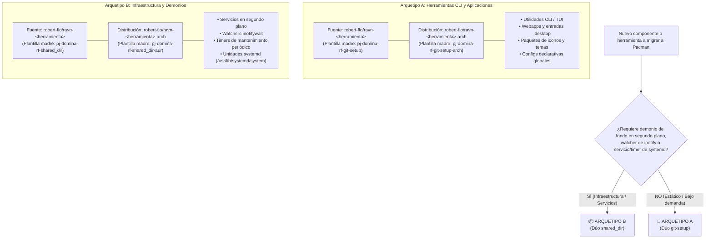
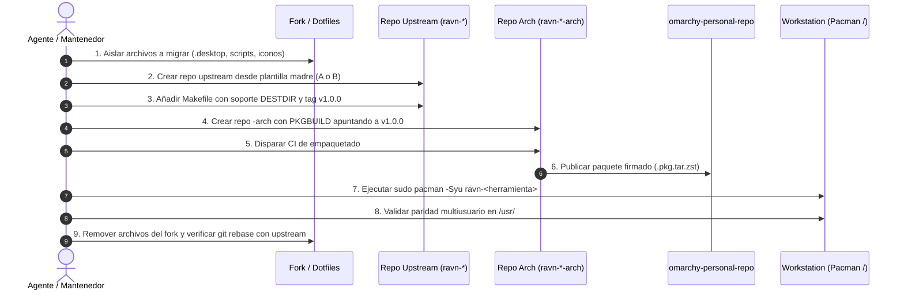

# 🏛️ ADR 0002: Árbol de Decisión y Estándar de Dúo de Repositorios (Arquetipo A git-setup vs. Arquetipo B shared_dir)

> [!NOTE]
> **Navegación y Metadatos:**
> * **Estado:** Aceptado (Vigente).
> * **Fecha:** 2026-10-26.
> * **Decisor:** Roberto Flores.
> * **Tickets relacionados:** #17 (Una sola fuente de binarios), #18-#20 (Plantillas y empaquetado formal), #32 (Desacople de shared_dir), #40 (Piloto capas).
> * **Vault de Referencia:** [[00.0 - Mapa General del Sistema (MOC)|Mapa General del Sistema (MOC)]], [[docs/adr/0001-una-sola-puerta-y-meta-workspace|ADR 0001 — Una Sola Puerta y Meta-Workspace]] y [[07.6 - Estandar de Duo Repositorios y Arbol de Decision (git-setup vs shared_dir)|07.6 Estándar de Dúo Repositorios]].

---

## 1. Estado

**Aceptado**. Esta decisión formaliza la arquitectura del modelo de **Dúo de Repositorios** acordada en el grill arquitectónico del ticket #17 y consolida las reglas operativas para que cualquier agente o mantenedor extraiga herramientas desde repositorios de dotfiles o scripts huérfanos hacia paquetes globales de Pacman sin necesidad de explicaciones repetitivas.

---

## 2. Contexto y Problema

En consonancia con lo establecido en el [[docs/adr/0001-una-sola-puerta-y-meta-workspace|ADR 0001]], **Pacman es la única puerta legítima de entrada a la raíz (`/`)**. Sin embargo, a medida que la estación de trabajo madura, surgen múltiples componentes atrapados indebidamente en capas intermedias:

1. **Contaminación de Forks de Dotfiles:** Aplicaciones, scripts y lanzadores `.desktop` viviendo en la rama `personal` de `fo-omarchy` o en `niri-dotfiles`. Esto causa dos problemas graves:
   - **Conflictos recurrentes de rebase:** Cada sincronización contra el upstream oficial (`quattro` u otros) genera colisiones en rutas como `applications/`.
   - **Aislamiento por usuario:** Al instalarse en `$HOME/.local/share/applications/` de un usuario específico (`omarchy`), quedan invisibles para los demás perfiles (`niri`, `nyxuri`, `sura`, `sandbox`, `guest`).
2. **Binarios y Scripts Huérfanos:** Scripts dispersos en repositorios paraguas como `pj-domina-rf-tools` o en `assets/system/usr/local/bin/`.
3. **Falta de Criterio Canónico de Empaquetado:** Dudas sobre cuándo un componente debe seguir la estructura ligera de una utilidad CLI o cuándo requiere la infraestructura completa de servicios del sistema.

Hacía falta definir un **árbol de decisión unívoco y vinculante** para clasificar cualquier componente a migrar entre los dos únicos arquetipos canónicos aprobados.

---

## 3. Decisión

Se adopta con carácter vinculante el estándar de **Dúo de Repositorios** (`<componente>` upstream + `<componente>-arch` distribución) estructurado en dos arquetipos canónicos:

### 3.1. Definición de Arquetipos



#### Arquetipo A: Herramienta CLI / Activos de Aplicación (Plantilla madre `git-setup`)
* **Repositorio Fuente (`ravn-<nombre>`):** Hereda de `robert-flo/pj-domina-rf-git-setup`.
  - Contiene exclusivamente código fuente, scripts ejecutables, activos estáticos (`.desktop`, iconos) y un `Makefile` estándar con soporte de la variable `DESTDIR`.
  - Publica releases semánticos vía tags de Git (`vX.Y.Z`).
  - No contiene lógica de empaquetado específica de Arch Linux.
* **Repositorio Distribución Arch (`ravn-<nombre>-arch`):** Hereda de `robert-flo/pj-domina-rf-git-setup-arch`.
  - Contiene el `PKGBUILD`, `.SRCINFO`, `scripts/check_upstream.sh` y el workflow de GitHub Actions que detecta nuevos releases en upstream, compila el paquete Pacman, verifica firmas/checksums y lo distribuye hacia `omarchy-personal-repo`.

#### Arquetipo B: Infraestructura y Servicios Systemd (Plantilla madre `shared_dir`)
* **Repositorio Fuente (`ravn-<nombre>`):** Hereda de `robert-flo/pj-domina-rf-shared_dir`.
  - Contiene los scripts de demonio, helpers de interacción con el kernel / ACLs, unidades de systemd de plantilla y suite de pruebas en contenedor.
* **Repositorio Distribución Arch (`ravn-<nombre>-arch`):** Hereda de `robert-flo/pj-domina-rf-shared_dir-aur`.
  - Contiene el `PKGBUILD` configurado para ubicar las unidades de servicio en `/usr/lib/systemd/system/` y los ejecutables en `/usr/bin/`, con los triggers correspondientes de `systemd --system daemon-reload`.

---

## 4. Matriz Comparativa y Reglas de Oro

| Atributo | Arquetipo A (`git-setup` / `git-setup-arch`) | Arquetipo B (`shared_dir` / `shared_dir-aur`) |
| :--- | :--- | :--- |
| **Casos de uso** | CLI, scripts, webapps (`.desktop`), iconpacks, launchers. | Daemons, watchers inotify, timers periódicos de sistema. |
| **Persistencia en ejecución** | Se ejecuta bajo demanda y termina inmediatamente. | Corre indefinidamente en memoria gestionado por PID 1. |
| **Unidades systemd** | Ninguna. | Obligatorias (`.service`, `.timer`, `.path`). |
| **Destinos de instalación** | `/usr/bin/`, `/usr/share/applications/`, `/usr/share/icons/` | `/usr/bin/`, `/usr/lib/systemd/system/` |
| **Gobernanza de réplica** | Listado en `family.yml` de `git-setup`. | Listado en `family.yml` de `shared_dir`. |

> [!CAUTION]
> **Regla de Cero Sobrediseño:**  
> Nunca debe usarse el Arquetipo B para herramientas estáticas o lanzadores. Si un script no necesita un bucle continuo (`while true`), monitoreo de eventos de inotify o ejecución supervisada por systemd, **debe pertenecer obligatoriamente al Arquetipo A**.

---

## 5. Protocolo de Extracción Idempotente (Paso a Paso)

Cuando un agente reciba la instrucción de migrar o extraer herramientas o lanzadores (como las webapps de `fo-omarchy`), debe seguir este procedimiento secuencial sin improvisaciones:



### Paso 1: Detección y Clasificación
- Identificar los archivos huérfanos o atrapados en el fork de dotfiles.
- Aplicar el Árbol de Decisión (Sección 3.1) para seleccionar Arquetipo A o B.

### Paso 2: Creación del Repositorio Upstream (`robert-flo/ravn-<nombre>`)
- Inicializar desde la plantilla correspondiente.
- Convención de nombres: Prefijo permanente **`ravn-<nombre>`**.
- Escribir `Makefile` estricto con `install` que respete `$(DESTDIR)`:
  ```makefile
  install:
  	install -d $(DESTDIR)/usr/bin $(DESTDIR)/usr/share/applications $(DESTDIR)/usr/share/icons
  	install -m 755 bin/* $(DESTDIR)/usr/bin/
  	install -m 644 applications/* $(DESTDIR)/usr/share/applications/
  	cp -dr --no-preserve=ownership icons/* $(DESTDIR)/usr/share/icons/
  ```
- Crear tag de release semántico (ej. `v1.0.0`) y subir a GitHub.

### Paso 3: Creación del Repositorio de Distribución Arch (`robert-flo/ravn-<nombre>-arch`)
- Inicializar desde la plantilla `-arch` correspondiente.
- Configurar `PKGBUILD`:
  - `pkgname=ravn-<nombre>`
  - `source=("$pkgname-$pkgver.tar.gz::https://github.com/robert-flo/$pkgname/archive/refs/tags/v$pkgver.tar.gz")`
  - Función `package()`: Invoca `make DESTDIR="$pkgdir" install`.
- Registrar en el `family.yml` de la plantilla madre para recibir actualizaciones de CI automáticas.

### Paso 4: Publicación en el Repositorio Personal
- Compilar y registrar el paquete en [robert-flo/omarchy-personal-repo](https://github.com/robert-flo/omarchy-personal-repo) a través del pipeline de `pj-omarchy`.

### Paso 5: Instalación Global en la Workstation
- Instalar en la máquina local:
  ```bash
  sudo pacman -Syu ravn-<nombre>
  ```
- Validar que todos los usuarios (`omarchy`, `niri`, `nyxuri`, etc.) ven y ejecutan los archivos desde `/usr/bin/` o `/usr/share/applications/`.

### Paso 6: Saneamiento de Dotfiles y Validación de Rebase
- Crear rama auxiliar en el fork (`fo-omarchy` o similar).
- Eliminar los archivos extraídos.
- Ejecutar rebase de prueba contra el upstream (`quattro`): **debe arrojar 0 conflictos**.
- Abrir PR a `personal`, merge y cleanup.

---

## 6. Caso de Referencia: `ravn-webapps`

La extracción de las más de 60 webapps alojadas en `fo-omarchy/applications/` se rige como el primer caso emblemático de aplicación de este ADR:

* **Arquetipo:** **A** (Archivos `.desktop`, iconos y script lanzador `ravn-launch-webapp`).
* **Repo Upstream:** `robert-flo/ravn-webapps`.
* **Repo Arch:** `robert-flo/ravn-webapps-arch`.
* **Paquete Pacman:** `ravn-webapps`.
* **Resultado:** Eliminación del 100% del ruido en `fo-omarchy/applications/` y disponibilidad inmediata de ChatGPT, Claude, WhatsApp, Notion, Figma y demás webapps en los lanzadores Fuzzel/Clavis de cualquier usuario del sistema.

---

## 7. Consecuencias

### Positivas
* **Previsibilidad total:** Los agentes no requieren reexplicaciones; consultan este ADR y ejecutan la receta de empaquetado de forma autónoma.
* **Forks libres de deuda:** `fo-omarchy` y los dotfiles reducen su delta con upstream al mínimo esencial de personalización, simplificando los rebases continuos.
* **Paridad multiusuario:** Todas las herramientas y aplicaciones quedan en `/usr/` accesibles universalmente sin importar qué usuario inicie sesión.
* **Trazabilidad:** Cualquier cambio a un binario o webapp genera un release versionado con historial auditable y paquete Pacman firmado.

### Mitigaciones
* El tiempo inicial de configurar el dúo de repositorios se compensa ampliamente con la automatización del CI de `family.yml` y la eliminación de conflictos manuales de rebase.
